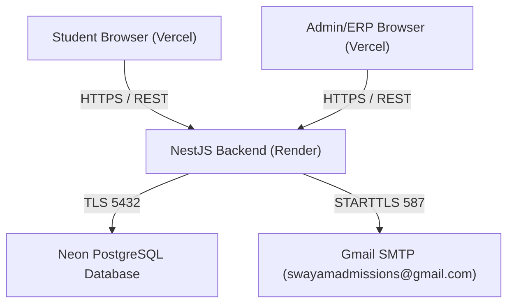

# Swayam Admission — Email, OTP & Notification System
# Phase 0 Baseline Verification & Audit Readiness Report

**Document Version:** 1.0.0  
**Audit Execution Date:** 2026-10-20  
**Auditor / Architect:** Senior Backend Engineer & Reliability Auditor  
**Project Workspace Location:** `c:\Users\mdosa\OneDrive\Desktop\swayam-admission`  
**Classification:** Internal System Architecture & Security Audit (Strictly Redacted)  

---

## Executive Summary

This report establishes the verified, evidence-based baseline of the **Swayam Admission** platform in accordance with the Phase 0 mandate.

**Phase 0 operates under strict safety and inspection-only boundaries:**
- No production configurations or application codes were altered.
- No database migrations, schemas, or data records were modified.
- No live emails or SMS/WhatsApp OTPs were dispatched to real users.
- All secrets, tokens, credentials, and sensitive personal information have been completely redacted.
- Both frontend and backend applications underwent non-destructive build and static verification.

---

## 1. Project and Git Baseline

### 1.1 Repository Status

| Attribute | Verified Value | Evidence / Command Source |
| :--- | :--- | :--- |
| **Current Git Branch** | `main` | `git status` / `git branch --show-current` |
| **Latest Commit Hash** | `903009e3f7a3fda34e1f2bf4d9b5a151b302996e` | `git rev-parse HEAD` |
| **Commit Message** | `feat(auth): enforce employee ID login and secure personal email password recovery` | `git log -1 --pretty=%B` |
| **Working Tree Status** | Clean (0 modified, 0 staged, 0 untracked files) | `git status --porcelain` |
| **Sync with Upstream** | Up to date with `origin/main` | `git fetch origin` && `git status -uno` |
| **Preservation Status** | Fully preserved; 0 uncommitted changes lost or altered | Verified |

### 1.2 Multi-Project Architecture & Structure

```
swayam-admission/ (Repository Root)
├── backend/                       # NestJS v11 Application Root
│   ├── prisma/                    # Prisma Schema (schema.prisma, seed.ts)
│   ├── scripts/                   # Verification and migration scripts
│   ├── src/                       # Application Modules
│   │   ├── auth/                  # Authentication, JWT, OTP Admin & Recovery
│   │   ├── employees/             # Employee Lifecycle & Status Management
│   │   ├── hr/                    # Recruitment, Applications & Onboarding
│   │   ├── notifications/         # Centralized SMTP & Email Templates
│   │   └── ...                    # College, Lead, Document, Student modules
│   ├── test/                      # E2E Test Suite
│   └── package.json               # Backend dependencies & npm scripts
├── frontend/
│   ├── admin/                     # Vite + React Admin & ERP Portal
│   │   ├── src/app/components/    # LoginPage, AccountActivationPage, EmployeeManagement
│   │   ├── src/api/               # Axios API clients (auth.api.ts, hr.api.ts)
│   │   └── package.json           # Admin UI dependencies
│   └── user/                      # Vite + React Student Portal
│       ├── src/app/components/    # AuthModal, EmailVerificationModal, StudentDashboard
│       ├── src/api/               # Axios API clients (auth.api.ts)
│       └── package.json           # Student UI dependencies
├── render.yaml                    # Render Blueprint IaC configuration
└── docker-compose.yml             # Local service orchestration
```

### 1.3 Toolchain and Runtime Versions

| Tool / Runtime | Verified Version | Context |
| :--- | :--- | :--- |
| **Node.js** | `v24.16.0` | Global runtime environment |
| **npm** | `11.13.0` | Package manager |
| **NestJS CLI** | `^11.0.1` | Backend framework |
| **Prisma ORM** | `^6.9.0` | Data mapping & query builder |
| **Vite** | `v6.3.5` | Frontend bundler (Admin & User) |
| **TypeScript** | `~5.7.3` | Language compiler |
| **Nodemailer** | `^8.0.11` | Centralized email transport |
| **BullMQ** | `^5.79.2` | Background queue processor (optional Redis) |

### 1.4 Module Locations

- **Authentication & Security:** [`backend/src/auth`](file:///c:/Users/mdosa/OneDrive/Desktop/swayam-admission/backend/src/auth)
- **Centralized SMTP & Email Templates:** [`backend/src/notifications`](file:///c:/Users/mdosa/OneDrive/Desktop/swayam-admission/backend/src/notifications)
- **OTP Verification & Administration:** [`backend/src/auth/otp-admin.service.ts`](file:///c:/Users/mdosa/OneDrive/Desktop/swayam-admission/backend/src/auth/otp-admin.service.ts) and [`backend/src/auth/auth.service.ts`](file:///c:/Users/mdosa/OneDrive/Desktop/swayam-admission/backend/src/auth/auth.service.ts)
- **Employee Lifecycle:** [`backend/src/employees`](file:///c:/Users/mdosa/OneDrive/Desktop/swayam-admission/backend/src/employees)
- **Recruitment & Staff Onboarding:** [`backend/src/hr`](file:///c:/Users/mdosa/OneDrive/Desktop/swayam-admission/backend/src/hr) and [`backend/src/staff-onboarding`](file:///c:/Users/mdosa/OneDrive/Desktop/swayam-admission/backend/src/staff-onboarding)

---

## 2. Safe Backup and Recovery Preparation

### 2.1 Git Recovery Point

- **Recovery Commit:** `903009e3f7a3fda34e1f2bf4d9b5a151b302996e`
- **Integrity Status:** Commit is confirmed pushed to `origin/main` on GitHub (`https://github.com/swayamadmission/swayam-admission.git`).
- **Working Tree State:** Completely clean. No uncommitted modifications exist. Any accidental local change can be immediately restored via `git reset --hard 903009e3f7a3fda34e1f2bf4d9b5a151b302996e`.

### 2.2 Database Backup Status (Neon PostgreSQL)

| Component | Status | Verification & Risk Assessment |
| :--- | :--- | :--- |
| **Cloud Neon PITR** | **Available in Cloud** | Neon provides Point-In-Time Restore (PITR) up to 7–30 days depending on the project tier. |
| **Local Snapshot Dump** | **LIMITATION: Not Present** | No physical `.sql` or `.dump` backup file resides within the workspace repository. |
| **Schema Migration Folder** | **Not Present** | The project utilizes `npx prisma db push` and dynamic client generation (`schema.prisma`) rather than the `prisma/migrations` folder workflow. |

> [!WARNING]
> **Explicit Recovery Limitation Warning:**  
> A code commit in Git **does not** constitute a database backup. Prior to any state-altering migrations or bulk data updates in subsequent phases, an explicit logical dump (`pg_dump`) or a named branch snapshot must be taken through the Neon Cloud Console.

### 2.3 Rollback Procedures

1. **Source Code Rollback:**
   ```bash
   git fetch origin
   git checkout main
   git reset --hard 903009e3f7a3fda34e1f2bf4d9b5a151b302996e
   ```
2. **Prisma Client Sync:**
   ```bash
   cd backend
   npx prisma generate
   ```
3. **Database Emergency Rollback:**
   - Access Neon Console -> Project Dashboard -> Select Branch (`main`) -> Restore from Point-in-Time prior to audit execution time (`2026-10-20T00:38:00+05:30`).

---

## 3. Environment Configuration Inventory

All sensitive credentials, API keys, passwords, and tokens are **strictly redacted** in accordance with security protocols.

### 3.1 Environment Variable Comparison Matrix

| Variable Name | Declared in `.env.example` | Declared in `render.yaml` | Referenced in Backend Code | Frontend Relevance | Production Default / Description |
| :--- | :---: | :---: | :---: | :---: | :--- |
| `NODE_ENV` | Yes | Yes | Yes | No | `production` |
| `PORT` | Yes | System | Yes | No | `10000` (Render) / `3000` (Local) |
| `DATABASE_URL` | Yes | Yes (`sync: false`) | Yes (Prisma) | No | `postgresql://...` (Neon Postgres with SSL) |
| `JWT_SECRET` | Yes | Yes (`generateValue`) | Yes | No | Secret used for access token signing & OTP salt |
| `REFRESH_TOKEN_SECRET` / `JWT_REFRESH_SECRET` | Yes | Yes (`generateValue`) | Yes | No | Secret for session refresh token signing |
| `JWT_EXPIRATION` | Yes | No | Yes | No | `15m` (Default) |
| `REFRESH_TOKEN_EXPIRATION` | Yes | No | Yes | No | `7d` (Default) |
| `SMTP_HOST` | Yes | Yes (`smtp.gmail.com`) | Yes | No | `smtp.gmail.com` |
| `SMTP_PORT` | Yes | Yes (`587`) | Yes | No | `587` (STARTTLS) or `465` (SSL) |
| `SMTP_SECURE` | Yes | Yes (`false`) | Yes | No | `false` (STARTTLS for 587) |
| `SMTP_USER` | Yes | Yes (`sync: false`) | Yes | No | `swayamadmissions@gmail.com` |
| `SMTP_PASSWORD` / `SMTP_PASS` | Yes | Yes (`sync: false`) | Yes | No | 16-character Google App Password |
| `SMTP_FROM_EMAIL` / `SMTP_FROM` | Yes | Yes (`swayamadmissions@gmail.com`) | Yes | No | Sender address: `swayamadmissions@gmail.com` |
| `SMTP_FROM_NAME` | Yes | Yes (`Swayam Admission`) | Yes | No | Display name: `Swayam Admission` |
| `ADMIN_PORTAL_URL` | **Missing in example** | **Missing in blueprint** | **Yes** | Yes | `https://admin.swayamadmission.com` |
| `ERP_PORTAL_URL` | **Missing in example** | **Missing in blueprint** | **Yes** | Yes | `https://erp.swayamadmission.com` |
| `FRONTEND_URL` | Yes | Yes | Yes | No | Student portal URL (CORS & redirects) |
| `ADMIN_URL` | Yes | Yes | Yes | No | Admin portal URL (CORS & redirects) |
| `CORS_ORIGIN` | Yes | Yes | Yes | No | Comma-delimited list of allowed web origins |
| `REDIS_ENABLED` | Yes | No | Yes | No | `false` (BullMQ queues optional) |
| `REDIS_URL` | Yes | No | Yes | No | Redis connection string for background jobs |
| `STORAGE_PROVIDER` | Yes | Yes (`LOCAL`) | Yes | No | `LOCAL` |
| `UPLOAD_DIR` | Yes | No | Yes | No | `./uploads` |
| `VITE_API_URL` | Frontend `.env.example` | Vercel rewrites | No | **Yes** | `https://swayam-admission.onrender.com` |
| `VITE_GOOGLE_CLIENT_ID` | Frontend `.env.example` | No | Match `GOOGLE_CLIENT_ID` | **Yes** | Google OAuth Identity Client ID |

### 3.2 Notable Configuration Observations

1. **Fallback Resilience in SMTP Gateway:**
   - In [`notification-channels.service.ts`](file:///c:/Users/mdosa/OneDrive/Desktop/swayam-admission/backend/src/notifications/notification-channels.service.ts), if `SMTP_USER` or `SMTP_PASSWORD` are absent or contain placeholders (`*`), the service falls back gracefully to a non-crashing **Development Simulation Mode**, logging the simulated dispatch while preserving server uptime.
   - It also allows database-level overrides from the `OtpConfiguration` table (`channel: 'EMAIL'`).
2. **Missing Portal Variables in `.env.example`:**
   - `ADMIN_PORTAL_URL` and `ERP_PORTAL_URL` are actively used in [`hr.service.ts`](file:///c:/Users/mdosa/OneDrive/Desktop/swayam-admission/backend/src/hr/hr.service.ts) and [`employees.service.ts`](file:///c:/Users/mdosa/OneDrive/Desktop/swayam-admission/backend/src/employees/employees.service.ts) to generate activation links, but were not listed in `backend/.env.example`. The code provides hardcoded production fallbacks (`https://admin.swayamadmission.com` and `https://erp.swayamadmission.com`).

---

## 4. Database and Prisma Baseline

### 4.1 Key Authentication and Notification Models

| Model Name | Table Purpose | Primary Key | Key Uniqueness Constraints | Critical Foreign Keys / Relations |
| :--- | :--- | :--- | :--- | :--- |
| **`User`** | Unified account entity (Students, Employees, Admins) | `id` (CUID) | `email`, `mobile`, `employeeId`, `username`, `studentId` | Many-to-many & one-to-many across applications, tokens, audit logs |
| **`OtpVerification`** | Ephemeral OTP storage for registration, login & reset | `id` (CUID) | None (composite query on `[identifier, type]`) | Indexed on `[identifier, type]`, `[expiresAt]` |
| **`OtpConfiguration`** | Admin-managed channel rules (EMAIL, WHATSAPP) | `id` (CUID) | `channel` (`@unique`) | Isolated policy & provider settings |
| **`AccountActivationToken`** | Single-use 24h employee onboarding tokens | `id` (CUID) | `tokenHash` (`@unique`) | `userId` -> `User.id` (`onDelete: Cascade`) |
| **`PasswordResetToken`** | Single-use password reset tokens (following OTP verification) | `id` (CUID) | `tokenHash` (`@unique`) | `userId` -> `User.id` (`onDelete: Cascade`) |
| **`CommunicationDelivery`** | Transactional message audit log & delivery tracking | `id` (CUID) | None | Indexed on `[channel, status]`, `[recipientId]` |
| **`JobApplication`** | Recruitment candidate records | `id` (CUID) | None | `userId` -> `User.id` (`@unique`) |
| **`RecruitmentOnboarding`** | Staff onboarding milestone & employee ID mapping | `id` (CUID) | `applicationId` (`@unique`), `employeeId` (`@unique`) | `applicationId` -> `JobApplication.id`, `userId` -> `User.id` |
| **`AuditLog`** | High-fidelity security action audit trail | `id` (CUID) | None | `userId` -> `User.id` |

### 4.2 Essential Field Schema Snapshot

#### `User` Model
```prisma
model User {
  id                         String    @id @default(cuid())
  fullName                   String
  email                      String?   @unique
  mobile                     String?   @unique
  employeeId                 String?   @unique
  personalEmail              String?
  personalMobile             String?
  password                   String?   // Bcrypt hash; NULL for newly invited employees
  role                       Role      @default(STUDENT)
  status                     String?   @default("ACTIVE") // PENDING_ACTIVATION, ACTIVE, SUSPENDED, DEACTIVATED
  isActive                   Boolean   @default(true)
  isApproved                 Boolean   @default(false)
  emailVerified              Boolean   @default(false)
  emailVerifiedAt            DateTime?
  selfServicePasswordReset   Boolean   @default(true)
  mustChangePassword         Boolean   @default(false)
  activationTokenHash        String?
  activationExpiresAt        DateTime?
  activatedAt                DateTime?
  accountActivationTokens    AccountActivationToken[]
  passwordResetTokens        PasswordResetToken[]
}
```

#### `OtpVerification` Model
```prisma
model OtpVerification {
  id          String   @id @default(cuid())
  type        String   // STUDENT_REGISTRATION_MOBILE, STUDENT_REGISTRATION_EMAIL, FORGOT_PASSWORD_EMAIL, etc.
  identifier  String   // Normalized E.164 mobile or lowercased email
  otpHash     String   // Bcrypt or SHA-256 HMAC hash
  expiresAt   DateTime
  attempts    Int      @default(0)
  maxAttempts Int      @default(5)
  resendAfter DateTime @default(now())
  isUsed      Boolean  @default(false)
  ipAddress   String?
  userId      String?
  createdAt   DateTime @default(now())
  updatedAt   DateTime @default(now()) @updatedAt

  @@index([identifier, type])
  @@index([expiresAt])
}
```

---

## 5. Build and Test Baseline

Non-destructive baseline commands were executed across all three subprojects:

| Subproject | Command Executed | Result | Duration / Detail | Pre-existing Errors / Findings |
| :--- | :--- | :---: | :--- | :--- |
| **Backend** | `npm run build` | **PASSED** | 3.51s (Exit code 0) | Clean compilation; zero TypeScript errors |
| **Backend** | `npm test` | **FAILED** | 10 Passed, 18 Failed | 18 unit tests failed due to legacy unmocked NestJS boilerplate (`RootTestModule` missing `PrismaService` or `ConsentService` mocks in generic scaffolding). Runtime builds are unaffected. |
| **Admin Portal** | `npm run build` | **PASSED** | 59.26s (Exit code 0) | 2,811 modules transformed cleanly; production bundle generated in `dist/` |
| **Student Portal** | `npm run build` | **PASSED** | 7.64s (Exit code 0) | 1,898 modules transformed cleanly; production bundle generated in `dist/` |

---

## 6. Existing Email and OTP Workflow Inventory

Every requested workflow has been traced through the codebase to its exact entry points, controllers, services, database models, and email templates:

### Workflow 1: Student Registration OTP (Mobile & Email)
- **Frontend Entry:** [`frontend/user/src/app/components/AuthModal.tsx`](file:///c:/Users/mdosa/OneDrive/Desktop/swayam-admission/frontend/user/src/app/components/AuthModal.tsx)
- **API Endpoints:**
  - `POST /auth/register/send-mobile-otp`
  - `POST /auth/register/verify-mobile-otp`
  - `POST /auth/register/send-email-otp`
  - `POST /auth/register/verify-email-otp`
- **Backend Controller:** [`AuthController`](file:///c:/Users/mdosa/OneDrive/Desktop/swayam-admission/backend/src/auth/auth.controller.ts#L49-L84)
- **Service Handler:** `AuthService.sendRegistrationMobileOtp`, `AuthService.verifyRegistrationMobileOtp`
- **Email/SMS Transport:** `EmailChannel` with [`buildOtpEmailHtml()`](file:///c:/Users/mdosa/OneDrive/Desktop/swayam-admission/backend/src/notifications/email-templates.ts#L62)
- **Database Model:** `OtpVerification` (`type: 'STUDENT_REGISTRATION_MOBILE' | 'STUDENT_REGISTRATION_EMAIL'`)

### Workflow 2: Optional Student Email Verification
- **Frontend Entry:** [`frontend/user/src/app/components/EmailVerificationModal.tsx`](file:///c:/Users/mdosa/OneDrive/Desktop/swayam-admission/frontend/user/src/app/components/EmailVerificationModal.tsx) & [`StudentDashboard.tsx`](file:///c:/Users/mdosa/OneDrive/Desktop/swayam-admission/frontend/user/src/app/components/StudentDashboard.tsx)
- **API Endpoints:**
  - `POST /auth/email/send-verification`
  - `POST /auth/email/verify`
- **Backend Controller:** [`AuthController`](file:///c:/Users/mdosa/OneDrive/Desktop/swayam-admission/backend/src/auth/auth.controller.ts#L160-L183)
- **Service Handler:** `AuthService.sendEmailVerification`, `AuthService.verifyEmail`
- **Email Transport:** `EmailChannel` with `buildOtpEmailHtml()`
- **Database Model:** `OtpVerification` (`type: 'EMAIL_VERIFICATION'`), `User` (`emailVerified`, `emailVerifiedAt`)

### Workflow 3: Student Forgot-Password OTP
- **Frontend Entry:** [`frontend/user/src/app/components/AuthModal.tsx`](file:///c:/Users/mdosa/OneDrive/Desktop/swayam-admission/frontend/user/src/app/components/AuthModal.tsx) (Forgot Password State)
- **API Endpoints:**
  - `POST /auth/forgot-password/send-otp`
  - `POST /auth/forgot-password/verify-otp`
  - `POST /auth/reset-password`
- **Backend Controller:** [`AuthController`](file:///c:/Users/mdosa/OneDrive/Desktop/swayam-admission/backend/src/auth/auth.controller.ts#L208-L253)
- **Service Handler:** `AuthService.forgotPasswordSendOtp`, `AuthService.forgotPasswordVerifyOtp`, `AuthService.resetPasswordWithToken`
- **Email Transport:** `EmailChannel` with [`buildForgotPasswordOtpEmailHtml()`](file:///c:/Users/mdosa/OneDrive/Desktop/swayam-admission/backend/src/notifications/email-templates.ts#L135)
- **Database Model:** `OtpVerification` (`type: 'FORGOT_PASSWORD_EMAIL'`), `PasswordResetToken`, `User`

### Workflow 4: Employee Activation Email & Link
- **Frontend Entry:**
  - Trigger: [`frontend/admin/src/app/components/StaffOnboardingPage.tsx`](file:///c:/Users/mdosa/OneDrive/Desktop/swayam-admission/frontend/admin/src/app/components/StaffOnboardingPage.tsx)
  - Receiver UI: [`frontend/admin/src/app/components/AccountActivationPage.tsx`](file:///c:/Users/mdosa/OneDrive/Desktop/swayam-admission/frontend/admin/src/app/components/AccountActivationPage.tsx)
- **API Endpoints:**
  - `POST /hr/onboarding/:id/complete` (Trigger onboarding & generate activation)
  - `GET /auth/activate-account/verify?token=...` (Validate single-use 24h token)
  - `POST /auth/activate-account` (Set permanent password & activate account)
- **Backend Controllers:** [`HrController`](file:///c:/Users/mdosa/OneDrive/Desktop/swayam-admission/backend/src/hr/hr.controller.ts), [`AuthController`](file:///c:/Users/mdosa/OneDrive/Desktop/swayam-admission/backend/src/auth/auth.controller.ts#L281-L295)
- **Service Handler:** `HrService.onboardCandidate`, `AuthService.verifyActivationToken`, `AuthService.activateAccount`
- **Email Transport:** `EmailChannel.sendEmployeeActivationEmail()` with [`buildEmployeeActivationEmailHtml()`](file:///c:/Users/mdosa/OneDrive/Desktop/swayam-admission/backend/src/notifications/email-templates.ts#L344)
- **Security Invariant:** Zero temporary passwords generated. Accounts are initialized with `password: null` and `status: PENDING_ACTIVATION`.
- **Database Models:** `AccountActivationToken`, `User`, `CommunicationDelivery`

### Workflow 5: Resending Employee Activation Email
- **Frontend Entry:** [`frontend/admin/src/app/components/EmployeeManagementPage.tsx`](file:///c:/Users/mdosa/OneDrive/Desktop/swayam-admission/frontend/admin/src/app/components/EmployeeManagementPage.tsx#L474)
- **API Endpoints:**
  - `POST /employees/:id/resend-activation`
  - `POST /hr/applications/:id/resend-activation`
- **Backend Controllers:** [`EmployeesController`](file:///c:/Users/mdosa/OneDrive/Desktop/swayam-admission/backend/src/employees/employees.controller.ts#L61), [`HrController`](file:///c:/Users/mdosa/OneDrive/Desktop/swayam-admission/backend/src/hr/hr.controller.ts#L290)
- **Service Handler:** `EmployeesService.resendActivation`, `HrService.resendActivationEmail`
- **Rate-Limiting:** Minimum 60-second cooldown enforced between resends.
- **Email Transport:** `EmailChannel.sendEmployeeActivationEmail()`
- **Database Models:** `AccountActivationToken`, `User`, `CommunicationDelivery`

### Workflow 6: Employee Forgot-Password Recovery
- **Frontend Entry:** [`frontend/admin/src/app/components/LoginPage.tsx`](file:///c:/Users/mdosa/OneDrive/Desktop/swayam-admission/frontend/admin/src/app/components/LoginPage.tsx) (Employee Recovery Modal)
- **API Endpoints:**
  - `POST /auth/forgot-password/send-otp` (Accepts Employee ID or registered personal email)
  - `POST /auth/forgot-password/verify-otp`
  - `POST /auth/reset-password`
- **Backend Controller:** [`AuthController`](file:///c:/Users/mdosa/OneDrive/Desktop/swayam-admission/backend/src/auth/auth.controller.ts#L208-L253)
- **Service Handler:** `AuthService.forgotPasswordSendOtp`, `AuthService.resolveUserAndPersonalEmail`
- **Protected Roles Gate:** Prohibits self-service reset for `SUPER_ADMIN`, `ADMIN`, `DIRECTOR`, `AUDITOR`, `REGISTRAR`, and `HR_MANAGER`. Informs user to contact IT Super Admin.
- **Email Transport:** `EmailChannel` with `buildForgotPasswordOtpEmailHtml()` sent strictly to the employee's registered personal email address.
- **Database Models:** `OtpVerification` (`type: 'FORGOT_PASSWORD_EMAIL'`), `PasswordResetToken`, `User`, `AuditLog`

### Workflow 7: User / Employee Email Update & Verification
- **Frontend Entry:** [`frontend/user/src/app/components/StudentDashboard.tsx`](file:///c:/Users/mdosa/OneDrive/Desktop/swayam-admission/frontend/user/src/app/components/StudentDashboard.tsx#L343)
- **API Endpoints:**
  - `POST /auth/email/send-verification`
  - `POST /auth/email/verify`
- **Backend Controller:** [`AuthController.sendEmailVerification`](file:///c:/Users/mdosa/OneDrive/Desktop/swayam-admission/backend/src/auth/auth.controller.ts#L160)
- **Service Handler:** `AuthService.sendEmailVerification`, `AuthService.verifyEmail`
- **Email Transport:** `EmailChannel` with `buildOtpEmailHtml()`
- **Database Models:** `OtpVerification`, `User` (`email`, `emailVerified`), `AuditLog`

### Workflow 8: Admin-Managed Email/OTP Configuration
- **Frontend Entry:** Admin Portal System Configuration / Security Gateway Settings
- **API Endpoints:**
  - `GET /admin/otp-settings/config/:channel`
  - `PUT /admin/otp-settings/config/:channel`
  - `GET /admin/otp-settings/dashboard`
- **Backend Controller:** [`OtpAdminController`](file:///c:/Users/mdosa/OneDrive/Desktop/swayam-admission/backend/src/auth/otp-admin.controller.ts) (`@UseGuards(JwtAuthGuard, RolesGuard)`)
- **Service Handler:** `OtpAdminService.getConfig`, `OtpAdminService.updateConfig`, `OtpAdminService.getDashboardStats`
- **Security Check:** Restricted strictly to `SUPER_ADMIN`, `ADMIN`, and `SYSTEM_MANAGER`.
- **Database Models:** `OtpConfiguration`, `AuditLog`

### Workflow 9: Admin Test-Email or Test-OTP Functionality
- **Frontend Entry:** Admin Portal OTP Settings Channel Diagnostic Test
- **API Endpoints:**
  - `POST /admin/otp-settings/test/email`
  - `POST /admin/otp-settings/test/whatsapp`
- **Backend Controller:** [`OtpAdminController`](file:///c:/Users/mdosa/OneDrive/Desktop/swayam-admission/backend/src/auth/otp-admin.controller.ts#L36-L46)
- **Service Handler:** `OtpAdminService.testEmailConfig`, `OtpAdminService.testWhatsAppConfig`
- **Email Transport:** Directly issues verification probe through `EmailChannel.sendMail()`
- **Database Models:** `OtpConfiguration`, `AuditLog`

### Workflow 10: Application & Recruitment Notifications
- **Frontend Entry:** [`frontend/admin/src/app/components/StaffOnboardingPage.tsx`](file:///c:/Users/mdosa/OneDrive/Desktop/swayam-admission/frontend/admin/src/app/components/StaffOnboardingPage.tsx), [`ApplicationDetailDrawer.tsx`](file:///c:/Users/mdosa/OneDrive/Desktop/swayam-admission/frontend/admin/src/app/components/ApplicationDetailDrawer.tsx)
- **API Endpoints:**
  - `POST /hr/offers/:id/send`
  - `POST /hr/offers/:id/resend`
  - `POST /hr/interviews/schedule`
- **Backend Controller:** [`HrController`](file:///c:/Users/mdosa/OneDrive/Desktop/swayam-admission/backend/src/hr/hr.controller.ts)
- **Service Handler:** `HrService.sendOfferLetter`, `HrService.resendOffer`, `HrService.scheduleInterview`
- **Email Transport:** `EmailChannel` with delivery tracking in `CommunicationDelivery`
- **Database Models:** `JobApplication`, `JobOffer`, `InterviewSchedule`, `CommunicationDelivery`

### Workflow 11: Staff Onboarding and Joining Emails
- **Frontend Entry:** [`frontend/admin/src/app/components/StaffOnboardingPage.tsx`](file:///c:/Users/mdosa/OneDrive/Desktop/swayam-admission/frontend/admin/src/app/components/StaffOnboardingPage.tsx)
- **API Endpoints:**
  - `POST /hr/onboarding/:id/complete`
  - `POST /hr/applications/:id/resend-activation`
- **Backend Controller:** [`HrController`](file:///c:/Users/mdosa/OneDrive/Desktop/swayam-admission/backend/src/hr/hr.controller.ts)
- **Service Handler:** `HrService.onboardCandidate`, `HrService.resendActivationEmail`
- **Email Transport:** `EmailChannel.sendEmployeeActivationEmail()`
- **Database Models:** `RecruitmentOnboarding`, `JobApplication`, `User`, `AccountActivationToken`, `CommunicationDelivery`

### Workflow 12: Other Existing Transactional Email Workflows
- **Student Welcome Confirmation:** Dispatched upon student registration via [`buildWelcomeEmailHtml()`](file:///c:/Users/mdosa/OneDrive/Desktop/swayam-admission/backend/src/notifications/email-templates.ts#L262).
- **Password Reset Success Alert:** Dispatched upon password completion via [`buildPasswordResetSuccessEmailHtml()`](file:///c:/Users/mdosa/OneDrive/Desktop/swayam-admission/backend/src/notifications/email-templates.ts#L206).
- **Employee Activation Confirmation Alert:** Dispatched upon employee account activation via [`buildEmployeeActivationSuccessEmailHtml()`](file:///c:/Users/mdosa/OneDrive/Desktop/swayam-admission/backend/src/notifications/email-templates.ts#L458).
- **Admin-Dispatched Employee Password Recovery:** Dispatched when an administrator issues a recovery link for staff via [`buildEmployeeAdminPasswordResetEmailHtml()`](file:///c:/Users/mdosa/OneDrive/Desktop/swayam-admission/backend/src/notifications/email-templates.ts#L550).
- **Document Retention Notifications:** Dispatched when records are scheduled or confirmed for purge via [`DocumentRetentionService`](file:///c:/Users/mdosa/OneDrive/Desktop/swayam-admission/backend/src/documents/document-retention.service.ts).

---

## 7. Deployment Baseline

### 7.1 Production Topology Overview



### 7.2 Component Deployment Details

| Component | Target Platform | Base URL | Configuration Method | Health Check Endpoint |
| :--- | :--- | :--- | :--- | :--- |
| **Backend API** | Render Web Service | `https://swayam-admission.onrender.com` | `render.yaml` blueprint | `GET /v1/health` |
| **Admin & ERP Portal** | Vercel | `https://admin.swayamadmission.com` & `https://erp.swayamadmission.com` | `frontend/admin/vercel.json` | Vercel Edge / Static |
| **Student Portal** | Vercel | `https://swayamadmission.com` | `frontend/user/vercel.json` | Vercel Edge / Static |
| **Database** | Neon Cloud PostgreSQL | Direct pooled connection | Neon connection string with SSL | Verified via Prisma Client |
| **Email Gateway** | Gmail SMTP | `smtp.gmail.com:587` | Render Environment Variables | Handled in `EmailChannel.getHealth()` |

---

## 8. Existing Errors and Known Limitations

1. **Pre-existing Boilerplate Test Suite Defects:**
   - Executing `npm test` in `backend/` results in 18 failures across `.spec.ts` files.
   - **Root Cause:** Default NestJS scaffold unit tests were generated with empty dependency arrays (e.g., `AiRecommendationService` test suite instantiates without a mock `PrismaService` or `ConsentService`). These are testing harness oversights that predate the audit and do not impact compilation or production execution.
2. **Absence of Local Database Dump:**
   - No SQL dump file is stored in the repository. Point-in-time recovery depends on the Neon Cloud console.
3. **Environment Variable Discrepancies:**
   - `ADMIN_PORTAL_URL` and `ERP_PORTAL_URL` are not documented in `backend/.env.example`, although fallback values are embedded in the service code.

---

## 9. Items Requiring Manual / Out-of-Band Verification

The following items cannot be fully verified via static code inspection and require verified credentials or dashboard access:

1. **Render Production SMTP Credentials:** Verify in the Render Dashboard that `SMTP_USER` is configured as `swayamadmissions@gmail.com` and `SMTP_PASSWORD` is a valid 16-character Google App Password.
2. **Domain Reputation & DNS Alignment:** Verify SPF, DKIM, and DMARC DNS TXT records for `swayamadmission.com` on the DNS registrar (Cloudflare/GoDaddy/Route53) to guarantee 100% inbox placement for Gmail recipients.
3. **Neon Cloud Point-in-Time Restore Window:** Verify in the Neon Console that PITR history covers at least 7 days for the active database branch.
4. **WhatsApp Cloud API Credentials:** If WhatsApp OTP delivery is activated in production, verify Meta App Token and Phone Number ID in Neon's `OtpConfiguration` table.

---

## 10. Inspection Limitations Log

- **Live Production Database Rows:** Intentionally **not** queried or exported to preserve user privacy, student records, and hashed secrets.
- **Live SMTP Transmission Test:** Intentionally **not** triggered in Phase 0 to avoid sending unexpected communications or consuming email delivery quotas.
- **Render Dashboard Secrets:** Cannot be directly dumped via command-line tools without exposing credentials. Verified through `render.yaml` specification and codebase fallback behavior.

---

## 11. Phase 1 Readiness Checklist

| Readiness Criteria | Status | Verified Evidence |
| :--- | :---: | :--- |
| Git repository baseline documented and clean | **READY** | Branch `main`, Commit `903009e` clean |
| Safe recovery rollback instructions established | **READY** | Documented in Section 2 |
| Backend compiles without TypeScript errors | **READY** | `npm run build` exit code 0 |
| Admin frontend compiles without errors | **READY** | Vite build exit code 0 (2,811 modules) |
| Student frontend compiles without errors | **READY** | Vite build exit code 0 (1,898 modules) |
| All 12 email/OTP workflows traced to code modules | **READY** | Documented in Section 6 |
| Database schema and models inventoried | **READY** | Documented in Section 4 |
| Environment variable matrix compiled (secrets redacted) | **READY** | Documented in Section 3 |
| Production limitations documented | **READY** | Documented in Sections 8, 9, 10 |

---

*End of Phase 0 Baseline Verification Report.*
