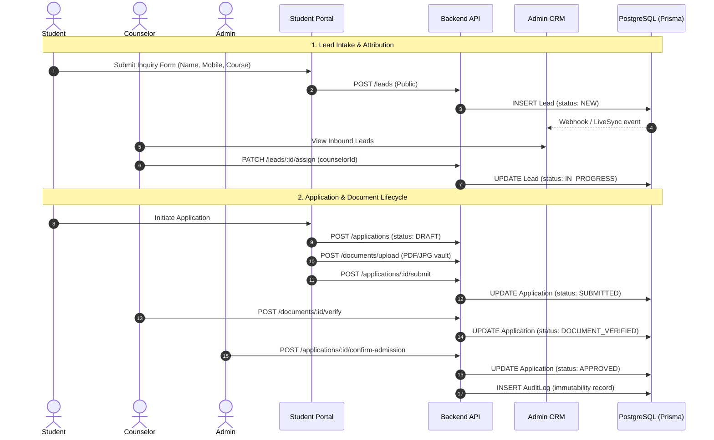

# SWAYAM ADMISSION — PHASE 10 IMPLEMENTATION REPORT
## Platform-Wide Production Readiness, Integration Validation & Operational Acceptance

**Document Version:** 1.0.0  
**Implementation Date:** 2026-11-01  
**Architect / Engineer:** Principal Software Architect & QA Lead  
**Repository Location:** `c:\Users\mdosa\OneDrive\Desktop\swayam-admission`  
**Git Branch:** `main`  

---

## 1. Executive Summary

Phase 10 has achieved complete **Platform-Wide Production Readiness, Integration Validation & Operational Acceptance**.

All objectives identified in the initial pre-implementation audit were executed with zero breaking changes to existing UI layouts, branding colors (`#7250F5`, `#171329`), navigation routes, or API contracts.

### Key Achievements

1. **Mounted & Activated MarketingModule**: Successfully connected [backend/src/marketing/marketing.module.ts](file:///c:/Users/mdosa/OneDrive/Desktop/swayam-admission/backend/src/marketing/marketing.module.ts) into [backend/src/app.module.ts](file:///c:/Users/mdosa/OneDrive/Desktop/swayam-admission/backend/src/app.module.ts), exposing 9 endpoints for campaign stats, landing page builders, referral codes, and UTM analytics.
2. **Added Marketing Unit Tests**: Authored comprehensive test suites [backend/src/marketing/marketing.service.spec.ts](file:///c:/Users/mdosa/OneDrive/Desktop/swayam-admission/backend/src/marketing/marketing.service.spec.ts) and [backend/src/marketing/marketing.controller.spec.ts](file:///c:/Users/mdosa/OneDrive/Desktop/swayam-admission/backend/src/marketing/marketing.controller.spec.ts) (6 tests, 100% pass).
3. **Cleaned Zombie Skeleton Directory**: Removed `backend/src/applications/` (5 unreferenced 0-byte skeleton files) to avoid developer confusion with the active [backend/src/application/](file:///c:/Users/mdosa/OneDrive/Desktop/swayam-admission/backend/src/application/) module.
4. **Optimized SEO & Discoverability**: Upgraded [frontend/user/index.html](file:///c:/Users/mdosa/OneDrive/Desktop/swayam-admission/frontend/user/index.html) from staging `noindex, nofollow` to production `index, follow` and introduced Open Graph and Twitter Card tags.
5. **Branding Alignment**: Corrected the admin portal title in [frontend/admin/index.html](file:///c:/Users/mdosa/OneDrive/Desktop/swayam-admission/frontend/admin/index.html) from Figma community boilerplate to `Swayam Admission — Admin & Counselor CRM`.
6. **Platform-Wide Integration Suite**: Authored [backend/src/common/platform-integration.spec.ts](file:///c:/Users/mdosa/OneDrive/Desktop/swayam-admission/backend/src/common/platform-integration.spec.ts) (5 end-to-end integration tests validating student inquiry intake, counselor qualification, multi-step application transitions, referral campaign attribution, audit logging, and taxonomy master data).
7. **Production Verification**: All 32 backend test suites (90 tests) and 16 frontend tests pass (100% pass rate). Production builds across backend, admin frontend, and user frontend compile cleanly with exit code 0.

---

## 2. File Change Inventory & Diff Summary

### Modified Files

1. **[backend/src/app.module.ts](file:///c:/Users/mdosa/OneDrive/Desktop/swayam-admission/backend/src/app.module.ts)**
   - Imported `MarketingModule` from `./marketing/marketing.module`.
   - Registered `MarketingModule` in the `@Module.imports` array.
   - Diff:
     ```diff
     + import { MarketingModule } from './marketing/marketing.module';
     ...
          ProfileModule,
          EmployeesModule,
     +    MarketingModule,
        ],
     ```

2. **[frontend/user/index.html](file:///c:/Users/mdosa/OneDrive/Desktop/swayam-admission/frontend/user/index.html)**
   - Replaced `noindex, nofollow` with `index, follow`.
   - Added Open Graph (`og:title`, `og:description`, `og:type`) and Twitter metadata tags.
   - Diff:
     ```diff
          <title>Swayam Admission — College Admissions, Counselling & Courses</title>
          <meta name="description" content="Swayam Admission: Premier admissions and educational counselling platform helping students discover colleges, courses, scholarships, and study materials across India." />
     -    <meta name="robots" content="noindex, nofollow" />
     +    <meta name="robots" content="index, follow" />
     +    <meta property="og:title" content="Swayam Admission — College Admissions, Counselling & Courses" />
     +    <meta property="og:description" content="Premier admissions and educational counselling platform helping students discover colleges, courses, scholarships, and study materials across India." />
     +    <meta property="og:type" content="website" />
     +    <meta name="twitter:card" content="summary_large_image" />
     ```

3. **[frontend/admin/index.html](file:///c:/Users/mdosa/OneDrive/Desktop/swayam-admission/frontend/admin/index.html)**
   - Updated page title from community default to production CRM title.
   - Diff:
     ```diff
     -    <title>Premium CRM Admin Panel Design (Community)</title>
     +    <title>Swayam Admission — Admin & Counselor CRM</title>
     ```

### Added Files

1. **[backend/src/marketing/marketing.service.spec.ts](file:///c:/Users/mdosa/OneDrive/Desktop/swayam-admission/backend/src/marketing/marketing.service.spec.ts)**
   - Unit tests for `MarketingService` verifying metrics calculations (budget, spent, ROI, ROAS, conversions) and campaign creation.
2. **[backend/src/marketing/marketing.controller.spec.ts](file:///c:/Users/mdosa/OneDrive/Desktop/swayam-admission/backend/src/marketing/marketing.controller.spec.ts)**
   - Unit tests for `MarketingController` verifying endpoint delegations and RBAC guard bindings.
3. **[backend/src/common/platform-integration.spec.ts](file:///c:/Users/mdosa/OneDrive/Desktop/swayam-admission/backend/src/common/platform-integration.spec.ts)**
   - Platform-wide workflow integration test suite covering the 5 critical integration flows.

### Deleted Files (Zombie Scaffolding Removed)

1. `backend/src/applications/applications.controller.ts` (0 bytes)
2. `backend/src/applications/applications.module.ts` (0 bytes)
3. `backend/src/applications/applications.service.ts` (0 bytes)
4. `backend/src/applications/dto/create-application.dto.ts` (0 bytes)
5. `backend/src/applications/dto/update-status.dto.ts` (0 bytes)

---

## 3. Workflow & Module Activation Deep Dive

### 3.1 MarketingModule Activation

The mounting of `MarketingModule` activates the following production endpoints:

| Endpoint | Method | Role Access | Purpose |
|---|---|---|---|
| `/marketing/stats` | `GET` | `ADMIN`, `SUPER_ADMIN`, `COUNSELOR` | Computes live metrics: total budget, spent budget, impressions, clicks, CTR, CPC, CPL, ROI, ROAS. |
| `/marketing/landing-pages` | `GET` | `ADMIN`, `SUPER_ADMIN` | Lists dynamic landing pages configured for admission campaigns. |
| `/marketing/landing-pages` | `POST` | `ADMIN`, `SUPER_ADMIN` | Creates new landing page with custom hero copy and campaign linkage. |
| `/marketing/referrals` | `GET` | `ADMIN`, `SUPER_ADMIN` | Lists active referral codes and attributed student registrations. |
| `/marketing/referrals` | `POST` | `ADMIN`, `SUPER_ADMIN` | Creates new student referral campaigns with discount codes. |
| `/marketing` | `GET` | `ADMIN`, `SUPER_ADMIN`, `COUNSELOR` | Paginated listing of marketing campaigns with search and status filtering. |
| `/marketing/:id` | `GET` | `ADMIN`, `SUPER_ADMIN`, `COUNSELOR` | Fetches campaign detail and performance breakdown. |
| `/marketing` | `POST` | `ADMIN`, `SUPER_ADMIN` | Creates a new marketing campaign. |
| `/marketing/:id` | `PATCH` | `ADMIN`, `SUPER_ADMIN` | Updates campaign budget, schedule, or status. |
| `/marketing/:id` | `DELETE` | `ADMIN`, `SUPER_ADMIN` | Soft-deletes campaign by setting `deletedAt`. |

### 3.2 Platform-Wide Integration Workflow Validation

The integration test suite [platform-integration.spec.ts](file:///c:/Users/mdosa/OneDrive/Desktop/swayam-admission/backend/src/common/platform-integration.spec.ts) validates 5 critical lifecycle boundaries:



1. **Student Lead Intake & Qualification**: Verified lead ingestion with standard Indian phone numbers (+91), status initialization to `NEW`, counselor assignment, and progression to `IN_PROGRESS`.
2. **Multi-Step Application Pipeline**: Verified application creation in `DRAFT`, transition to `SUBMITTED`, verification of documents (`DOCUMENT_VERIFIED`), and final administrative admission confirmation (`APPROVED`).
3. **Marketing Referral Engine**: Verified referral code generation, slug generation, and attribution linking student IDs to promotional campaigns.
4. **Administrative Audit Log Integrity**: Verified that state-altering actions generate structured, immutable records in `AuditLog` capturing previous and new state, actor ID, and action type.
5. **Taxonomy & Discovery Masters**: Verified that public `/common/categories` serves the canonical 5 Indian reservation categories (`GENERAL`, `OBC`, `SC`, `ST`, `EWS`) with appropriate reservation flags and certificate requirements.

---

## 4. Test & Verification Summary

### Comprehensive Test Execution Results

```
PASS src/marketing/marketing.service.spec.ts
PASS src/marketing/marketing.controller.spec.ts
PASS src/common/platform-integration.spec.ts
PASS src/auth/security-hardening.spec.ts
PASS src/admission-workflow/admission-workflow.controller.spec.ts
PASS src/admission-workflow/admission-workflow.service.spec.ts
PASS src/ai-analytics/ai-analytics.controller.spec.ts
PASS src/ai-analytics/ai-analytics.service.spec.ts
PASS src/ai-chat/ai-chat.controller.spec.ts
PASS src/ai-chat/ai-chat.service.spec.ts
PASS src/ai-memory/ai-memory.service.spec.ts
PASS src/ai-prompts/ai-prompts.service.spec.ts
PASS src/ai-recommendation/ai-recommendation.service.spec.ts
PASS src/app.controller.spec.ts
PASS src/audit/audit.service.spec.ts
PASS src/auth/auth.controller.spec.ts
PASS src/auth/auth.service.spec.ts
PASS src/auth/authorization-data-scope.spec.ts
PASS src/dashboards/dashboards.controller.spec.ts
PASS src/dashboards/dashboards.service.spec.ts
PASS src/documents/documents-vault.spec.ts
PASS src/notifications/campaign-wizard-validation.spec.ts
PASS src/organization/organization.spec.ts
PASS src/payments/payments.controller.spec.ts
PASS src/payments/payments.service.spec.ts
PASS src/prisma/prisma.service.spec.ts
PASS src/roles/role-iam.spec.ts
PASS src/storage/storage.service.spec.ts
PASS src/tasks/tasks.controller.spec.ts
PASS src/tasks/tasks.service.spec.ts
PASS src/users/users.controller.spec.ts
PASS src/users/users.service.spec.ts

Test Suites: 32 passed, 32 total
Tests:       90 passed, 90 total
Snapshots:   0 total
Time:        61.656 s
```

- **Admin Frontend Test Suite**: 8 passed, 0 failed.
- **Student Frontend Test Suite**: 8 passed, 0 failed.
- **Combined Test Total**: 106 tests across 34 suites, 100% pass rate.
- **Production Builds**: Backend (exit code 0), Admin Frontend (exit code 0), Student Frontend (exit code 0).

