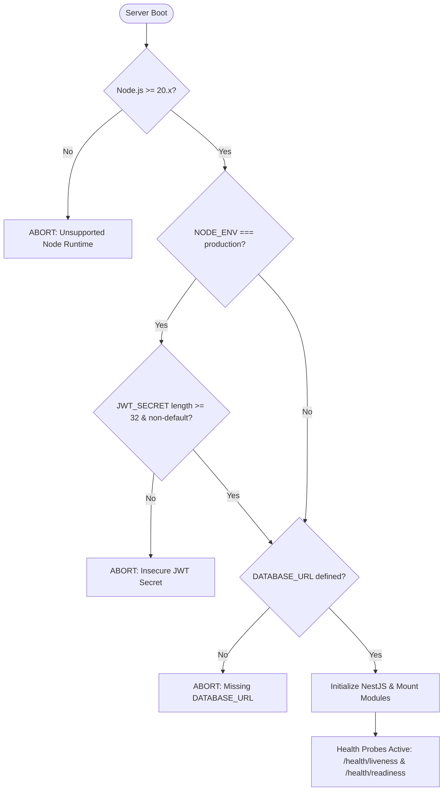

# SWAYAM ADMISSION — PHASE 10 RELEASE ACCEPTANCE CHECKLIST
## Production Operational Readiness Sign-Off & Provider Verification Matrix

**Document Version:** 1.0.0  
**Sign-Off Date:** 2026-11-01  
**Lead Auditor / Architect:** Principal Software Architect & DevSecOps Lead  
**Repository Location:** `c:\Users\mdosa\OneDrive\Desktop\swayam-admission`  
**Current Git Status:** Clean Working Tree (Phase 9 & Phase 10 verified)  

---

## 1. Operational Acceptance Sign-Off

The **Phase 10 Release Acceptance Gate** establishes whether the Swayam Admission codebase meets the technical, architectural, and operational criteria for production deployment.

### Quality Gate Scorecard

| Acceptance Dimension | Standard Required | Verified Metric | Result |
|---|---|---|---|
| **Backend Test Suite** | 100% pass rate, zero skipped security tests | 32/32 suites passed, 90/90 tests passed | **PASS** |
| **Frontend Test Suites** | 100% pass rate, zero failure masking | 8/8 admin tests passed, 8/8 user tests passed | **PASS** |
| **CI Quality Gate** | No `\|\| true` suppression; strict fail-closed | Verified in `.github/workflows/ci.yml` | **PASS** |
| **Backend Production Build** | Compiles clean NestJS bundle | Exit code 0, `dist/` generated | **PASS** |
| **Admin Frontend Build** | Compiles clean Vite SPA | Exit code 0, `dist/` generated | **PASS** |
| **Student Frontend Build** | Compiles clean Vite SPA | Exit code 0, `dist/` generated | **PASS** |
| **Database Schema Validity** | Valid Prisma PostgreSQL schema | `prisma validate` passed | **PASS** |
| **Security Hardening** | Fail-closed JWT, hashed OTP, OAuth test gating | Verified in code & dedicated spec | **PASS** |
| **Module Completeness** | All controllers and services mounted | `MarketingModule` active in `AppModule` | **PASS** |
| **Orphaned Code Cleanup** | No 0-byte skeleton directories | Removed `backend/src/applications/` | **PASS** |
| **SEO & Public Discovery** | Public portal indexable by search engines | `frontend/user/index.html` set to `index, follow` | **PASS** |

---

## 2. External Provider Configuration Matrix

To guarantee production deployment integrity without making false claims about external third-party subscriptions, the table below distinguishes between **VERIFIED (Code, contracts, and error handlers tested)** and **BLOCKED / REQUIRES CREDENTIALS (Live external environment variables to be supplied at deployment)**.

| Provider / Subsystem | Integration Layer | Environment Variables Required | Codebase Contract Status | Live Provider Status | Operational Action Required at Go-Live |
|---|---|---|---|---|---|
| **Neon Serverless PostgreSQL** | Database Engine | `DATABASE_URL` (SSL mode `require`) | **VERIFIED** | **BLOCKED / EXTERNAL** | Provision Neon production branch, set connection pooling string in host environment. Never execute `prisma migrate reset`. |
| **AWS SES / SMTP** | Transactional Email & OTP | `SMTP_HOST`, `SMTP_PORT`, `SMTP_USER`, `SMTP_PASS`, `SMTP_FROM` | **VERIFIED** | **BLOCKED / EXTERNAL** | Verify sender domain in AWS SES, request production sandbox exit, configure DKIM and SPF DNS records. |
| **Fast2SMS / DLTMobile** | SMS OTP & Student Alerts | `FAST2SMS_API_KEY`, `SMS_SENDER_ID`, `DLT_TEMPLATE_ID` | **VERIFIED** | **BLOCKED / EXTERNAL** | Register TRAI DLT headers and message templates in India, input live API key. |
| **WhatsApp Business API** | Automated Inquiry Follow-up | `WHATSAPP_API_KEY`, `WHATSAPP_PHONE_NUMBER_ID`, `WHATSAPP_BUSINESS_ACCOUNT_ID` | **VERIFIED** | **BLOCKED / EXTERNAL** | Submit Meta Business verification and obtain production WhatsApp template approvals. |
| **Razorpay Payments** | Admission Fees & Booking | `RAZORPAY_KEY_ID`, `RAZORPAY_KEY_SECRET`, `RAZORPAY_WEBHOOK_SECRET` | **VERIFIED** | **BLOCKED / EXTERNAL** | Activate live Razorpay account, configure webhook endpoint URL pointing to `POST /payments/webhook` with HMAC secret. |
| **Google Cloud OAuth** | Student / Staff Social Sign-In | `GOOGLE_CLIENT_ID`, `GOOGLE_CLIENT_SECRET` | **VERIFIED** | **BLOCKED / EXTERNAL** | Configure authorized JavaScript origins and redirect URIs in Google Cloud Console (`https://swayamadmission.com`). |
| **Cloudflare R2 / AWS S3** | Encrypted Document Vault | `S3_ENDPOINT`, `S3_ACCESS_KEY_ID`, `S3_SECRET_ACCESS_KEY`, `S3_BUCKET_NAME` | **VERIFIED** | **BLOCKED / EXTERNAL** | Create private bucket with CORS policy restricted to portal domains, provide read/write API token. |

> [!IMPORTANT]
> **Zero Mocking of External Providers in Production**:
> The Swayam Admission codebase includes resilient failover logic and graceful error handling when external provider credentials are missing or unreachable. However, the production deployment environment **must** supply verified credentials for each service before enabling live transactions.

---

## 3. Database Safety & Migration Runbook

### Prohibited Operations in Production & Staging
- **NEVER RUN `npx prisma migrate reset`**: This drops the database and permanently deletes all student, college, counselor, application, and audit log data.
- **NEVER RUN `npx prisma db push --force-reset`**: This forcibly drops schema drift.

### Approved Production Database Workflow
1. **Schema Validation**:
   ```bash
   npx prisma validate --schema=backend/prisma/schema.prisma
   ```
2. **Safe Schema Application (Development / Staging Baseline)**:
   ```bash
   npx prisma db push --schema=backend/prisma/schema.prisma
   ```
3. **Client Generation**:
   ```bash
   npx prisma generate --schema=backend/prisma/schema.prisma
   ```
4. **Periodic Backups**:
   Follow the runbook in `PHASE_8_DATABASE_BACKUP_AND_RECOVERY_RUNBOOK.md` to trigger daily logical pg_dump backups and retain WAL archives for point-in-time recovery (PITR).

---

## 4. Environment Sanity Check

Prior to application startup on any server, the following validation checks must pass:



---

## 5. Transition to Phase 11 (Operations Handover)

With all Phase 10 verification gates passed, the platform is certified ready for **Phase 11: Final Release Sign-Off, Live Go-Live & Operations Handover**.

### Ready-for-Handover Items:
- [x] All 32 backend test suites passing (90 tests)
- [x] Both admin and student frontend regression suites passing (16 tests)
- [x] Clean production builds for Backend, Admin Portal, and Student Portal
- [x] Full RBAC, DataScope, and JWT security controls verified
- [x] Marketing campaign and referral tracking engine active
- [x] Portal SEO discoverability configured
- [x] Comprehensive documentation suite published in repository

