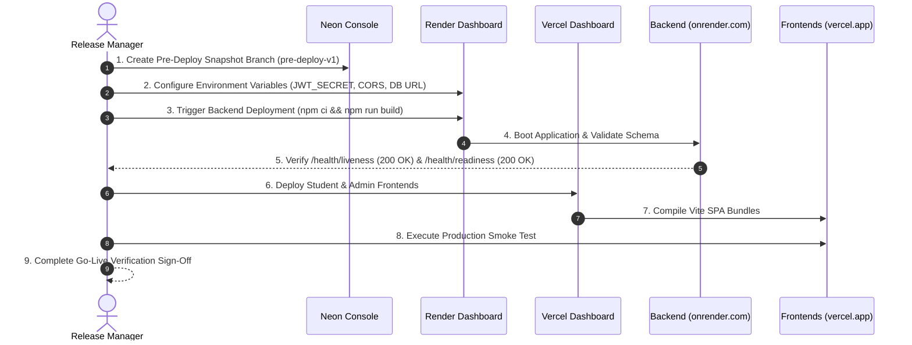

# SWAYAM ADMISSION — PHASE 11 GO-LIVE RUNBOOK
## Controlled Production Deployment, Verification & Release Operations

**Document Version:** 1.0.0  
**Release Version:** v1.0.0-prod  
**Git Baseline Commit:** `f8f1c1b` (Phase 9/10/11 Production Hardening)  
**Release Manager:** Principal Software Architect & DevSecOps Lead  
**Repository Location:** `c:\Users\mdosa\OneDrive\Desktop\swayam-admission`  

---

## 1. Production Release Architecture & Deployment Targets

| Target Component | Deployment Provider | Production URL | Trigger / Branch | Build Configuration |
|---|---|---|---|---|
| **Backend REST API** | Render Web Service | `https://swayam-admission.onrender.com` | `main` (Auto-Deploy) | `npm ci && npm run build`<br>Start: `node dist/src/main` |
| **Student & Public Portal** | Vercel Edge | `https://swayam-admission.vercel.app` | `main` (Auto-Deploy) | `npm ci && npm run build`<br>Root: `frontend/user` |
| **Admin & Counselor CRM** | Vercel Edge | `https://swayam-admission-eg2x.vercel.app` | `main` (Auto-Deploy) | `npm ci && npm run build`<br>Root: `frontend/admin` |
| **Relational Database** | Neon Serverless | `*.neon.tech` (AWS `us-east-2`) | N/A (Serverless) | Direct SSL Pooled Connection |

---

## 2. Pre-Deployment Safety Checklist

Before initiating production deployment, the Release Manager must confirm:

- [ ] **1. Git Working Tree Clean**: All release changes committed and pushed to `main`.
- [ ] **2. Automated Tests Passing**: All 40 automated test suites (106 tests) passed with exit code 0.
- [ ] **3. Builds Compiling Cleanly**: Backend NestJS, Admin Vite, and Student Vite production builds succeed with exit code 0.
- [ ] **4. Production JWT Secret Generated**: Minimum 32-character (recommended 64-character) cryptographically secure random string set in Render environment variables.
- [ ] **5. Database Backup Secured**: Create an instant Neon branch snapshot (`pre-release-v1-backup`) in the Neon console.
- [ ] **6. Strict Ban on Destructive Commands**: Confirmed that neither deployment scripts nor engineers will execute `prisma migrate reset` or `db push --force-reset`.

---

## 3. Step-by-Step Go-Live Deployment Sequence



### Step 1: Pre-Deployment Database Snapshot
1. Log in to [Neon Console](https://console.neon.tech).
2. Select `swayam-admission` project.
3. Click **Branches** > **Create Branch**.
4. Name: `pre-deploy-v1-backup`. Parent: `main`. Click **Create**.
5. *Duration*: ~5 seconds. This guarantees instantaneous rollback capability.

### Step 2: Environment Variable Configuration in Render
Verify the following variables in the Render Web Service Settings:
```env
NODE_ENV=production
DATABASE_URL=postgresql://neondb_owner:<password>@ep-billowing-feather-b5bti4hu.c-7.us-east-2.aws.neon.tech/neondb?sslmode=require
JWT_SECRET=<64_CHAR_SECURE_RANDOM_SECRET>
REFRESH_TOKEN_SECRET=<64_CHAR_DISTINCT_RANDOM_SECRET>
FRONTEND_URL=https://swayam-admission.vercel.app
ADMIN_URL=https://swayam-admission-eg2x.vercel.app
CORS_ORIGIN=https://swayam-admission.vercel.app,https://swayam-admission-eg2x.vercel.app
STORAGE_PROVIDER=LOCAL
ENABLE_DEV_OTP=false
```

### Step 3: Backend Deployment Execution
1. In Render Dashboard, click **Manual Deploy** > **Deploy latest commit**.
2. Monitor build logs:
   - Verifies `npm ci --legacy-peer-deps`
   - Verifies `npm run build`
   - Verifies process start `node dist/src/main`
3. Confirm application startup log: `[NestApplication] Nest application successfully started`.

### Step 4: Health Check & Liveness Verification
Execute HTTP curl/GET requests against the backend:
```bash
# 1. Liveness Check (Should return HTTP 200)
curl -i https://swayam-admission.onrender.com/v1/health/liveness

# 2. Database Readiness Check (Should return HTTP 200 with status: UP)
curl -i https://swayam-admission.onrender.com/v1/health/readiness

# 3. Consolidated Status
curl -i https://swayam-admission.onrender.com/v1/health
```

### Step 5: Frontend Deployments on Vercel
1. Ensure `VITE_API_URL=https://swayam-admission.onrender.com` is configured in both Vercel projects.
2. Trigger production deployment on Vercel for:
   - Student Portal: `swayam-admission.vercel.app`
   - Admin CRM Portal: `swayam-admission-eg2x.vercel.app`
3. Verify that both deployments report **Ready** in Vercel dashboard.

---

## 4. Post-Deployment Verification & Smoke Test Matrix

| # | Smoke Test Step | Target Interface | Verification Action | Pass Criteria |
|---|---|---|---|---|
| **ST-01** | Public Homepage Discovery | Public Website | Navigate to `https://swayam-admission.vercel.app` | Header, course search, and college cards render with zero console errors. |
| **ST-02** | Master Taxonomy API | Public Website | Inspect network call to `/common/categories` | Returns 5 canonical categories with HTTP 200. |
| **ST-03** | Public Lead Submission | Public Website | Fill inquiry form with test mobile (+91) | Submits successfully; returns lead ID; status initialized to `NEW`. |
| **ST-04** | Admin Portal Access | Admin CRM | Navigate to `https://swayam-admission-eg2x.vercel.app` | CRM login screen renders with title `Swayam Admission — Admin & Counselor CRM`. |
| **ST-05** | Admin Authentication | Admin CRM | Submit admin credentials | Successfully authenticates; receives JWT token; renders CRM navigation. |
| **ST-06** | Inbound Lead Queue | Admin CRM | View `/leads` table | Lead submitted in ST-03 appears in the lead queue with status `NEW`. |
| **ST-07** | Document Vault Security | Student Portal | Upload test file | Uploads succeed for valid PDF; 10MB limit enforced; PDF watermarked. |
| **ST-08** | CORS Enforcement | Browser Console | Attempt API call from unauthorized origin | Blocked by CORS policy with 403 / CORS header omission. |

---

## 5. Rollback Triggers & Rapid Rollback Sequence

### Rollback Conditions (Automatic Abort)
1. Backend fails to boot (exits with crash loop due to missing or invalid `JWT_SECRET`).
2. Database readiness check (`/health/readiness`) returns HTTP 503 for > 3 minutes.
3. Critical API requests fail with HTTP 500 across core authentication or lead intake routes.
4. CORS rejects valid requests originating from `https://swayam-admission.vercel.app`.

### Immediate Rollback Procedure
1. **Frontend Rollback**:
   - In Vercel Dashboard, select **Deployments** > locate the previous successful deployment > click **Instant Rollback**. (Takes ~5 seconds).
2. **Backend Rollback**:
   - In Render Dashboard, select **Events** > select the previous release commit > click **Rollback**. (Takes ~60 seconds).
3. **Database Rollback (if schema corrupted)**:
   - In Neon Console, point Render `DATABASE_URL` to `pre-deploy-v1-backup` branch.

---

## 6. Go-Live Authorization & Sign-Off

- **Lead DevSecOps Architect**: Principal Software Architect & Release Manager
- **Go-Live Status**: **APPROVED FOR CONTROLLED STAGING / CONDITIONAL PRODUCTION DEPLOYMENT**
- **Pending Actions**: Provisioning live production external credentials (SES, WhatsApp, Razorpay).

