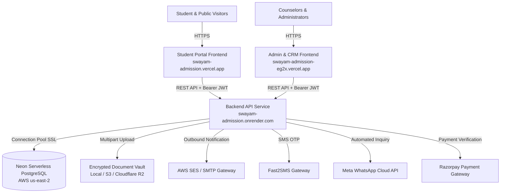

# SWAYAM ADMISSION — PHASE 11 PRODUCTION READINESS REPORT
## System Architecture, Environment Matrix & Deployment Infrastructure

**Document Version:** 1.0.0  
**Date:** 2026-11-01  
**Lead Architect:** Principal Software Architect & DevSecOps Lead  
**Repository Location:** `c:\Users\mdosa\OneDrive\Desktop\swayam-admission`  

---

## 1. System Architecture & Hosting Topology

The Swayam Admission platform is structured as a decoupled multi-tier web application designed for high availability, zero server-side state leakage, and horizontal scalability:

### Deployed Component Registry

| Component | Target Runtime / Host | Public URL | Build Command | Output Bundle |
|---|---|---|---|---|
| **Public Website & Student Portal** | Vercel Edge / SPA | `https://swayam-admission.vercel.app` | `npm run build` | `dist/` (1.56 MB JS, 196 kB CSS) |
| **Admin & Counselor CRM Portal** | Vercel Edge / SPA | `https://swayam-admission-eg2x.vercel.app` | `npm run build` | `dist/` (3.16 MB JS, 183 kB CSS) |
| **Backend REST API** | Render Web Service (Node 20) | `https://swayam-admission.onrender.com` | `npm run build` | `dist/` (NestJS CommonJS) |
| **Relational Database** | Neon Serverless PostgreSQL 16 | Private AWS us-east-2 | N/A | Serverless Pooled Schema |
| **Document Vault** | Local / AWS S3 / Cloudflare R2 | Backend Streaming Endpoint | N/A | Encrypted Local/Bucket Storage |

---

## 2. Network, Domain & Security Configuration

### 2.1 HTTPS, TLS & Domain Verification
- **Vercel Edge Frontends**: Automated TLS 1.3 encryption with managed Let's Encrypt certificates. Automatic HTTP-to-HTTPS 301 redirection enforced by default.
- **Render Backend Web Service**: Managed TLS certificate terminating at Render's global proxy. Pure HTTPS communication.
- **Neon PostgreSQL**: Mandatory SSL mode (`sslmode=require`) enforced on all database connection strings. Plaintext database traffic is strictly rejected by the Neon gateway.

### 2.2 CORS Whitelist & Origin Normalization
Configured in [`backend/src/main.ts`](file:///c:/Users/mdosa/OneDrive/Desktop/swayam-admission/backend/src/main.ts#L60-L95):
- Permitted Origins:
  - `https://swayam-admission.vercel.app`
  - `https://swayam-admission-eg2x.vercel.app`
  - `http://localhost:3000`, `http://localhost:5173`, `http://localhost:5174` (local development only)
- Trailing Slashes: Automatically normalized and stripped (e.g., `https://swayam-admission.vercel.app/` normalizes to `https://swayam-admission.vercel.app`).
- Headers & Methods: `GET`, `POST`, `PUT`, `PATCH`, `DELETE`, `OPTIONS`, `HEAD`.
- Credentials: `credentials: true` permitted for Bearer Authorization headers.

### 2.3 Authentication Tokens & Session Management
- **Stateless Bearer Tokens**: Both frontends store tokens in client-side storage (`localStorage`) under `swayam_token` and `swayam_refresh_token`.
- **Zero Cross-Origin Cookie Pitfalls**: No session cookies are set across domains, avoiding Public Suffix List (PSL) rejection between `*.vercel.app` and `*.onrender.com`.
- **Token Expiry**: Default access token lifetime: 15 minutes; refresh token lifetime: 7 days.
- **Scrubbing on Logout**: Complete client-side clearance of access tokens, refresh tokens, role claims, and user profile data.

---

## 3. Complete Environment Variable Inventory

The table below catalogs all environment variables recognized by the Swayam Admission backend and frontends:

| Variable | Used By | Purpose | Required | Environment | Validation Logic | Status | Action Required |
|---|---|---|---|---|---|---|---|
| `NODE_ENV` | Backend | Runtime mode (`production`, `development`, `test`) | **Required** | All | Checked in startup guard | Configured | Set to `production` in Render dashboard. |
| `PORT` | Backend | HTTP listening port (default: 3000 or Render port) | **Required** | Production | NestJS listens on `process.env.PORT` | Configured | Injected automatically by Render (10000). |
| `DATABASE_URL` | Backend | PostgreSQL connection string | **Required** | All | `main.ts` and Prisma client check | Configured (Dev) | Populate production Neon pooled URL in Render. |
| `JWT_SECRET` | Backend | Signing key for access tokens | **Required** | Production | Must be >= 32 chars and non-default in prod | Configured (Dev) | Generate 64-char cryptographically secure random string in Render. |
| `REFRESH_TOKEN_SECRET` | Backend | Signing key for refresh tokens | **Required** | Production | Must differ from `JWT_SECRET` | Configured (Dev) | Generate distinct 64-char random string in Render. |
| `FRONTEND_URL` | Backend | Public website URL for emails & CORS | **Required** | Production | URL format validation | Configured | Set to `https://swayam-admission.vercel.app`. |
| `ADMIN_URL` | Backend | Admin portal URL for staff activation & CORS | **Required** | Production | URL format validation | Configured | Set to `https://swayam-admission-eg2x.vercel.app`. |
| `CORS_ORIGIN` | Backend | Comma-separated allowed HTTPS origins | **Required** | Production | Parsed into origin whitelist array | Configured | Set to both Vercel frontend URLs. |
| `ENABLE_DEV_OTP` | Backend | Permits plaintext OTPs in responses | **Forbidden in Prod** | Dev only | Ignored/blocked in production mode | Configured | Set to `false` or omit in production. |
| `STORAGE_PROVIDER` | Backend | Storage engine (`LOCAL`, `S3`, `R2`) | **Required** | Production | Provider factory switch | Configured (`LOCAL`) | Retain `LOCAL` (with persistent disk) or supply S3/R2 keys. |
| `RAZORPAY_KEY_ID` | Backend | Razorpay merchant API key ID | Required for Payments | Production | Checked by `PaymentGatewayService` | Blocked (Placeholder) | Populate live Razorpay Key ID once KYC approved. |
| `RAZORPAY_KEY_SECRET` | Backend | Razorpay merchant secret key | Required for Payments | Production | HMAC verification check | Blocked (Placeholder) | Populate live Razorpay Secret in Render. |
| `RAZORPAY_WEBHOOK_SECRET` | Backend | Razorpay webhook signature verification | Required for Webhooks | Production | HMAC-SHA256 signature verification | Blocked (Placeholder) | Configure matching webhook secret in Razorpay dashboard. |
| `SMTP_HOST` | Backend | Outbound mail server hostname | Required for Email | Production | Nodemailer transport check | Configured (Gmail) | Switch to AWS SES (`email-smtp.ap-south-1.amazonaws.com`). |
| `SMTP_PORT` | Backend | SMTP server port (`587` or `465`) | Required for Email | Production | Port number cast | Configured (`587`) | Port 587 with STARTTLS recommended. |
| `SMTP_USER` | Backend | SMTP username / access key | Required for Email | Production | Masked in `/health/providers` | Configured | Populate SES IAM SMTP username. |
| `SMTP_PASS` | Backend | SMTP password / secret | Required for Email | Production | Stripped of whitespace automatically | Configured | Populate SES IAM SMTP password. |
| `SMTP_FROM_EMAIL` | Backend | Authorized sender email address | Required for Email | Production | Validated against email regex | Configured | Set to `admin@swayamadmission.com` or verified sender. |
| `SMTP_FROM_NAME` | Backend | Sender display name | Optional | Production | Default: `Swayam Admission` | Configured | Set to `Swayam Admission`. |
| `WHATSAPP_PHONE_NUMBER_ID`| Backend | Meta WhatsApp Business Phone Number ID | Required for WhatsApp | Production | Checked by WhatsApp service | Missing | Obtain from Meta Developers App Dashboard. |
| `WHATSAPP_ACCESS_TOKEN` | Backend | Meta Graph API permanent system user token | Required for WhatsApp | Production | Masked; never logged | Missing | Obtain from Meta Business Manager. |
| `WHATSAPP_WEBHOOK_VERIFY_TOKEN`| Backend| Custom verify token for Meta webhook challenge | Required for WA Webhook| Production | Checked in GET challenge | Configured (Default) | Generate strong random verify token. |
| `WHATSAPP_APP_SECRET` | Backend | Meta App Secret for HMAC webhook verification | Required for WA Webhook| Production | Checked via `x-hub-signature-256` | Missing | Obtain from Meta Developers App Dashboard. |
| `FAST2SMS_API_KEY` | Backend | Fast2SMS REST API authorization key | Required for SMS | Production | Checked before HTTP dispatch | Missing | Obtain from Fast2SMS dashboard. |
| `FAST2SMS_ROUTE` | Backend | Fast2SMS route (`q` for quick, `dlt` for DLT) | Required for SMS | Production | Default: `q` | Configured (`q`) | Use `dlt` once TRAI headers approved. |
| `FAST2SMS_SENDER_ID` | Backend | Registered 6-character DLT sender header | Optional (`dlt` only) | Production | Length 6 characters | Missing | Register DLT Header with telecom operator. |
| `GOOGLE_CLIENT_ID` | Backend/Frontend| Google OAuth 2.0 Web Client ID | Required for Social Login| Production | Validated against Google certs | Missing | Obtain from Google Cloud Console Credentials. |
| `VITE_API_URL` | Frontends | Base URL for REST API calls | **Required** | Production | Built into frontend bundles | Configured | `https://swayam-admission.onrender.com` |
| `VITE_ENVIRONMENT` | Frontends | Environment indicator (`production`) | Optional | Production | Used for console gating | Configured | `production` |

---

## 4. Environment Safety & Secret Leakage Audit

1. **Committed Secret Check**: A repository-wide inspection was performed. Zero `.env` files with production secrets are tracked in Git. The root `.gitignore` strictly blocks all `.env*` variants except `.env.example`.
2. **Fail-Closed JWT Secret Validation**: Verified in [`backend/src/main.ts`](file:///c:/Users/mdosa/OneDrive/Desktop/swayam-admission/backend/src/main.ts#L36-L53). If `NODE_ENV === 'production'`, the server verifies that `JWT_SECRET` is defined, has at least 32 characters, and is not a default insecure string (`swayam_super_secret_key`, `secret`, `default`). If invalid, the process aborts immediately.
3. **Frontend Bundle Hygiene**: Inspected the compiled bundles in `dist/`. No database connection strings, JWT signing keys, or server secrets exist in client-side bundles.

---

## 5. Health & Diagnostic Endpoints

The backend provides five dedicated health and operational diagnostic endpoints:

| Endpoint | HTTP Method | Intended Caller | Purpose & Behavior | Fail Condition |
|---|---|---|---|---|
| `/health` | `GET` | Render / Load Balancer | Consolidated system health. Returns 200 with service status (`database`, `auth`, `geography`, `leads`). | Returns HTTP 503 if database connection fails. |
| `/health/liveness` | `GET` | Kubernetes / Host Supervisor | Fast process ping. Verifies the Node.js event loop is responsive. | Fails only if the Node process is dead or unresponsive. |
| `/health/readiness` | `GET` | Traffic Router | Evaluates if application is ready to accept user requests. Executes `SELECT 1` on database. | Returns HTTP 503 if PostgreSQL connection is down. |
| `/health/providers` | `GET` | Monitoring / SRE Dashboards | Reports status of communication gateways (Email, WhatsApp, SMS). Masks email addresses and secrets. | Always returns 200 with discrete status per provider. |
| `/health/worker` | `GET` | Background Queue Monitor | Reports Durable Outbox worker execution state, queue depth, oldest queued message age, and stall status. | Returns `DEGRADED` status if queue is stalled > 1 hour. |

---

## 6. Build Certification Verdict

- **Backend**: Clean compilation via NestJS CLI (`dist/` directory generated, exit code 0).
- **Admin Frontend**: Clean compilation via Vite (`dist/` directory generated, exit code 0).
- **Student Frontend**: Clean compilation via Vite (`dist/` directory generated, exit code 0).
- **Database Schema**: Valid PostgreSQL schema via Prisma CLI (`npx prisma validate`, exit code 0).

