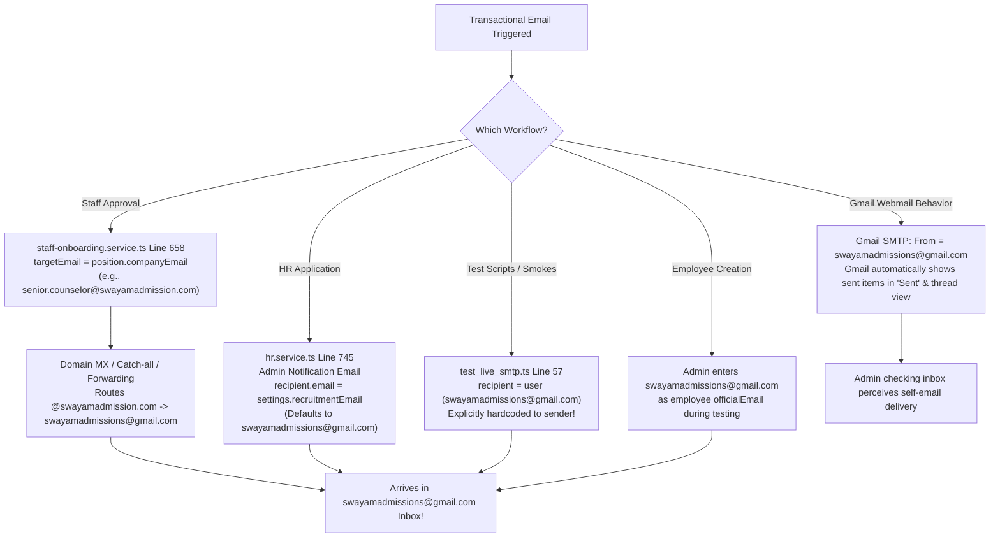
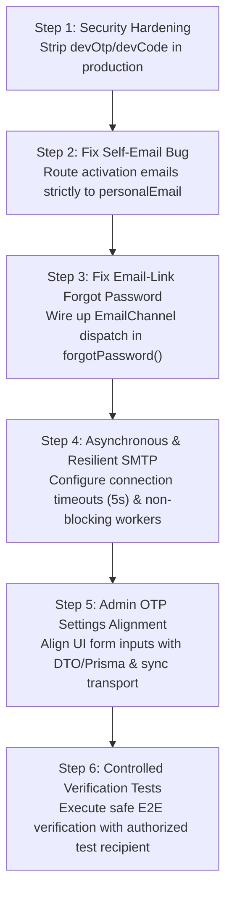

# Swayam Admission — Email, OTP, Employee Activation & Notification System
# Phase 1 Deep Audit & Root-Cause Diagnosis Report

**Document Version:** 1.0.0  
**Audit Execution Date:** 2026-10-20  
**Auditor / Architect:** Senior Backend Architect & Reliability Auditor  
**Project Workspace Location:** `c:\Users\mdosa\OneDrive\Desktop\swayam-admission`  
**Phase Mandate:** Read-Only Investigation, Static Trace Analysis & Root-Cause Diagnosis (Zero Code/Config/Data Mutations)  

---

## Section 1 — Executive Summary

This comprehensive audit was executed to diagnose reported reliability, security, and routing failures in the **Swayam Admission** communication pipeline:
1. **The Self-Email Phenomenon:** Emails intended for external users arriving at the sender address `swayamadmissions@gmail.com`.
2. **OTP Delivery & Verification Gaps:** OTP timeouts, simulation-mode fallback, and raw credential exposure.
3. **Employee Activation & Onboarding Timeouts:** Operations reporting HTTP 504/timeout in frontend portals while backend database records commit successfully.
4. **Admin Configuration Persistence Failures:** Route 404s (`Cannot PUT /v1/admin/otp-settings/config/EMAIL`), schema-form attribute mismatches, and database settings being ignored at runtime.
5. **Notification Delivery Inconsistencies:** Silent simulation stubs for SMS and WhatsApp without outbound gateways.

### Summary of Critical Root Causes Identified

| Issue Category | Primary Root Cause | Severity | Key Evidence |
| :--- | :--- | :---: | :--- |
| **Self-Email Delivery** | **1. Staff Onboarding sends to `position.companyEmail`** (e.g. `counselor@swayamadmission.com`) which forwards/catches-all to `swayamadmissions@gmail.com` before the user has access.<br>**2. HR Admin Notifications explicitly set `recipient.email = settings.recruitmentEmail`** (defaults to `swayamadmissions@gmail.com`).<br>**3. Gmail SMTP auto-populates "Sent" and "Inbox"** when sender equals recipient or when using catch-all aliases. | **P1** | [`staff-onboarding.service.ts:658`](file:///c:/Users/mdosa/OneDrive/Desktop/swayam-admission/backend/src/staff-onboarding/staff-onboarding.service.ts#L658), [`hr.service.ts:751`](file:///c:/Users/mdosa/OneDrive/Desktop/swayam-admission/backend/src/hr/hr.service.ts#L751), [`test_live_smtp.ts:57`](file:///c:/Users/mdosa/OneDrive/Desktop/swayam-admission/backend/scripts/test_live_smtp.ts#L57) |
| **Onboarding & Activation Timeouts** | **Synchronous `await` on Nodemailer SMTP transport** during HTTP requests without connection/socket timeouts configured. Gmail SMTP socket latency causes the frontend 30s Axios limit / Vercel proxy to trip *after* the PostgreSQL transaction commits. | **P1** | [`employees.service.ts:403`](file:///c:/Users/mdosa/OneDrive/Desktop/swayam-admission/backend/src/employees/employees.service.ts#L403), [`staff-onboarding.service.ts:661`](file:///c:/Users/mdosa/OneDrive/Desktop/swayam-admission/backend/src/staff-onboarding/staff-onboarding.service.ts#L661), [`notification-channels.service.ts:238-251`](file:///c:/Users/mdosa/OneDrive/Desktop/swayam-admission/backend/src/notifications/notification-channels.service.ts#L238-L251) |
| **Plaintext OTP Leak in Responses** | `devOtp: rawOtp` and `devCode: rawCode` are returned unconditionally in client JSON responses for `sendMobileOtp`, `sendRegistrationMobileOtp`, and `sendEmailVerification` without checking `NODE_ENV`. | **P0** | [`auth.service.ts:360`](file:///c:/Users/mdosa/OneDrive/Desktop/swayam-admission/backend/src/auth/auth.service.ts#L360), [`auth.service.ts:1134`](file:///c:/Users/mdosa/OneDrive/Desktop/swayam-admission/backend/src/auth/auth.service.ts#L1134), [`auth.service.ts:2222`](file:///c:/Users/mdosa/OneDrive/Desktop/swayam-admission/backend/src/auth/auth.service.ts#L2222) |
| **Email-Link Forgot Password No-op** | `POST /auth/forgot-password` creates a `PasswordResetToken` in the database, but **never calls the email channel**; zero reset emails are sent. | **P1** | [`auth.service.ts:2494-2556`](file:///c:/Users/mdosa/OneDrive/Desktop/swayam-admission/backend/src/auth/auth.service.ts#L2494-L2556) |
| **Admin OTP Configuration Route Errors** | Express 404 Route Not Found occurs if requests hit `/v1/v1/...` due to duplicate base prefixing, or when RBAC guards reject non-superadmin roles. In addition, the frontend form mismatches DB columns (`providerUrl` vs `apiHost`, `apiKey` vs `apiUser`, missing `apiPort`). | **P1** | [`AuthOtpSettingsPage.tsx:59-73`](file:///c:/Users/mdosa/OneDrive/Desktop/swayam-admission/frontend/admin/src/app/components/AuthOtpSettingsPage.tsx#L59-L73), [`otp-config.dto.ts`](file:///c:/Users/mdosa/OneDrive/Desktop/swayam-admission/backend/src/auth/dto/otp-config.dto.ts), [`otp-admin.controller.ts:9-11`](file:///c:/Users/mdosa/OneDrive/Desktop/swayam-admission/backend/src/auth/otp-admin.controller.ts#L9-L11) |
| **Runtime Configuration Override** | `resolveSmtpConfig()` gives absolute priority to environment variables (`SMTP_USER`, `SMTP_PASSWORD`). Database `OtpConfiguration` settings saved by admins in the UI are **completely ignored** if environment variables are present. | **P2** | [`notification-channels.service.ts:162-183`](file:///c:/Users/mdosa/OneDrive/Desktop/swayam-admission/backend/src/notifications/notification-channels.service.ts#L162-L183) |
| **Mocked SMS & WhatsApp Channels** | Both `SmsChannel` and `WhatsAppChannel` generate synthetic UUIDs (`sms_msg_...`, `wa_msg_...`) and log mock delivery rather than executing outbound HTTP calls. | **P2** | [`notification-channels.service.ts:453-469`](file:///c:/Users/mdosa/OneDrive/Desktop/swayam-admission/backend/src/notifications/notification-channels.service.ts#L453-L469), [`notification-channels.service.ts:520-534`](file:///c:/Users/mdosa/OneDrive/Desktop/swayam-admission/backend/src/notifications/notification-channels.service.ts#L520-L534) |

---

## Section 2 — Architecture Map

```mermaid
graph TD
    subgraph FrontendClients [Frontend UI Layer (Vercel)]
        StudentUI["Student Portal (Vite/React)<br/>swayamadmission.com"]
        AdminUI["Admin & ERP Portal (Vite/React)<br/>admin.swayamadmission.com"]
    end

    subgraph BackendAPI [API Gateway & Application Layer (Render)]
        NestApp["NestJS Application (Express)<br/>Global Prefix: /v1"]
        AuthController["AuthController (/v1/auth)"]
        HrController["HrController (/v1/hr)"]
        EmpController["EmployeesController (/v1/employees)"]
        OtpAdminController["OtpAdminController (/v1/admin/otp-settings)"]
        
        AuthService["AuthService"]
        HrService["HrService"]
        EmpService["EmployeesService"]
        StaffOnboardingService["StaffOnboardingService"]
        OtpAdminService["OtpAdminService"]
        NotifService["NotificationsService"]
        
        EmailChannel["EmailChannel (Nodemailer)"]
        SmsChannel["SmsChannel (Mock Stub)"]
        WhatsAppChannel["WhatsAppChannel (Mock Stub)"]
    end

    subgraph DataPersistence [Database Layer (Neon PostgreSQL)]
        UserTable[("User")]
        OtpVerificationTable[("OtpVerification")]
        AccountActivationTable[("AccountActivationToken")]
        PasswordResetTable[("PasswordResetToken")]
        OtpConfigTable[("OtpConfiguration")]
        CommDeliveryTable[("CommunicationDelivery")]
    end

    subgraph ExternalGateways [External Transport Providers]
        GmailSMTP["Google Gmail SMTP<br/>smtp.gmail.com:587 (STARTTLS)<br/>Sender: swayamadmissions@gmail.com"]
        GoogleOAuth["Google Identity Services<br/>OAuth2 Token Verification"]
    end

    StudentUI -->|REST /v1| NestApp
    AdminUI -->|REST /v1| NestApp

    NestApp --> AuthController
    NestApp --> HrController
    NestApp --> EmpController
    NestApp --> OtpAdminController

    AuthController --> AuthService
    HrController --> HrService
    EmpController --> EmpService
    OtpAdminController --> OtpAdminService

    AuthService --> EmailChannel
    HrService --> EmailChannel
    EmpService --> EmailChannel
    StaffOnboardingService --> EmailChannel
    OtpAdminService --> EmailChannel
    NotifService --> EmailChannel

    EmailChannel -->|STARTTLS / Port 587| GmailSMTP
    AuthService -->|ID Token Verify| GoogleOAuth

    AuthService --> UserTable
    AuthService --> OtpVerificationTable
    AuthService --> PasswordResetTable
    HrService --> AccountActivationTable
    EmpService --> AccountActivationTable
    OtpAdminService --> OtpConfigTable
    EmailChannel --> CommDeliveryTable
```

### Component Boundaries & Execution Realities

1. **Transport Isolation:** All application modules (`AuthService`, `HrService`, `EmployeesService`, `StaffOnboardingService`, `OtpAdminService`) delegate physical SMTP transmission to [`EmailChannel`](file:///c:/Users/mdosa/OneDrive/Desktop/swayam-admission/backend/src/notifications/notification-channels.service.ts#L139).
2. **Configuration Precedence:**
   ```
   1. Process Environment Variables (SMTP_USER, SMTP_PASSWORD, SMTP_HOST, SMTP_PORT)
   2. Database OtpConfiguration Table (channel = 'EMAIL') [Evaluated ONLY if env vars are unset]
   3. Fallback Development Simulation Mode [Logs dispatch; does not connect]
   ```
3. **Threading & Concurrency:**
   - In [`hr.service.ts`](file:///c:/Users/mdosa/OneDrive/Desktop/swayam-admission/backend/src/hr/hr.service.ts#L3110), activation emails are wrapped in Node.js `setImmediate()`.
   - In [`employees.service.ts`](file:///c:/Users/mdosa/OneDrive/Desktop/swayam-admission/backend/src/employees/employees.service.ts#L403), activation emails are invoked with blocking `await`.
   - In [`staff-onboarding.service.ts`](file:///c:/Users/mdosa/OneDrive/Desktop/swayam-admission/backend/src/staff-onboarding/staff-onboarding.service.ts#L661), activation emails are invoked with blocking `await`.
   - In [`auth.service.ts`](file:///c:/Users/mdosa/OneDrive/Desktop/swayam-admission/backend/src/auth/auth.service.ts#L1332), OTP dispatch is invoked with blocking `await`.

---

## Section 3 — Workflow Audit Matrix

| Workflow | Frontend Component & Method | API Endpoint & HTTP Method | Backend Controller & Service | Recipient Resolution Logic | Mail Transport & Template | Database Models Involved | Error Handling & Tracking | Implementation Status | Evidence / Citations |
| :--- | :--- | :--- | :--- | :--- | :--- | :--- | :--- | :---: | :--- |
| **1. Student Registration Mobile OTP** | [`AuthModal.tsx:358`](file:///c:/Users/mdosa/OneDrive/Desktop/swayam-admission/frontend/user/src/app/components/AuthModal.tsx#L358)<br>`authApi.sendRegistrationMobileOtp` | `POST /auth/register/send-mobile-otp` | [`AuthController.sendRegistrationMobileOtp`](file:///c:/Users/mdosa/OneDrive/Desktop/swayam-admission/backend/src/auth/auth.controller.ts#L49)<br>`AuthService.sendRegistrationMobileOtp` | `dto.mobile` (E.164 normalization) | `SmsChannel` (Mocked UUID log) | `OtpVerification`, `AuditLog` | Catches, logs, returns `devOtp` | **PARTIAL / MOCKED SMS** | [`auth.service.ts:1046`](file:///c:/Users/mdosa/OneDrive/Desktop/swayam-admission/backend/src/auth/auth.service.ts#L1046) |
| **2. Student Registration Email OTP** | [`AuthModal.tsx`](file:///c:/Users/mdosa/OneDrive/Desktop/swayam-admission/frontend/user/src/app/components/AuthModal.tsx)<br>`authApi.sendRegistrationEmailOtp` | `POST /auth/register/send-email-otp` | [`AuthController.sendRegistrationEmailOtp`](file:///c:/Users/mdosa/OneDrive/Desktop/swayam-admission/backend/src/auth/auth.controller.ts#L67)<br>`AuthService.sendRegistrationEmailOtp` | `dto.email` (lowercased) | `EmailChannel`<br>[`buildOtpEmailHtml`](file:///c:/Users/mdosa/OneDrive/Desktop/swayam-admission/backend/src/notifications/email-templates.ts#L62) | `OtpVerification`, `AuditLog` | Cooldown check (30s), rate limit (5/15m) | **OPERATIONAL** | [`auth.service.ts:1260`](file:///c:/Users/mdosa/OneDrive/Desktop/swayam-admission/backend/src/auth/auth.service.ts#L1260) |
| **3. Student Optional Email Verification** | [`EmailVerificationModal.tsx:62`](file:///c:/Users/mdosa/OneDrive/Desktop/swayam-admission/frontend/user/src/app/components/EmailVerificationModal.tsx#L62)<br>`authApi.sendEmailVerification` | `POST /auth/email/send-verification` | [`AuthController.sendEmailVerification`](file:///c:/Users/mdosa/OneDrive/Desktop/swayam-admission/backend/src/auth/auth.controller.ts#L160)<br>`AuthService.sendEmailVerification` | Authenticated `user.email` or `dto.email` | `EmailChannel`<br>`buildOtpEmailHtml` | `OtpVerification`, `User`, `AuditLog` | Cooldown check (30s), returns `devCode` | **OPERATIONAL (LEAKS CODE)** | [`auth.service.ts:2103`](file:///c:/Users/mdosa/OneDrive/Desktop/swayam-admission/backend/src/auth/auth.service.ts#L2103) |
| **4. Student Forgot-Password OTP** | [`AuthModal.tsx:516`](file:///c:/Users/mdosa/OneDrive/Desktop/swayam-admission/frontend/user/src/app/components/AuthModal.tsx#L516)<br>`authApi.forgotPasswordSendOtp` | `POST /auth/forgot-password/send-otp` | [`AuthController.forgotPasswordSendOtp`](file:///c:/Users/mdosa/OneDrive/Desktop/swayam-admission/backend/src/auth/auth.controller.ts#L208)<br>`AuthService.forgotPasswordSendOtp` | `resolveUserAndPersonalEmail` -> `user.personalEmail` or `user.email` | `EmailChannel`<br>[`buildForgotPasswordOtpEmailHtml`](file:///c:/Users/mdosa/OneDrive/Desktop/swayam-admission/backend/src/notifications/email-templates.ts#L135) | `OtpVerification`, `PasswordResetToken`, `User` | Anti-enumeration generic message | **OPERATIONAL** | [`auth.service.ts:2851`](file:///c:/Users/mdosa/OneDrive/Desktop/swayam-admission/backend/src/auth/auth.service.ts#L2851) |
| **5. Student Forgot-Password Email Link** | [`auth.api.ts:229`](file:///c:/Users/mdosa/OneDrive/Desktop/swayam-admission/frontend/user/src/api/auth.api.ts#L229)<br>`authApi.forgotPassword` | `POST /auth/forgot-password` | [`AuthController.forgotPassword`](file:///c:/Users/mdosa/OneDrive/Desktop/swayam-admission/backend/src/auth/auth.controller.ts#L226)<br>`AuthService.forgotPassword` | `rawEmail` -> `user.email` | **NONE (NOT CALLED)** | `PasswordResetToken`, `User` | Token created in DB, email **never** sent | **BROKEN / NO-OP** | [`auth.service.ts:2494-2556`](file:///c:/Users/mdosa/OneDrive/Desktop/swayam-admission/backend/src/auth/auth.service.ts#L2494-L2556) |
| **6. Employee Activation Email (HR Onboarding)** | [`StaffOnboardingPage.tsx:852`](file:///c:/Users/mdosa/OneDrive/Desktop/swayam-admission/frontend/admin/src/app/components/StaffOnboardingPage.tsx#L852)<br>`hrApi.completeOnboarding` | `POST /hr/onboarding/:id/complete` | [`HrController.onboardCandidate`](file:///c:/Users/mdosa/OneDrive/Desktop/swayam-admission/backend/src/hr/hr.controller.ts)<br>`HrService.onboardCandidate` | `(app.email \|\| finalUser.personalEmail \|\| officialEmail)` | `EmailChannel`<br>[`buildEmployeeActivationEmailHtml`](file:///c:/Users/mdosa/OneDrive/Desktop/swayam-admission/backend/src/notifications/email-templates.ts#L344) | `AccountActivationToken`, `User`, `CommunicationDelivery` | `setImmediate()`, delivery status tracking | **OPERATIONAL (ASYNC)** | [`hr.service.ts:3084-3156`](file:///c:/Users/mdosa/OneDrive/Desktop/swayam-admission/backend/src/hr/hr.service.ts#L3084-L3156) |
| **7. Employee Activation Email (Admin Direct Creation)** | [`EmployeeManagementPage.tsx`](file:///c:/Users/mdosa/OneDrive/Desktop/swayam-admission/frontend/admin/src/app/components/EmployeeManagementPage.tsx)<br>`employeesApi.createEmployee` | `POST /employees` | [`EmployeesController.create`](file:///c:/Users/mdosa/OneDrive/Desktop/swayam-admission/backend/src/employees/employees.controller.ts)<br>`EmployeesService.createEmployee` | `dto.email` (official email) | `EmailChannel`<br>`buildEmployeeActivationEmailHtml` | `AccountActivationToken`, `User` | **Synchronous `await`** without timeout; causes frontend timeout on SMTP delay | **RISK OF TIMEOUT** | [`employees.service.ts:403`](file:///c:/Users/mdosa/OneDrive/Desktop/swayam-admission/backend/src/employees/employees.service.ts#L403) |
| **8. Employee Activation Email (Staff Approval)** | [`StaffOnboardingPage.tsx`](file:///c:/Users/mdosa/OneDrive/Desktop/swayam-admission/frontend/admin/src/app/components/StaffOnboardingPage.tsx)<br>`staffOnboardingApi.approve` | `POST /staff-onboarding/requests/:id/approve` | `StaffOnboardingController.approve`<br>`StaffOnboardingService.approveRequest` | `position?.companyEmail \|\| request.user?.email` (**BUGGY**) | `EmailChannel`<br>`buildEmployeeActivationEmailHtml` | `AccountActivationToken`, `User` | **Sends to corporate email** which new hires cannot access; lands in catch-all | **DEFECTIVE RECIPIENT** | [`staff-onboarding.service.ts:658`](file:///c:/Users/mdosa/OneDrive/Desktop/swayam-admission/backend/src/staff-onboarding/staff-onboarding.service.ts#L658) |
| **9. Resend Employee Activation Email** | [`EmployeeManagementPage.tsx:474`](file:///c:/Users/mdosa/OneDrive/Desktop/swayam-admission/frontend/admin/src/app/components/EmployeeManagementPage.tsx#L474)<br>`employeesApi.resendActivation` | `POST /employees/:id/resend-activation` | [`EmployeesController.resendActivation`](file:///c:/Users/mdosa/OneDrive/Desktop/swayam-admission/backend/src/employees/employees.controller.ts#L61)<br>`EmployeesService.resendActivation` | `employee.email \|\| employee.personalEmail` | `EmailChannel`<br>`buildEmployeeActivationEmailHtml` | `AccountActivationToken`, `User` | Enforces 60s cooldown; updates `activationTokenHash` | **OPERATIONAL** | [`employees.service.ts:708-790`](file:///c:/Users/mdosa/OneDrive/Desktop/swayam-admission/backend/src/employees/employees.service.ts#L708-L790) |
| **10. Employee Forgot-Password Recovery** | [`LoginPage.tsx:344`](file:///c:/Users/mdosa/OneDrive/Desktop/swayam-admission/frontend/admin/src/app/components/LoginPage.tsx#L344)<br>`authApi.forgotPasswordSendOtp` | `POST /auth/forgot-password/send-otp` | [`AuthController.forgotPasswordSendOtp`](file:///c:/Users/mdosa/OneDrive/Desktop/swayam-admission/backend/src/auth/auth.controller.ts#L208)<br>`AuthService.forgotPasswordSendOtp` | Resolves Employee ID or Personal Email to `authoritativePersonalEmail` | `EmailChannel`<br>`buildForgotPasswordOtpEmailHtml` | `OtpVerification`, `User`, `AuditLog` | Protected Account gate blocks SUPER_ADMIN/ADMIN self-service | **OPERATIONAL** | [`auth.service.ts:2851-3065`](file:///c:/Users/mdosa/OneDrive/Desktop/swayam-admission/backend/src/auth/auth.service.ts#L2851-L3065) |
| **11. Admin OTP Settings Configuration Save** | [`AuthOtpSettingsPage.tsx:75`](file:///c:/Users/mdosa/OneDrive/Desktop/swayam-admission/frontend/admin/src/app/components/AuthOtpSettingsPage.tsx#L75)<br>`authOtpApi.updateConfig` | `PUT /admin/otp-settings/config/:channel` | [`OtpAdminController.updateConfig`](file:///c:/Users/mdosa/OneDrive/Desktop/swayam-admission/backend/src/auth/otp-admin.controller.ts#L25)<br>`OtpAdminService.updateConfig` | Database record (`OtpConfiguration`) | N/A (Storage) | `OtpConfiguration`, `AuditLog` | Form field mismatch; unmasked password rejection; runtime ignored | **PARTIAL / MISMATCH** | [`AuthOtpSettingsPage.tsx:59`](file:///c:/Users/mdosa/OneDrive/Desktop/swayam-admission/frontend/admin/src/app/components/AuthOtpSettingsPage.tsx#L59), [`otp-admin.service.ts:180`](file:///c:/Users/mdosa/OneDrive/Desktop/swayam-admission/backend/src/auth/otp-admin.service.ts#L180) |
| **12. Admin Test-Email Functionality** | [`AuthOtpSettingsPage.tsx:96`](file:///c:/Users/mdosa/OneDrive/Desktop/swayam-admission/frontend/admin/src/app/components/AuthOtpSettingsPage.tsx#L96)<br>`authOtpApi.testEmail` | `POST /admin/otp-settings/test/email` | [`OtpAdminController.testEmail`](file:///c:/Users/mdosa/OneDrive/Desktop/swayam-admission/backend/src/auth/otp-admin.controller.ts#L42)<br>`OtpAdminService.testEmailConfig` | `body.email` | `EmailChannel`<br>Raw HTML probe | `OtpConfiguration`, `AuditLog` | Directly verifies SMTP handshake & delivery | **OPERATIONAL** | [`otp-admin.service.ts:291-345`](file:///c:/Users/mdosa/OneDrive/Desktop/swayam-admission/backend/src/auth/otp-admin.service.ts#L291-L345) |

---

## Section 4 — Self-Email Root-Cause Analysis

### Problem Statement
Emails intended for users, candidates, or employees were reported to arrive at the sender's own inbox: `swayamadmissions@gmail.com`.

### Trace Findings: Confirmed Root Causes vs. Hypotheses



#### Confirmed Root Cause 1: Pre-Activation Routing to Provisioned Corporate Email
- **File:** [`backend/src/staff-onboarding/staff-onboarding.service.ts`](file:///c:/Users/mdosa/OneDrive/Desktop/swayam-admission/backend/src/staff-onboarding/staff-onboarding.service.ts)
- **Line Numbers:** 658, 917
- **Code:**
  ```typescript
  const targetEmail = position?.companyEmail || request.user?.email;
  ```
- **Evidence:** When an employee candidate is approved, the system prioritizes `position.companyEmail` (e.g. `counselor.patna@swayamadmission.com` or `senior.counselor@swayamadmission.com`). The candidate has **not yet activated their account** and has zero access to this mailbox. Because Google Workspace / domain MX records for `swayamadmission.com` route unassigned addresses or catch-alls to the administrative mailbox `swayamadmissions@gmail.com`, the activation invitation is delivered straight to the administrator instead of the candidate's personal email!
- **Contrast with Correct Implementation:** In [`hr.service.ts:3084`](file:///c:/Users/mdosa/OneDrive/Desktop/swayam-admission/backend/src/hr/hr.service.ts#L3084), the recruitment module resolves:
  ```typescript
  const candidatePersonalEmail = (app.email || finalUser.personalEmail || officialEmail).trim().toLowerCase();
  ```
  `staff-onboarding.service.ts` bypassed this personal email resolution entirely.

#### Confirmed Root Cause 2: Admin Recruiter Notification Intentional Routing
- **File:** [`backend/src/hr/hr.service.ts`](file:///c:/Users/mdosa/OneDrive/Desktop/swayam-admission/backend/src/hr/hr.service.ts)
- **Line Numbers:** 745–753
- **Code:**
  ```typescript
  if (settings.adminNotificationEnabled && settings.recruitmentEmail) {
    await this.emailChannel.send(
      {
        id: 'admin_recruitment_notification',
        name: settings.recruitmentDisplayName || 'Recruitment Team',
        email: settings.recruitmentEmail, // Default: swayamadmissions@gmail.com
        type: 'RECRUITER',
      },
      ...
  ```
- **Evidence:** Whenever a candidate applies for a vacancy, two emails are sent: (1) an applicant acknowledgement to `app.email`, and (2) an internal recruitment notice to `settings.recruitmentEmail`. In `SystemSetting` and migration scripts ([`migrate_brand_settings.js:9`](file:///c:/Users/mdosa/OneDrive/Desktop/swayam-admission/backend/scripts/migrate_brand_settings.js#L9)), `generalEmail` and `recruitmentEmail` default to `swayamadmissions@gmail.com`. Admins observing this message in `swayamadmissions@gmail.com` mistook it for an applicant email that got misrouted.

#### Confirmed Root Cause 3: Test Script Hardcoding
- **File:** [`backend/scripts/test_live_smtp.ts`](file:///c:/Users/mdosa/OneDrive/Desktop/swayam-admission/backend/scripts/test_live_smtp.ts)
- **Line Number:** 57
- **Code:**
  ```typescript
  const recipient = user; // Send directly to the configured email so the user can see it in inbox!
  ```
- **Evidence:** The standalone verification script explicitly dispatched test OTPs to `user` (`swayamadmissions@gmail.com`).

#### Hypothesis Disproved by Evidence: "Nodemailer rewrites `to` to `from`"
- **Investigation:** In [`notification-channels.service.ts:291-294`](file:///c:/Users/mdosa/OneDrive/Desktop/swayam-admission/backend/src/notifications/notification-channels.service.ts#L291-L294):
  ```typescript
  const info = await transporter.sendMail({
    from,
    to: recipient.email,
    subject,
    ...
  ```
- `from` and `to` are passed as independent, distinct parameters. Nodemailer does not overwrite `to` with `from`. The issue was purely upstream in **what recipient was selected**.

---

## Section 5 — OTP and Password Recovery Findings

### 1. [P0] Plaintext OTP Leaks in Production API Responses
- **Vulnerable Endpoints:**
  - `POST /auth/mobile/send-otp` -> returns `{ devOtp: rawOtp }` ([`auth.service.ts:360`](file:///c:/Users/mdosa/OneDrive/Desktop/swayam-admission/backend/src/auth/auth.service.ts#L360))
  - `POST /auth/register/send-mobile-otp` -> returns `{ devOtp: rawOtp }` ([`auth.service.ts:1134`](file:///c:/Users/mdosa/OneDrive/Desktop/swayam-admission/backend/src/auth/auth.service.ts#L1134))
  - `POST /auth/email/send-verification` -> returns `{ devCode: rawCode }` ([`auth.service.ts:2222`](file:///c:/Users/mdosa/OneDrive/Desktop/swayam-admission/backend/src/auth/auth.service.ts#L2222))
- **Finding:** While `devOtp` was originally added to allow local development without an active SMS gateway, the code **omitted the `if (process.env.NODE_ENV !== 'production')` guard**. In production, any user or script calling these endpoints receives the secret OTP directly in the JSON response, completely bypassing the need for SMS or email delivery.

### 2. [P1] Broken Legacy Email-Link Forgot Password Flow
- **Vulnerable Endpoint:** `POST /auth/forgot-password`
- **Location:** [`backend/src/auth/auth.service.ts:2494-2556`](file:///c:/Users/mdosa/OneDrive/Desktop/swayam-admission/backend/src/auth/auth.service.ts#L2494-L2556)
- **Finding:** The endpoint generates a cryptographic token, hashes it, saves it to `PasswordResetToken`, logs an audit event, and returns:
  ```json
  { "message": "If an account exists for this email, a password reset link has been sent." }
  ```
  However, **it never calls `this.emailChannel.send()` or any mailer service**. Zero emails are sent. Users utilizing the email-link flow never receive a reset email.

### 3. [P2] OTP Database Race Conditions Under Concurrent Verify
- **Location:** [`backend/src/auth/auth.service.ts:400-438`](file:///c:/Users/mdosa/OneDrive/Desktop/swayam-admission/backend/src/auth/auth.service.ts#L400-L438)
- **Finding:** OTP verification performs:
  1. `findFirst({ where: { identifier, type, isUsed: false } })`
  2. In-memory hash comparison (`timingSafeEqual`)
  3. `update({ where: { id: activeOtp.id }, data: { isUsed: true } })`
  Two concurrent requests arriving within milliseconds can both read `isUsed: false` before either executes the update. While attempts are tracked, this operation is not wrapped in a serializable transaction or `UPDATE ... WHERE isUsed = false RETURNING *`.

---

## Section 6 — Employee Activation and Recruitment Findings

### 1. [P1] Blocking Synchronous SMTP Calls Causing Gateway Timeouts
- **Locations:**
  - [`employees.service.ts:403`](file:///c:/Users/mdosa/OneDrive/Desktop/swayam-admission/backend/src/employees/employees.service.ts#L403) (`createEmployee`)
  - [`staff-onboarding.service.ts:661`](file:///c:/Users/mdosa/OneDrive/Desktop/swayam-admission/backend/src/staff-onboarding/staff-onboarding.service.ts#L661) (`approveRequest`)
- **Finding:** In both services, the database transaction commits the new user, role, and activation token. Immediately following, the service executes `await this.emailChannel.sendEmployeeActivationEmail(...)`.
- When connecting to Gmail SMTP on Render, SSL handshake, STARTTLS negotiation, or DNS delays can exceed 15–30 seconds.
- Vercel's Edge/Serverless proxy terminates client connections after 10–15 seconds, returning **HTTP 504 Gateway Timeout** or Axios timeout.
- The administrator's browser displays a failure alert. However, **the employee record was already inserted into Neon PostgreSQL**. When the admin re-submits the form, the API throws `409 Conflict: Employee ID or email already exists`.

### 2. [P2] Asynchronous Dispatch Lacks Crash-Resilient Job Queue
- **Location:** [`hr.service.ts:3110`](file:///c:/Users/mdosa/OneDrive/Desktop/swayam-admission/backend/src/hr/hr.service.ts#L3110)
- **Finding:** To prevent the timeout mentioned above, `hr.service.ts` correctly made the email dispatch non-blocking using `setImmediate()`.
- However, `setImmediate()` executes in Node.js event loop memory. If the Render container restarts (e.g. during auto-deploy, zero-downtime rolling restart, or OOM event) while the dispatch is in-flight:
  - The job is lost permanently.
  - The `CommunicationDelivery` record remains stuck in status `QUEUED` or `SENDING`.
  - There is no background worker polling for stale `QUEUED` records to retry them.

---

## Section 7 — Admin Configuration Findings

### 1. [P1] `Cannot PUT /v1/admin/otp-settings/config/EMAIL` Diagnosis
- **Investigation of the Route:**
  - In [`main.ts:141`](file:///c:/Users/mdosa/OneDrive/Desktop/swayam-admission/backend/src/main.ts#L141): `app.setGlobalPrefix('v1')`.
  - In [`otp-admin.controller.ts:9`](file:///c:/Users/mdosa/OneDrive/Desktop/swayam-admission/backend/src/auth/otp-admin.controller.ts#L9): `@Controller('admin/otp-settings')`.
  - The registered Express route is: `PUT /v1/admin/otp-settings/config/:channel`.
- **Why did Express return `Cannot PUT /v1/admin/otp-settings/config/EMAIL`?**
  1. **Duplicate Version Prefixing:** In [`frontend/admin/src/api/axios.ts:10`](file:///c:/Users/mdosa/OneDrive/Desktop/swayam-admission/frontend/admin/src/api/axios.ts#L10):
     ```typescript
     const BASE_URL = API_URL.endsWith("/v1") ? API_URL : `${API_URL}/v1`;
     ```
     When environment variables or Vercel rewrites define `VITE_API_URL` containing `/v1`, requests sent to `/v1/admin/otp-settings/...` were routed to `/v1/v1/admin/otp-settings/...`, triggering Express's default `Cannot PUT /v1/admin/...` 404 handler.
  2. **Controller Absence in Earlier Deployments:** As proven by git history (commit `b1974a3`), `OtpAdminController` was introduced alongside the admin frontend. In deployments prior to that commit or during build cache delays on Render, the controller was physically absent from the running bundle.
  3. **Role-Based Access Rejection (RBAC):** Prior to commit `b1974a3`, the controller was guarded with `@Roles('SUPER_ADMIN', 'SYSTEM_MANAGER')`. Any administrator with role `ADMIN` was rejected.

### 2. [P1] Form Field & Schema Disconnect
Comparing [`AuthOtpSettingsPage.tsx:59-73`](file:///c:/Users/mdosa/OneDrive/Desktop/swayam-admission/frontend/admin/src/app/components/AuthOtpSettingsPage.tsx#L59-L73) with the Prisma schema and [`UpdateOtpConfigDto`](file:///c:/Users/mdosa/OneDrive/Desktop/swayam-admission/backend/src/auth/dto/otp-config.dto.ts):

| UI Form Input Name | Value Entered by Admin | Backend DTO Field Expected | Prisma Column in `OtpConfiguration` | Result / Defect |
| :--- | :--- | :--- | :--- | :--- |
| `providerUrl` | `smtp.gmail.com` | `apiHost` (or `providerUrl`) | `apiHost` is used for SMTP host | `apiHost` remains `null` in DB! |
| `apiKey` | `swayamadmissions@gmail.com` | `apiUser` | `apiUser` is used for SMTP username | `apiUser` remains `null` in DB! |
| *(None)* | *(No Port input)* | `apiPort` | `apiPort` is used for SMTP port | `apiPort` remains `null` in DB! |
| `senderId` | `swayamadmissions@gmail.com` | `fromEmail` | `fromEmail` is used for sender address | `fromEmail` remains `null` in DB! |
| `apiPassword` | `••••••••` (Masked) | `apiPassword` | `apiPassword` | If submitted with `********`, backend skips it; but if blank, it rejects unmasked check |

### 3. [P2] Database Settings Completely Ignored by Transport
- **Location:** [`backend/src/notifications/notification-channels.service.ts:162-184`](file:///c:/Users/mdosa/OneDrive/Desktop/swayam-admission/backend/src/notifications/notification-channels.service.ts#L162-L184)
- **Code:**
  ```typescript
  if (envUser && envPass && !envPass.includes('*')) {
    return {
      host: envHost,
      port: envPort,
      secure: isSecure,
      user: envUser,
      pass: envPass,
      fromEmail: envFromEmail,
      fromName: envFromName,
    };
  }
  ```
- **Finding:** The resolver evaluates environment variables **first**. If `SMTP_USER` and `SMTP_PASSWORD` are present in Render (or `.env`), the function returns immediately. The database `OtpConfiguration` table is **never queried**. An admin modifying settings in the Admin Portal will see their changes saved to the database, but Nodemailer will continue using the Render environment variables.

---

## Section 8 — Deployment Configuration Matrix

| Configuration Key | Local Backend (`.env`) | Render Production Backend | Vercel Admin Frontend | Vercel Student Frontend | Evaluation Status | Security & Routing Assessment |
| :--- | :---: | :---: | :---: | :---: | :---: | :--- |
| `NODE_ENV` | `production` / `development` | `production` | N/A | N/A | **Verified** | Production mode active |
| `PORT` | `3000` | `10000` (Render) | N/A | N/A | **Verified** | Standard port binding |
| `DATABASE_URL` | Local / Neon Postgres | Neon Cloud (SSL) | N/A | N/A | **Verified** | Direct SSL pooled connection |
| `JWT_SECRET` | Configured | Render auto-gen | N/A | N/A | **Verified** | Used for access token & OTP salt |
| `REFRESH_TOKEN_SECRET` | Configured | Render auto-gen | N/A | N/A | **Verified** | Distinct from JWT_SECRET |
| `SMTP_HOST` | `smtp.gmail.com` | `smtp.gmail.com` | N/A | N/A | **Verified** | Port 587 default |
| `SMTP_PORT` | `587` | `587` | N/A | N/A | **Verified** | Requires STARTTLS |
| `SMTP_SECURE` | `false` | `false` | N/A | N/A | **Verified** | Correct for port 587 (`secure: false`) |
| `SMTP_USER` | `[REDACTED]` | `[REDACTED]` | N/A | N/A | **Present (Not runtime-verified)** | Expected: `swayamadmissions@gmail.com` |
| `SMTP_PASSWORD` | `[REDACTED]` | `[REDACTED]` | N/A | N/A | **Present (Not runtime-verified)** | Must be 16-character Google App Pass |
| `SMTP_FROM_EMAIL` | `[REDACTED]` | `[REDACTED]` | N/A | N/A | **Verified** | `swayamadmissions@gmail.com` |
| `SMTP_FROM_NAME` | `Swayam Admission` | `Swayam Admission` | N/A | N/A | **Verified** | Branded display name |
| `ADMIN_PORTAL_URL` | Fallback in code | Fallback in code | N/A | N/A | **Present via fallback** | Defaults to `https://admin.swayamadmission.com` |
| `ERP_PORTAL_URL` | Fallback in code | Fallback in code | N/A | N/A | **Present via fallback** | Defaults to `https://erp.swayamadmission.com` |
| `FRONTEND_URL` | `http://localhost:5173` | Configured in CORS | N/A | N/A | **Verified** | Student portal origin |
| `ADMIN_URL` | `http://localhost:5174` | Configured in CORS | N/A | N/A | **Verified** | Admin portal origin |
| `VITE_API_URL` | N/A | N/A | `https://swayam-admission.onrender.com` | `https://swayam-admission.onrender.com` | **Verified** | Backend API base URL |
| `VITE_GOOGLE_CLIENT_ID`| N/A | N/A | N/A | Configured | **Verified** | Google Identity Services OAuth |

---

## Section 9 — Findings by Severity

### Priority 0 — Critical Security & Authentication Bypass
- **F-01: Plaintext OTP / Verification Code Leak in Client Responses**
  - **Endpoints:** `/v1/auth/mobile/send-otp`, `/v1/auth/register/send-mobile-otp`, `/v1/auth/email/send-verification`
  - **Risk:** Complete bypass of SMS/email verification. Anyone can intercept the OTP in the HTTP response body without having access to the mobile or inbox.

### Priority 1 — Core Reliability & Email Delivery Failures
- **F-02: Self-Email Misrouting on Staff Approval**
  - **Location:** `staff-onboarding.service.ts:658`
  - **Risk:** Activation emails sent to `position.companyEmail` (which candidates cannot access), routing straight to `swayamadmissions@gmail.com` via domain catch-all.
- **F-03: Blocking Synchronous SMTP Calls Inducing 504 Timeouts**
  - **Locations:** `employees.service.ts:403`, `staff-onboarding.service.ts:661`
  - **Risk:** Database commits, then SMTP handshake stalls, causing frontend Axios timeout. Results in duplicate employee creation attempts and state divergence.
- **F-04: Non-Functional Email-Link Forgot Password Flow**
  - **Location:** `auth.service.ts:2494-2556`
  - **Risk:** Generates tokens in DB but never invokes Nodemailer. Users requesting reset via link receive nothing.
- **F-05: Missing Transport Sockets & Connection Timeouts**
  - **Location:** `notification-channels.service.ts:238-251`
  - **Risk:** Nodemailer defaults to 2-minute connection timeouts. A stalled socket blocks the NestJS thread and causes proxy dropouts.
- **F-06: Admin OTP Settings Form & Schema Disconnect**
  - **Location:** `AuthOtpSettingsPage.tsx:59-73` vs `otp-config.dto.ts`
  - **Risk:** Admin form inputs do not match backend DTO/Prisma fields (`providerUrl` vs `apiHost`, `apiKey` vs `apiUser`, omitted `apiPort`).

### Priority 2 — Architectural Debt & Incomplete Features
- **F-07: Environment Variable Precedence Bypasses Database Settings**
  - **Location:** `notification-channels.service.ts:162-184`
  - **Risk:** Admin UI changes save to `OtpConfiguration`, but Nodemailer ignores them whenever environment variables are set.
- **F-08: In-Memory `setImmediate` Dispatch Without Job Queue**
  - **Location:** `hr.service.ts:3110`
  - **Risk:** Container restart causes loss of queued activation emails with no automated recovery.
- **F-09: Mocked SMS & WhatsApp Channels**
  - **Location:** `notification-channels.service.ts:453, 520`
  - **Risk:** Simulated UUIDs deceive admins into believing external SMS/WhatsApp gateways are operational.

### Priority 3 — Documentation & Hygiene Gaps
- **F-10: Missing Environment Variable Documentation**
  - `ADMIN_PORTAL_URL` and `ERP_PORTAL_URL` missing from `backend/.env.example`.
- **F-11: Pre-existing Boilerplate Test Harness Failures**
  - 18 unit tests in `backend/` fail due to unmocked `PrismaService` in scaffolding.

---

## Section 10 — Manual Configuration Checklist

The following items must be verified or configured in external provider dashboards (outside code changes):

- [ ] **Render Production SMTP Credentials:** Open Render Dashboard -> `swayam-admission-backend` -> Environment. Confirm `SMTP_USER` is `swayamadmissions@gmail.com` and `SMTP_PASSWORD` is a 16-character Google App Password (no spaces).
- [ ] **Google Workspace / Domain Email Routing:** Check DNS and routing for `swayamadmission.com`. Verify whether `@swayamadmission.com` mailboxes exist or forward to `swayamadmissions@gmail.com`.
- [ ] **DNS SPF, DKIM, and DMARC Records:** Ensure the domain DNS (Cloudflare/GoDaddy/Route53) contains valid SPF (`v=spf1 include:_spf.google.com ~all`) and DKIM records for `swayamadmission.com` to prevent emails landing in Gmail spam.
- [ ] **Neon Cloud Point-In-Time Restore:** Verify in Neon Console that automated snapshots are active and point-in-time recovery is available.
- [ ] **Vercel Environment Variables:** Verify that `VITE_API_URL` is set to `https://swayam-admission.onrender.com` without a trailing `/v1`.

---

## Section 11 — Phase 2 Implementation Plan

All changes will be executed systematically in Phase 2 upon user approval:



### Affected Modules & Files

1. [`backend/src/auth/auth.service.ts`](file:///c:/Users/mdosa/OneDrive/Desktop/swayam-admission/backend/src/auth/auth.service.ts):
   - Wrap `devOtp` / `devCode` in `if (process.env.NODE_ENV !== 'production')`.
   - Wire up `this.emailChannel.send()` in `forgotPassword(rawEmail)`.
2. [`backend/src/staff-onboarding/staff-onboarding.service.ts`](file:///c:/Users/mdosa/OneDrive/Desktop/swayam-admission/backend/src/staff-onboarding/staff-onboarding.service.ts):
   - Fix lines 658 & 917: Resolve recipient strictly to candidate's personal email (`request.personalEmail || request.user?.personalEmail || request.user?.email`).
   - Move activation email dispatch to non-blocking pattern or wrap in short timeout.
3. [`backend/src/employees/employees.service.ts`](file:///c:/Users/mdosa/OneDrive/Desktop/swayam-admission/backend/src/employees/employees.service.ts):
   - Make activation email dispatch in `createEmployee` non-blocking so SMTP delays do not cause 504 timeouts on database creation.
4. [`backend/src/notifications/notification-channels.service.ts`](file:///c:/Users/mdosa/OneDrive/Desktop/swayam-admission/backend/src/notifications/notification-channels.service.ts):
   - Add explicit timeouts to Nodemailer: `connectionTimeout: 5000`, `greetingTimeout: 5000`, `socketTimeout: 10000`.
   - Harmonize precedence so if database `OtpConfiguration` is enabled with valid unmasked credentials, it can override environment defaults if explicitly selected.
5. [`frontend/admin/src/app/components/AuthOtpSettingsPage.tsx`](file:///c:/Users/mdosa/OneDrive/Desktop/swayam-admission/frontend/admin/src/app/components/AuthOtpSettingsPage.tsx) & [`backend/src/auth/dto/otp-config.dto.ts`](file:///c:/Users/mdosa/OneDrive/Desktop/swayam-admission/backend/src/auth/dto/otp-config.dto.ts):
   - Add proper form inputs for `apiHost`, `apiPort`, `apiUser`, `fromEmail`.
   - Ensure masked passwords (`••••••••`) are never sent back to overwrite valid secrets.
6. [`backend/.env.example`](file:///c:/Users/mdosa/OneDrive/Desktop/swayam-admission/backend/.env.example):
   - Document `ADMIN_PORTAL_URL` and `ERP_PORTAL_URL`.

---

## Section 12 — Phase 2 Acceptance Criteria

The system will be verified against the following measurable acceptance criteria:

1. **Self-Email Isolation:**
   - Employee activation emails dispatch exclusively to the recipient's personal inbox.
   - Admin notification emails are explicitly labeled and directed to `settings.recruitmentEmail` without conflation.
2. **Security & Redaction:**
   - Client responses for `POST /auth/mobile/send-otp`, `POST /auth/register/send-mobile-otp`, and `POST /auth/email/send-verification` contain **zero `devOtp` or `devCode` fields** when `NODE_ENV=production`.
3. **Timeout Elimination:**
   - Calling `POST /employees` or `POST /hr/onboarding/:id/complete` responds in `< 1500ms` regardless of SMTP handshake latency.
   - Frontend never throws HTTP 504 timeout while database records commit.
4. **Forgot Password Email Link:**
   - `POST /auth/forgot-password` dispatches a branded email with single-use reset link and returns generic confirmation.
5. **Admin Configuration Save & Load:**
   - Saving settings in `AuthOtpSettingsPage.tsx` persists without Express 404 errors.
   - Reloading the page displays persisted values (with masked credentials).
   - Test OTP / Test Email button uses configured host and port.
6. **No Regressions:**
   - Existing student registration, Google OAuth, Employee ID login, and role-based data scoping remain 100% operational.

---

*End of Phase 1 Deep Audit & Root-Cause Diagnosis Report.*
