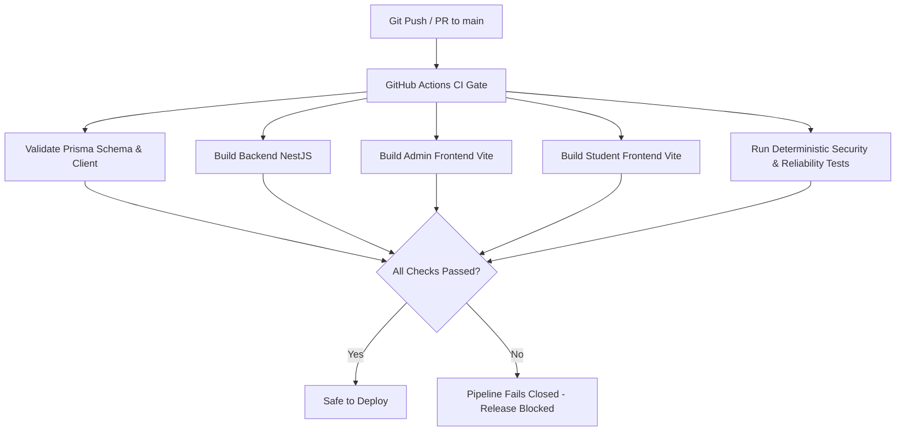

# SWAYAM ADMISSION — PHASE 8 CI/CD AND RELEASE RUNBOOK
## Safe Deployments, Automated Quality Gates, Schema Migrations & Rollback Procedures

**Document Version:** 1.0.0  
**Phase:** Phase 8 — DevSecOps & Deployment Safety  
**Repository Branch:** `main`  
**Hosting Platforms:** Render (Backend), Vercel (Frontends), Neon (PostgreSQL)  

---

## 1. Automated Release Pipeline Architecture

Every release to staging or production is governed by automated CI quality gates defined in `.github/workflows/ci.yml`.



### Mandatory Quality Gates Before Any Deployment
1. **Prisma Schema Validation:** `npx prisma validate` passes with zero schema errors.
2. **Backend Compilation:** `npm run build` compiles clean with zero TypeScript errors.
3. **Admin Portal Compilation:** `npm run build` generates production assets without unresolved imports.
4. **Student Portal Compilation:** `npm run build` generates production bundle cleanly.
5. **Security & Reliability Suite:** Deterministic security, webhook HMAC, SSRF defense, and outbox backoff tests pass.

---

## 2. Safe Database Migration Policy (Prisma)

### The Golden Rules of Production Migrations
1. **Never Run `prisma migrate dev` or `prisma migrate reset` in Production:**
   - `prisma migrate dev` can trigger interactive prompts and attempt schema recreation.
   - `prisma migrate reset` unconditionally drops all tables and wipes production data.
2. **Always Use `npx prisma migrate deploy`:**
   - Applies pending migrations recorded in `prisma/migrations/` sequentially.
   - Idempotent and fails closed if unapplied migrations conflict with existing schema.
3. **Practice Expand-and-Contract Migrations:**
   - **Phase 1 (Expand):** Add new optional/nullable columns or tables. Deploy backend code that writes to both old and new columns.
   - **Phase 2 (Migrate Data):** Backfill historical rows asynchronously via script.
   - **Phase 3 (Contract):** Deploy new code reading exclusively from new structure. In a subsequent release, drop deprecated columns.
4. **Validate Indexes on New Fields:**
   - Any column used in `WHERE`, `JOIN`, or `ORDER BY` in outbox, notification, application, or audit queries must include `@@index([fieldName])` in `schema.prisma`.

---

## 3. Step-by-Step Deployment Runbook

### Step 1: Pre-Release Local / Staging Validation
Before pushing to `main`, execute the local verification checklist:
```bash
# In backend/
npm run build
npx prisma validate
npx ts-node scripts/test_phase8_production_reliability.ts

# In frontend/admin/
npm run build

# In frontend/user/
npm run build
```

### Step 2: GitHub Repository Push & Quality Gate
```bash
git add .
git commit -m "feat(phase8): enhance health checks, throttling, and SRE runbooks"
git push origin main
```
- Observe GitHub Actions workflow at `https://github.com/<owner>/swayam-admission/actions`.
- Confirm all 5 jobs in `.github/workflows/ci.yml` succeed.

### Step 3: Backend Deployment (Render)
Render is configured for automated deployments on push to `main` via `render.yaml`.
- **Health Check Probe:** `/v1/health` (verified to return HTTP 200).
- **Build Command:** `npm install && npx prisma generate && npm run build`
- **Start Command:** `npm run start:prod`
- If applying migrations:
  Run in Render Shell or via Pre-Deploy Command:
  ```bash
  npx prisma migrate deploy
  ```

### Step 4: Frontend Deployment (Vercel)
Vercel monitors root and frontend directories:
- **Admin Portal (`@swayam/admin`):**
  - Production Domain: `https://swayam-admission-eg2x.vercel.app`
  - Build Command: `npm run build`
  - Output Directory: `dist`
- **Student Portal (`@swayam/user`):**
  - Production Domain: `https://swayam-admission.vercel.app`
  - Build Command: `npm run build`
  - Output Directory: `dist`

### Step 5: Post-Deployment Smoke Verification
Run the automated staging suite against live endpoints:
```bash
npx ts-node scripts/test_phase5_staging_acceptance.ts
```
Expected: `TOTAL TESTS : 12 | PASSED : 12 ✅ | FAILED : 0 ❌`.

---

## 4. Emergency Rollback Procedures

### Scenario A: Backend Deployment Failure (Unhealthy Pod or 5xx Errors)
1. **Render Instant Rollback:**
   - Go to [Render Dashboard](https://dashboard.render.com) > `swayam-admission-backend` > **Deploys**.
   - Locate the previous successful deploy.
   - Click **Rollback to this deploy**. Render instantly restores the previous immutable container image within 60 seconds.
2. **Verify Recovery:**
   - Query `/v1/health/liveness` and `/v1/health/readiness`.

### Scenario B: Frontend Regression (Vercel Instant Rollback)
1. **Vercel Rollback:**
   - Go to [Vercel Dashboard](https://vercel.com) > Select Project (`admin` or `user`).
   - Click **Deployments**.
   - Find the previous stable deployment.
   - Click the three dots `...` > **Promote to Production** (or **Rollback**).
   - Traffic shifts instantly via edge CDN (0 seconds downtime).

### Scenario C: Failed Database Migration Rollback
1. If a migration fails mid-execution:
   - Identify the failed migration name via `npx prisma migrate status`.
   - Neon Point-in-Time Recovery (PITR) can be used to branch 5 minutes prior to migration (see [Database Backup & Recovery Runbook](file:///c:/Users/mdosa/OneDrive/Desktop/swayam-admission/PHASE_8_DATABASE_BACKUP_AND_RECOVERY_RUNBOOK.md)).
   - Alternatively, apply a compensating backward-compatible migration using `npx prisma migrate deploy`.
