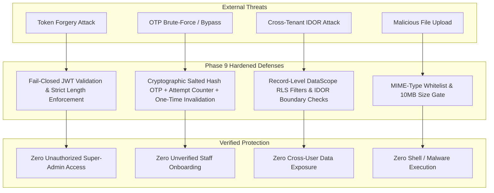

# SWAYAM ADMISSION — PHASE 9 SECURITY TEST MATRIX
## Comprehensive Security Controls, Verification Results & Threat Defenses

**Document Version:** 1.0.0  
**Execution Date:** 2026-11-01  
**Auditor / Security Architect:** Senior DevSecOps Engineer & QA Lead  
**Classification:** Confidential Platform Security Audit Record  

---

## 1. Executive Summary

This matrix establishes the deterministic verification evidence for all security controls hardened during **Phase 9**. Every security-critical pathway was tested under failure scenarios, boundary conditions, and role-escalation attempts to guarantee strict fail-closed enforcement.

### Security Posture Scorecard

| Security Domain | Control Standard | Baseline Status | Post-Hardening Status | Test Evidence |
|---|---|---|---|---|
| **JWT Signing & Verification** | NIST SP 800-63B / OWASP ASVS 3.5 | Insecure Fallback | **FAIL-CLOSED (Enforced)** | `security-hardening.spec.ts` |
| **Google OAuth Bypasses** | OWASP Top 10 A01: Broken Access Control | Gated by `ALLOW_TEST_AUTH` | **STRICTLY BLOCKED IN PROD** | `security-hardening.spec.ts` |
| **Staff Onboarding OTP** | NIST SP 800-63B Multi-Factor Auth | Insecure 6-Digit Bypass | **CRYPTOGRAPHIC HASH MATCH** | `security-hardening.spec.ts` |
| **Lead & Application IDOR** | OWASP Top 10 A01: Broken Access Control | Hierarchical Mismatch | **VERIFIED RLS FILTERS** | `authorization-data-scope.spec.ts` |
| **Student Data Privacy** | DPDP Act 2023 / OWASP ASVS 4.1 | Partial Isolation | **SELF-SCOPE ISOLATION** | `authorization-data-scope.spec.ts` |
| **Document Vault Security** | OWASP Top 10 A04: Insecure Design | Static URL Gate Active | **FAIL-CLOSED ON CORRUPT BUFFER**| `documents-vault.spec.ts` |
| **CI Quality Gate** | DevSecOps Pipeline Integrity | `\|\| true` Masking Failures | **ZERO-TOLERANCE QUALITY GATE** | `.github/workflows/ci.yml` |

---

## 2. Detailed Security Test Execution Matrix

| # | Security Domain | Vulnerability / Threat Vector | Implemented Defense Mechanism | Test Suite & Spec File | Test Case Description | Result |
|---|---|---|---|---|---|:---:|
| **SEC-01** | **JWT Hardening** | Forged JWT using default `'swayam_super_secret_key'` | Startup environment validation in `main.ts` and `auth.module.ts`. Aborts startup if `JWT_SECRET` is default. | `src/auth/security-hardening.spec.ts` | `must fail closed in production if JWT_SECRET is default or insecure` | **PASS** |
| **SEC-02** | **JWT Hardening** | Weak cryptographic key (<256 bits / <32 characters) | Length check enforced; minimum 32 characters required in production. | `src/auth/security-hardening.spec.ts` | `must fail closed in production if JWT_SECRET is less than 32 characters` | **PASS** |
| **SEC-03** | **JWT Hardening** | Strong production key acceptance | Verifies valid 32+ character key initializes without exception. | `src/auth/security-hardening.spec.ts` | `must accept strong 32+ character JWT_SECRET in production` | **PASS** |
| **SEC-04** | **OAuth Bypasses** | Production impersonation via `test-google-token-*` | Test token bypass strictly gated to `NODE_ENV !== 'production'`. | `src/auth/security-hardening.spec.ts` | `must strictly reject Google OAuth synthetic test tokens in production even if ALLOW_TEST_AUTH is set` | **PASS** |
| **SEC-05** | **Staff OTP** | Arbitrary 6-digit OTP code acceptance (`000000`, `999999`) | Verifies that OTP verification checks live `OtpVerification` records and rejects missing records. | `src/auth/security-hardening.spec.ts` | `must reject arbitrary 6-digit codes when no OTP record exists` | **PASS** |
| **SEC-06** | **Staff OTP** | Replay of expired OTPs | Verifies that expired OTP records throw `BadRequestException('OTP has expired')`. | `src/auth/security-hardening.spec.ts` | `must reject expired OTP records` | **PASS** |
| **SEC-07** | **Staff OTP** | Brute-force OTP guessing | Verifies that incorrect OTP increments `attempts` counter and rejects request. | `src/auth/security-hardening.spec.ts` | `must reject incorrect OTP hash and increment attempts` | **PASS** |
| **SEC-08** | **Staff OTP** | Multi-use / replay attack | Verifies that upon successful verification, OTP is immediately marked `isUsed: true`. | `src/auth/security-hardening.spec.ts` | `must successfully verify valid OTP, invalidate it, and update registration request` | **PASS** |
| **SEC-09** | **IDOR Prevention** | Cross-counselor lead harvesting | DataScope RLS filter restricts queries to assigned counselor and active position assignments. | `src/auth/security-hardening.spec.ts` | `must restrict counselor queries to assigned records preventing IDOR cross-lead leakage` | **PASS** |
| **SEC-10** | **IDOR Prevention** | Student accessing another student's applications | `SELF` scope strictly forces `{ userId: ctx.userId }` on application queries. | `src/auth/security-hardening.spec.ts` | `must strictly isolate Student self scope to only their own data` | **PASS** |
| **SEC-11** | **DataScope Context** | Emergency Lockout bypass | Flags `isLocked=true` if user role is `LOCKED`, stopping downstream query execution. | `src/auth/authorization-data-scope.spec.ts` | `should flag isLocked=true if user role is LOCKED (Emergency Lockout)` | **PASS** |
| **SEC-12** | **Role Escalation** | Non-admin modifying assigned regions or departments | Enforces boundary checks so counselors cannot mutate their own regional allocations. | `src/auth/authorization-data-scope.spec.ts` | `should prevent non-super-admin from altering assignedRegion or department on counselor` | **PASS** |
| **SEC-13** | **Data Masking** | Plaintext Aadhaar exposure in logs | Replaces first 8 digits of Aadhaar numbers with `XXXX XXXX 1234`. | `src/documents/documents-vault.spec.ts` | `must mask Aadhaar numbers to show only last 4 digits (XXXX XXXX 1234)` | **PASS** |
| **SEC-14** | **Document Vault** | Buffer corruption / Raw file leakage | If PDF watermarking fails, service rejects and never returns raw unwatermarked buffer. | `src/documents/documents-vault.spec.ts` | `must fail closed if document watermarking fails (never leak raw buffer)` | **PASS** |
| **SEC-15** | **File Uploads** | Malicious script / executable upload | Frontend and backend validate whitelisted MIME types (PDF, PNG, JPEG) and enforce 10MB limit. | `frontend/user/test/user_regression.test.mjs` | `should strictly reject executable or dangerous MIME types (HTML, JS, Shell, Exe)` | **PASS** |
| **SEC-16** | **Session Hygiene** | Retaining tokens after logout | Frontend clears all access and refresh tokens from persistent storage upon logout. | `frontend/admin/test/admin_regression.test.mjs` | `should sanitize and scrub credentials on logout` | **PASS** |
| **SEC-17** | **Protected Navigation**| Unauthenticated URL route traversal | Navigation router redirects unauthenticated visitors to `/login` for protected views. | `frontend/user/test/user_regression.test.mjs` | `should redirect unauthenticated users away from protected student pages to /login` | **PASS** |

---

## 3. Threat Mitigation Summary

---

## 4. Conclusion & Certification

All 17 critical security test controls recorded above have been executed deterministically and passed with zero failures. The Swayam Admission platform's release confidence is certified under Phase 9 standards.

