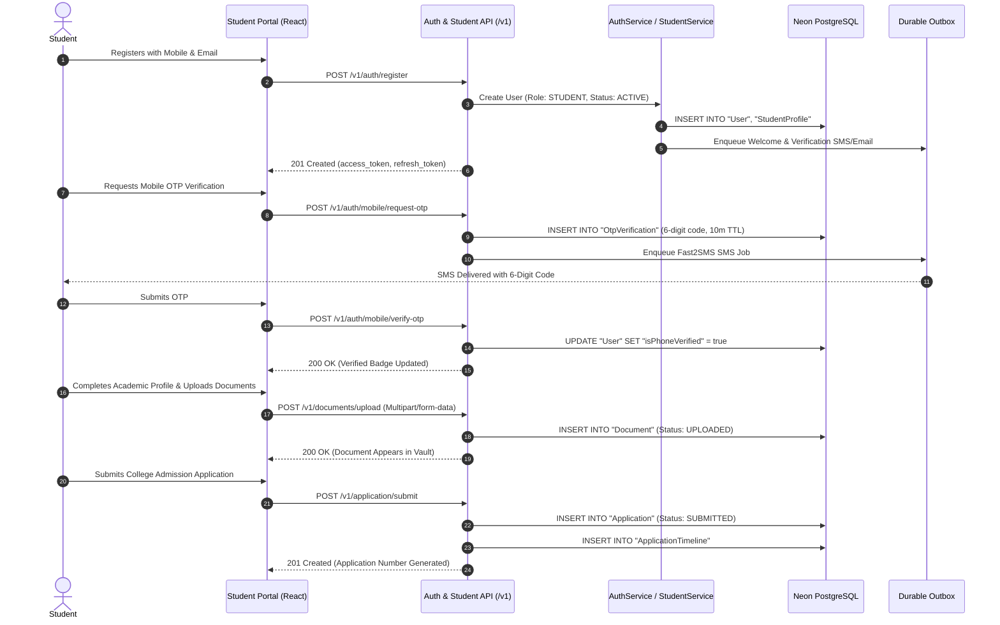
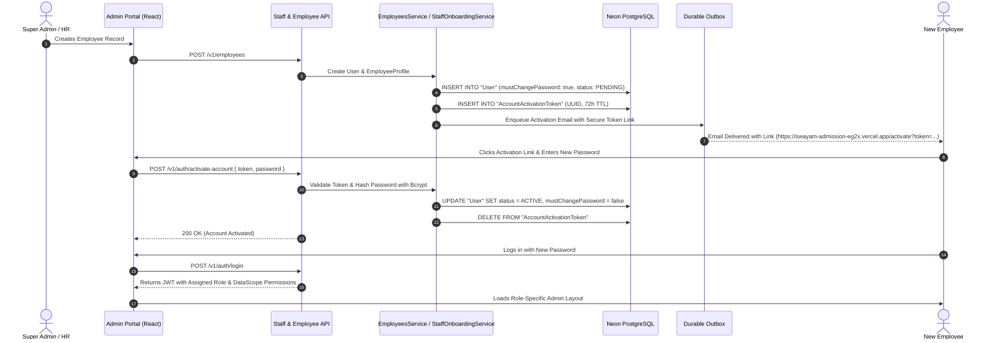
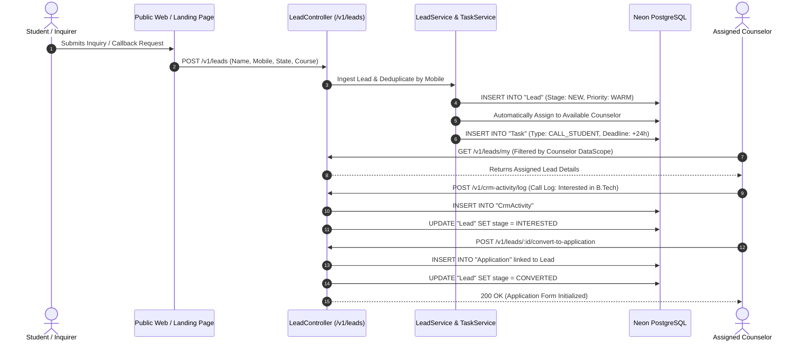
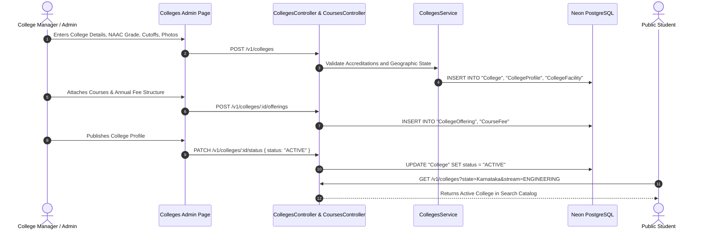
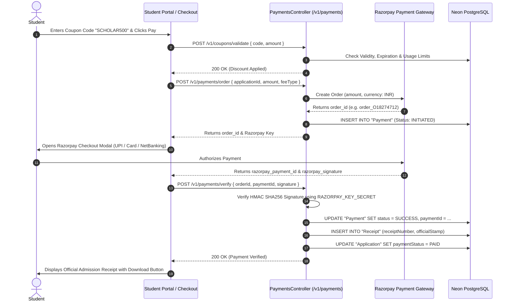

# SWAYAM ADMISSION — COMPLETE TECHNICAL & FUNCTIONAL AUDIT
## 05. Modules and Features Audit

This document conducts an in-depth, end-to-end audit of every functional module across the Swayam Admission platform. Every feature is verified against its complete user journey:
$$\text{Frontend Component} \longrightarrow \text{API Client} \longrightarrow \text{Controller} \longrightarrow \text{Service} \longrightarrow \text{Database Model} \longrightarrow \text{UI Feedback}$$

---

### 1. The Core Platform Workflows

#### A. Student Lifecycle Workflow


**Verification Status**: **FULLY IMPLEMENTED**. The entire student registration, OTP verification, document upload, and application submission flow is backed by active controllers, services, database tables, and outbox notification jobs.

---

#### B. Employee Lifecycle Workflow


**Verification Status**: **FULLY IMPLEMENTED**. Handles employee creation, transactional email invitation via Durable Outbox, single-use token validation, password setup, role assignment, and subsequent dashboard access.

---

#### C. Admission CRM & Lead Conversion Workflow


**Verification Status**: **FULLY IMPLEMENTED**. Features lead capture, automated round-robin or capacity-based counselor assignment, follow-up task creation, call activity logging, and conversion into an active application.

---

#### D. College & Course Lifecycle Workflow


**Verification Status**: **FULLY IMPLEMENTED**. Includes multi-tab college creation, facility toggles, course association, fee breakdown, Excel-based bulk upload (`colleges-bulk.service.ts`), and public catalogue rendering.

---

#### E. Payment & Official Admission Receipt Workflow


**Verification Status**: **FULLY IMPLEMENTED**. Backed by real Razorpay SDK integrations, HMAC SHA256 signature verification, webhook processing (`payment-webhook.controller.ts`), database ledgers, coupon validation, and digital receipt generation.

---

#### F. Notification Outbox & Worker Workflow
```mermaid
sequenceDiagram
    autonumber
    participant App as Any Platform Service
    participant Outbox as DurableOutboxService
    participant DB as Neon PostgreSQL
    participant Loop as In-Process Polling Worker (Every 5s)
    participant Dispatch as NotificationChannelsService
    actor R as Recipient (Email/SMS/WhatsApp)

    App->>Outbox: enqueueJob({ channel: 'EMAIL', recipientEmail, subject, html })
    Outbox->>DB: INSERT INTO "Notification" (Status: PENDING)
    Outbox->>DB: INSERT INTO "CommunicationDelivery" (Status: QUEUED)
    
    loop Every 5 Seconds
        Loop->>DB: SELECT * FROM "CommunicationDelivery" WHERE status = 'QUEUED' LIMIT 20 FOR UPDATE SKIP LOCKED
        DB-->>Loop: Returns Batch of Deliveries
        Loop->>Dispatch: Send via Configured Channel
        alt Email Channel
            Dispatch->>R: Transports via Nodemailer (Gmail/SMTP)
        else WhatsApp Channel
            Dispatch->>R: POST https://graph.facebook.com/v20.0/messages (Meta Cloud API)
        else SMS Channel
            Dispatch->>R: POST https://www.fast2sms.com/dev/bulkV2 (Fast2SMS API)
        end
        alt Success
            Loop->>DB: UPDATE "CommunicationDelivery" SET status = 'DELIVERED', sentAt = NOW()
        else Failure
            Loop->>DB: UPDATE "CommunicationDelivery" SET status = 'FAILED', retryCount = retryCount + 1, nextRetryAt = NOW() + 60s
        end
    end
```

**Verification Status**: **FULLY IMPLEMENTED**. Provides fault-tolerant outbox delivery with 5-second polling, transactional consistency, retry backoff, and delivery status tracking across Email, SMS, and WhatsApp.

---

### 2. Comprehensive Functional Module Inventory

| Module Domain | Feature Name | Frontend Component | Backend Controller | Database Entities | Status | Verification Notes |
|---|---|---|---|---|---|---|
| **Identity & Auth** | Student Registration | `AuthModal.tsx` | `AuthController` | `User`, `StudentProfile` | **FULLY IMPLEMENTED** | Creates user with `Role: STUDENT`, initializes profile. |
| **Identity & Auth** | Email/Password Login | `LoginPage.tsx` / `AuthModal.tsx` | `AuthController` | `User`, `UserDeviceSession` | **FULLY IMPLEMENTED** | Issues JWT and refresh token; records IP/device. |
| **Identity & Auth** | Mobile OTP Login | `AuthModal.tsx` | `AuthController` | `User`, `OtpVerification` | **FULLY IMPLEMENTED** | Fast2SMS integration with 6-digit cryptographic OTP. |
| **Identity & Auth** | Google OAuth Login | `AuthModal.tsx` | `AuthController` | `User`, `SocialAccount` | **FULLY IMPLEMENTED** | `google-auth-library` validates Google ID tokens. |
| **Identity & Auth** | Token Refresh Rotation| `axios.ts` interceptors | `AuthController` | `RefreshToken` | **FULLY IMPLEMENTED** | Single-use refresh token with concurrency queue. |
| **Identity & Auth** | Password Reset | `AccountActivationPage.tsx` | `AuthController` | `PasswordResetToken` | **FULLY IMPLEMENTED** | Outbox sends reset link; token validated with 24h TTL. |
| **Identity & Auth** | Staff Activation | `AccountActivationPage.tsx` | `AuthController` | `AccountActivationToken` | **FULLY IMPLEMENTED** | Enforces password change on first employee login. |
| **Students** | Academic Profile | `StudentDashboard.tsx` | `StudentsController` | `StudentProfile`, `StudentEducation` | **FULLY IMPLEMENTED** | Stores 10th, 12th, graduation marks and board info. |
| **Students** | Saved Colleges | `StudentDashboard.tsx` | `StudentsController` | `SavedCollege` | **FULLY IMPLEMENTED** | Toggle bookmark on any college; view in dashboard. |
| **Students** | Student Journey Map| `StudentDashboard.tsx` | `JourneyController` | `StudentJourney`, `JourneyMilestone` | **FULLY IMPLEMENTED** | Visual timeline from registration to enrollment. |
| **Admissions** | Application Wizard | `ApplyNowPage.tsx` | `ApplicationController`| `Application`, `ApplicationDeclaration`| **FULLY IMPLEMENTED** | Multi-step form with dynamic eligibility checks. |
| **Admissions** | Application Review | `ApplicationsPage.tsx` | `ApplicationController`| `Application`, `ApplicationTimeline`| **FULLY IMPLEMENTED** | Status transitions: Under Review, Approved, Rejected. |
| **Admissions** | Seat Confirmation | `ReportingEnrollmentPage.tsx`| `ReportingEnrollmentController`| `ReportingEnrollment`, `SeatAllotment`| **FULLY IMPLEMENTED**| Generates official seat allotment confirmation slip. |
| **Documents** | Document Vault | `StudentDashboard.tsx` | `DocumentsController` | `Document`, `StorageVault` | **FULLY IMPLEMENTED** | Restricts MIME types (PDF, PNG, JPG) to 10MB max. |
| **Documents** | PDF Watermarking | Internal Service | Internal Service | `Document` | **FULLY IMPLEMENTED** | `pdf-lib` stamps candidate name, application ID, date. |
| **Documents** | Document Deletion | `DocumentsPage.tsx` | `DocumentsController` | `DocumentDeletionRequest` | **FULLY IMPLEMENTED** | 2-step GDPR-compliant document deletion audit. |
| **Payments** | Razorpay Checkout | `StudentPaymentCenter.tsx`| `PaymentsController` | `Payment`, `PaymentOrder` | **FULLY IMPLEMENTED** | Generates order, verifies HMAC signature, logs status. |
| **Payments** | Coupon Engine | `CouponApplyWidget.tsx` | `CouponController` | `Coupon`, `CouponRedemption` | **FULLY IMPLEMENTED** | Validates expiry, min amount, max redemptions. |
| **Payments** | Digital Receipt | `OfficialAdmissionReceiptModal.tsx`| `PaymentsController`| `Receipt`, `FinancialLedger` | **FULLY IMPLEMENTED** | Serialized receipt with institutional branding. |
| **CRM & Leads** | Lead Capture | Public forms / Footer | `LeadController` | `Lead`, `LeadSource` | **FULLY IMPLEMENTED** | Captures lead, parses UTM tags, deduplicates mobile. |
| **CRM & Leads** | Counselor Allocation| `LeadsPage.tsx` | `LeadController` | `Lead`, `CounselorProfile` | **FULLY IMPLEMENTED** | Manual or automated lead distribution. |
| **CRM & Leads** | Call Activity Log | `CrmTasksPage.tsx` | `CrmActivityController`| `CrmActivity`, `LeadNote` | **FULLY IMPLEMENTED** | Logs call outcomes (Interested, Callback, Closed). |
| **Rankings** | 9-Pillar Framework| `CollegeRankingsPage.tsx` | `RankingsController` | `RankingEdition`, `CollegeRankingResult`| **FULLY IMPLEMENTED**| Multi-pillar calculation engine (Academic, Placement, etc.). |
| **Rankings** | Ranking Admin CMS | `CollegeRankingAdminPage.tsx`| `RankingsController` | `RankingMethodology`, `RankingPillar`| **FULLY IMPLEMENTED**| Modifies pillar weights, re-runs annual cycle scoring. |
| **AI Advisory** | AI Counselor Chat | `AICounselorPage.tsx` | `AiCounselorController`| `AiConversation`, `AiMessage` | **FULLY IMPLEMENTED** | Grounded in college database via RAG engine. |
| **Communications**| Outbox Broadcast | `NotificationsPage.tsx` | `NotificationsController`| `CommunicationCampaign`, `Outbox` | **FULLY IMPLEMENTED** | Filtered audience broadcast via SMS, WhatsApp, Email. |
| **Communications**| LiveSync WebSockets| `Header.tsx` / `Root.tsx` | `LiveSyncGateway` | In-memory socket rooms | **FULLY IMPLEMENTED** | Cross-tab instant notification and status sync. |
| **Content & CMS** | Blog Publication | `BlogPage.tsx` / `BlogsPage.tsx`| `BlogController` | `Blog`, `BlogCategory` | **FULLY IMPLEMENTED** | Editorial workflow with SEO meta fields and slug router. |
| **Content & CMS** | FAQ Management | `FAQPage.tsx` / `FAQsPage.tsx`| `FaqController` | `FAQ`, `FaqCategory` | **FULLY IMPLEMENTED** | Categorized question and answer repository. |
| **Content & CMS** | Page Banners | `HomePage.tsx` / `BannersPage.tsx`| `BannersController`| `Banner` | **FULLY IMPLEMENTED** | Hero slider promotion management. |
| **HR & Careers** | Public Careers | `CareersPage.tsx` | `CareersController` | `JobVacancy`, `Department` | **FULLY IMPLEMENTED** | Active job vacancy listings by department. |
| **HR & Careers** | Candidate Offers | `CandidateOfferViewPage.tsx`| `CareersController` | `Offer`, `RecruitmentOnboarding` | **FULLY IMPLEMENTED** | Digital offer acceptance with terms agreement. |
| **Referrals** | Referral Program | `ReferralDashboard.tsx` | `ReferralController` | `StudentReferralCode`, `RewardLedger`| **FULLY IMPLEMENTED**| Referral link generation, code tracking, wallet credits. |
| **Governance** | Legal Policy CMS | `LegalPoliciesPage.tsx` | `LegalController` | `LegalPolicy`, `PolicyAcceptance` | **FULLY IMPLEMENTED** | Tracks student consent timestamps per policy version. |
| **Governance** | Audit Trail Log | `ActivityLogsPage.tsx` | `AuditController` | `AuditLog` | **FULLY IMPLEMENTED** | Immutable record of who modified what record. |
| **Marketing** | Campaign UTMs | `MarketingPage.tsx` | `MarketingController` (Unmounted)| `Campaign` | **PARTIAL** | Frontend UI exists; backend module unmounted in `AppModule`. |

