# SWAYAM ADMISSION — COMPLETE TECHNICAL & FUNCTIONAL AUDIT
## 06. Database Architecture and ER Diagram

This document provides a thorough architectural inspection of the Swayam Admission database layer. All data definitions derive directly from `backend/prisma/schema.prisma` (6,162 lines).

---

### 1. Database Schema Metrics Overview

| Structural Dimension | Metric Count | Architectural Significance |
|---|---|---|
| **Total Database Models** | **218 Models** | High-density schema covering educational, CRM, transactional, and governance data. |
| **Total Enums** | **38 Enums** | Type-safe state constraints enforced at PostgreSQL engine level. |
| **Total Index Blocks (`@@index`)** | **463 Index Blocks** | Extensive query optimization covering foreign keys, lookup slugs, and composite queries. |
| **Unique Blocks (`@@unique`)** | **16 Multi-Column Blocks** | Composite uniqueness guarantees (e.g. `[collegeId, courseId]`, `[userId, role]`). |
| **Models with JSON Columns** | **63 Models** | Dynamic schemaless storage for weights, survey answers, audit diffs, and settings. |
| **Total JSON Fields** | **95 `Json` Fields** | Flexible metadata extension points within strongly typed entities. |
| **Primary Key Pattern** | `id String @id @default(uuid())` | UUID v4 distributed primary keys across 98% of tables. |
| **Migration Directory** | **None (Missing)** | Managed via direct sync (`prisma db push`); no version-controlled SQL files. |

---

### 2. Functional Domain Classification (218 Models)

The 218 models are grouped into 16 coherent functional domains:

```text
Database Domain Breakdown (218 Models):
├── 1. Identity, Auth & Sessions (15 models)
├── 2. Students & Academic Records (14 models)
├── 3. Employees, Positions & Staff Onboarding (16 models)
├── 4. Colleges, Universities, Campuses & Courses (23 models)
├── 5. Admissions, Applications & Seat Allotment (12 models)
├── 6. Documents, Watermarks & Storage Vault (8 models)
├── 7. Payments, Fees, Ledger & Receipts (12 models)
├── 8. Admission CRM, Leads & Counseling (15 models)
├── 9. Notifications, Outbox & Communication Channels (11 models)
├── 10. Content Management, Blog, FAQs & Banners (15 models)
├── 11. 9-Pillar College Rankings & Research (12 models)
├── 12. Student Referrals & Reward Ledgers (7 models)
├── 13. System Governance, Legal Policies & Consent (12 models)
├── 14. Support Desk, Grievances & Live Chat (14 models)
├── 15. AI Counselor, RAG Knowledge & Memory (20 models)
└── 16. Audit Trails, Security Logs & Analytics (12 models)
```

---

### 3. Detailed Domain Model Inventory

#### Domain 1: Identity, Auth & Sessions (15 Models)
- `User`: Central account identity (email, phone, passwordHash, role, status, mustChangePassword, isEmailVerified, isPhoneVerified).
- `UserRole`: Many-to-many junction binding users to system roles.
- `UserDeviceSession`: Active browser sessions, user-agent fingerprints, IP addresses, last seen timestamps.
- `UserLoginHistory`: Immutable authentication audit log (success/failure, IP, reason).
- `RefreshToken`: Single-use JWT rotation records with hashed token values, family tracking, and expiration dates.
- `PasswordResetToken`: Cryptographic UUID tokens for self-service password recovery (24-hour expiration).
- `AccountActivationToken`: Tokens issued upon employee creation for credential setup (72-hour expiration).
- `OtpVerification`: 6-digit phone and email OTP codes with attempt limits (max 5) and 10-minute expiry.
- `OtpConfiguration`: Admin settings for SMS/Email OTP delivery channels, daily thresholds, and mock modes.
- `AuthIdentity`: Federated identity provider mapping (Google OAuth Subject ID, provider email).
- `SocialAccount`: Social provider profile links and metadata.
- `UserConsent`: Consent history for privacy policy and terms agreement.
- `AdminSession`: Dedicated elevated administrative session tracking.
- `AuthOtpSettings`: System-wide OTP timeout and retry parameter settings.
- `AccessScope`: Granular operational scope rules (Global, Regional, State, District, Self).

#### Domain 2: Students & Academic Records (14 Models)
- `StudentProfile`: Master student dossier (DOB, gender, category, domicile, parent details, address).
- `StudentEducation`: Formal academic history (10th, 12th, Diploma, Graduation marks, roll numbers, board names).
- `StudentAcademicRecord`: Subject-wise score breakdown (Physics, Chemistry, Math, Biology percentages).
- `StudentPreference`: Desired degree levels, target courses, preferred states, budget ranges.
- `StudentParentInfo`: Guardian contact details, occupation, annual family income.
- `StudentEntranceExam`: Entrance exam scores (JEE Main, NEET, CAT rank and percentile).
- `StudentCertificate`: Academic achievements, sports quotas, extracurricular certificates.
- `SavedCollege`: Student-bookmarked colleges with alert notifications.
- `SavedCourse`: Student-shortlisted academic programs.
- `StudentJourney`: High-level milestone progression tracker (Registration to Campus Reporting).
- `StudentJourneyMilestone`: Discrete steps in student admission journey with timestamps.
- `StudentNote`: Private counselor notes attached to a student file.
- `StudentCollegeSelection`: Shortlisted institutions for priority counseling.
- `RecentlyViewed`: Historical log of recently viewed college and course pages.

#### Domain 3: Employees, Positions & Staff Onboarding (16 Models)
- `Employee`: Extended profile for administrative staff (PAN, Aadhaar, emergency contact, joining date).
- `Department`: Corporate departments (Admissions, Academic Counseling, IT, Accounts, HR, Marketing).
- `Position`: Organizational chart positions with reporting hierarchies.
- `PositionAssignment`: Active employee assignment to an organizational position with dates.
- `StaffRegistrationRequest`: External employee self-onboarding applications with resume and ID uploads.
- `RecruitmentOnboarding`: Candidate background verification and joining checklists.
- `JobVacancy`: Institutional job openings with title, department, JD, and closing dates.
- `JobApplication`: Candidate job applications with resume attachments and status.
- `Interview`: Scheduled recruitment interview rounds (Technical, HR, Director).
- `InterviewEvaluation`: Structured candidate scoring and interviewer remarks.
- `Offer`: Formal electronic offer letters with salary breakdown and digital acceptance tokens.
- `EmployeeRoleHistory`: Historical timeline of role promotions and lateral department transfers.
- `EmployeeClearance`: Resignation and exit clearance checklist items across departments.
- `ClearanceChecklistItem`: Specific department sign-offs (Laptop return, account deactivation).
- `StaffKycDocument`: Scanned employee identity documents.
- `Team` & `TeamMember`: Team structures grouping counselors under senior team leads.

#### Domain 4: Colleges, Universities & Courses (23 Models)
- `College`: Master institutional profile (name, slug, state, district, affiliation, NAAC grade, NIRF rank, logo, banner, status).
- `University`: Affiliating university entity (e.g. VTU, Mumbai University, AKTU).
- `CollegeProfile`: Long-form descriptions, campus acreage, year established, founder details.
- `CollegeCampus`: Physical campus location, address, GPS coordinates, nearest transit hubs.
- `CollegeFacility`: Amenities checklist (Hostel, Wi-Fi, Gym, Labs, Sports, Cafeteria, ATM, Medical).
- `CollegeGallery`: Categorized high-resolution photo gallery (Campus, Labs, Events, Hostel).
- `CollegeOffering`: Academic programs offered by specific college with seat intake and eligibility.
- `CollegeCutoff`: Historical opening and closing ranks/percentiles per quota.
- `Course`: Master course directory (B.Tech, MBA, MBBS, BBA, BCA, LLB).
- `CourseBranch`: Specific engineering and academic streams (Computer Science, Mechanical, AI/ML).
- `CourseSpecialization`: In-depth program specializations (Cybersecurity, Data Science).
- `CourseFee`: Detailed fee schedule (Tuition, Development fee, Examination fee, Hostel fee).
- `CourseEligibility`: Minimum marks and mandatory entrance exam requirements.
- `CourseExam`: Accepted entrance exams mapped to specific courses.
- `CollegeFAQ`: Institution-specific frequently asked questions.
- `CollegeReview`: Verified student reviews with star ratings across 9 dimensions.
- `CollegeBankAccount`: Verified institutional bank details for fee settlement.
- `CollegeDocument`: Official institutional documents (Accreditation certificates, brochures).
- `CollegeConfirmationToken`: Secure verification token for college administration claims.
- `CollegeChangeRequest`: Requested profile edits submitted by college representatives for admin approval.
- `CollegeRecommendation`: Algorithmic system recommendations linking students to colleges.
- `CollegeShortlist`: Aggregated shortlist metrics across the student body.
- `CollegeVerifiedFactor`: Swayam-verified facts regarding college infrastructure.

#### Domain 5: Admissions & Applications (12 Models)
- `Application`: Primary admission application dossier (applicationNumber, studentId, collegeId, courseId, status, paymentStatus).
- `ApplicationTimeline`: Immutable chronological event stream (Submitted, Under Review, Approved, Enrolled).
- `ApplicationDeclaration`: Signed legal declarations and code of conduct agreements.
- `AdmissionOffer`: Formal admission offer letter issued by institution with validity deadlines.
- `SeatAllotment`: Provisional seat allocation record with quota and branch allotment details.
- `StudentEnrollment`: Final matriculation record upon document physical verification.
- `ReportingEnrollment`: Institutional reporting verification record for campus reporting dates.
- `StudentCollegeReport`: Documented reporting outcomes and student fee settlement slips.
- `ApplicationWorkflowStep`: Dynamic multi-stage application progression state tracker.
- `ApplicationFee`: Computed application fee breakdown after discount vouchers.
- `CandidateDocument`: Student documents attached specifically to an application.
- `GovernanceRequest`: Formal administrative overrides requiring Director-level approval.

#### Domain 6: Documents & Storage Vault (8 Models)
- `Document`: Master file metadata (fileName, originalName, mimeType, sizeBytes, storagePath, category, status).
- `DocumentRequirement`: Mandatory document checklists per course (e.g. 10th marksheet, NEET scorecard).
- `DocumentAccessAudit`: Immutable audit record of every viewing, watermarking, or download event.
- `DocumentHistory`: File version history when a student uploads a re-scan.
- `DocumentDeletionRequest`: GDPR/Right-to-be-forgotten deletion workflows requiring administrative review.
- `DocumentDeletionRequestItem`: Specific documents slated for secure shredding.
- `UserProfileDocument`: Personal identification files attached to student profiles.
- `RetentionHold`: Legal preservation holds preventing automatic document purge.

#### Domain 7: Payments, Fees & Receipts (12 Models)
- `Payment`: Master financial transaction (orderId, paymentId, amountPaisa, currency, method, status, gateway).
- `PaymentOrder`: Razorpay order creation tracking with expiration timestamps.
- `Receipt`: Official serialized digital receipt with institutional watermark and QR code data.
- `Invoice`: Pro-forma and final student fee invoices with line-item breakdowns.
- `FeeHead`: Standard fee categories (Application Fee, Counseling Registration, Admission Advance).
- `FeeType`: Institutional fee definitions mapped to courses.
- `Coupon`: Promotional voucher rules (discountAmount, discountPercent, minOrder, maxUses, validUntil).
- `CouponRedemption`: Audit log of student coupon redemptions preventing duplicate usage.
- `FinancialLedger`: Double-entry accounting log recording credits and debits per student.
- `PaymentAllocation`: Mapping of bulk payments across multiple fee heads.
- `PaymentRefund`: Refund request tracking with reason, processing status, and gateway refund IDs.
- `PaymentReconciliation`: Batch banking settlement and reconciliation records.

#### Domain 8: Admission CRM, Leads & Counselors (15 Models)
- `Lead`: Inbound prospective student inquiry (name, mobile, email, state, course, stage, priority, score).
- `LeadActivity`: CRM interaction logs (calls, WhatsApp messages, emails, campus visits).
- `LeadNote`: Private counselor observations and discussion transcripts.
- `LeadAssignment`: Counselor assignment history with re-allocation reasons.
- `CounselorProfile`: Counselor bio, languages spoken, assigned specializations, active lead limits.
- `CounselorActivityLog`: Daily counselor productivity metrics (calls made, talk time, applications generated).
- `CounselorAttendance`: Counselor roster and daily availability flags.
- `CounselorMeeting`: Scheduled 1-on-1 counseling video or voice sessions.
- `CounselorCommission`: Incentive and commission calculations based on enrolled students.
- `CounselorReview`: Student feedback ratings evaluating counselor helpfulness.
- `Task`: Counselor CRM action items (Call student, Request marksheet, Payment reminder).
- `CrmActivity`: Central activity stream logging lead status changes.
- `FollowUpReminder`: Automated reminders alerting counselors of scheduled call dates.
- `GeographicAssignment`: Regional counselor jurisdictional rules (e.g. North India lead distribution).
- `LeadSource`: Lead acquisition channels (Website, Facebook Ads, Google Ads, Education Fair).

#### Domain 9: Notifications, Outbox & Communication (11 Models)
- `Notification`: High-level notification record (title, message, priority, type, receiverId, readStatus).
- `CommunicationDelivery`: **DURABLE OUTBOX WORKER QUEUE** (channel, recipient, payload, status, retryCount).
- `CommunicationTemplate`: Master system templates for SMS, WhatsApp, and transactional HTML emails.
- `CommunicationCampaign`: Bulk targeted broadcast campaigns (SMS/WhatsApp blasts).
- `SavedAudience`: Filtered recipient segments (e.g. "Karnataka Engineering Leads with 80%+ marks").
- `NotificationDelivery`: Delivery gateway dispatch receipts.
- `NotificationSetting`: User notification preferences (SMS on/off, WhatsApp on/off).
- `EmailTemplate`: Dynamic EJS email layouts.
- `Campaign`: Marketing campaign metadata and tracking parameters.
- `CampaignLead`: Leads acquired from specific marketing campaigns.
- `UserCommunicationPreference`: Unsubscribe and opt-out preferences.

#### Domain 10: Content Management, Blog, FAQs & Banners (15 Models)
- `Blog`: Rich-text editorial articles with title, slug, excerpt, contentHtml, bannerImage, status.
- `BlogRevision`: Draft history and editorial revisions before publication.
- `FAQ`: Categorized public questions and structured answers.
- `Banner`: Promotional graphics displayed on homepage and category headers.
- `Testimonial`: Student video links and quote cards with institutional verification flags.
- `Announcement`: Urgent platform-wide notification bars displayed at the top of the portal.
- `Exam`: Entrance exam directory entries with dates, syllabus, and registration links.
- `Scholarship`: Financial aid programs with eligibility criteria and award values.
- `StudyMaterial`: Curated downloadable PDF guides, question banks, and syllabus documents.
- `Page` & `PageVersion`: Dynamic CMS pages with revision histories.
- `NavigationMenu` & `NavigationLink`: Dynamic public navigation bar link configuration.
- `HomepageSection`: Dynamic homepage section ordering and layout toggles.
- `MediaAsset` & `MediaFolder`: Media library asset manager for uploaded graphics and logos.

#### Domain 11: 9-Pillar College Rankings & Research (12 Models)
- `RankingEdition`: Annual ranking release cycle (e.g. "Swayam National Engineering Rankings 2026").
- `RankingMethodology`: Formal framework versioning with mathematical pillar weights.
- `CollegeRankingResult`: Computed final institutional rank, overall score, and tier badge.
- `CollegePillarScore`: Score breakdown across each of the 9 pillars (0.0 to 100.0).
- `RankingDataPoint`: Granular evidence metric (e.g. "Verified Median CTC = 8.5 LPA").
- `RankingSurvey`: Survey instruments distributed to verified students and alumni.
- `RankingSurveyResponse`: Individual survey submissions with Bayesian weight adjustments.
- `RankingAnnualReport`: Downloadable executive whitepapers and research dossiers.
- `RankingVerificationQueue`: Review queue for human verification of self-reported college claims.
- `StudentSurvey`: Student experience feedback surveys.
- `SpecialRanking`: Specialized sub-rankings (e.g. "Top ROI Colleges", "Best Women's Engineering Institutes").
- `ConfidentialComplaint`: Whistleblower or student dispute submissions questioning institutional data.

#### Domain 12: Student Referrals & Reward Ledgers (7 Models)
- `StudentReferralCode`: Unique student referral codes (e.g. "SWAYAM-ROHAN12").
- `StudentReferral`: Junction tracking referred students, conversion milestones, and qualification dates.
- `ReferralRewardLedger`: Immutable credits and debits in student's reward account.
- `ReferralCampaign`: Special promotional bonus periods (e.g. "Double Reward Admission Season").
- `ReferralPolicy`: Terms governing referral payout eligibility and anti-fraud lockouts.
- `Wallet` & `WalletTransaction`: Digital student cash wallet for reward disbursements.

#### Domain 13: System Governance, Legal Policies & Consent (12 Models)
- `LegalPolicy`: Regulatory policies (Terms of Service, Privacy Policy, Student Honor Code).
- `PolicyAcceptance`: Timestamped cryptographic records of user consent with IP addresses.
- `ConsentConfiguration`: System settings for mandatory policy gates.
- `CookieItem`: Categorized cookie consent disclosures (Essential, Analytics, Marketing).
- `SystemSetting`: Global key-value configuration repository.
- `SystemConfiguration` & `SystemConfigurationVersion`: Version-controlled infrastructure settings.
- `ConfigurationApprovalRequest`: Four-eyes principle approval workflows for critical setting changes.
- `SystemBackup`: Database snapshot and automated backup verification logs.
- `State` & `District`: Standardized Indian geographic hierarchy for administrative jurisdictions.
- `StateRestriction`: Regional operational policy toggles.
- `StateUpdate`: Log of geographic boundary adjustments.

#### Domain 14: Support Desk, Grievances & Live Chat (14 Models)
- `SupportTicket`: Student helpdesk tickets with ticket numbers, categories, priority, and SLA deadlines.
- `SupportMessage`: Chronological message thread within a ticket.
- `SupportAttachment`: Screenshots and documents uploaded in support tickets.
- `SupportAgent`: Support staff assignment and capacity tracking.
- `SupportCategory`: Ticket routing categories (Payment issues, Document rejections, Technical bugs).
- `SupportDepartment`: Departmental routing rules.
- `SupportFeedback`: Post-resolution student satisfaction ratings.
- `SupportAudit`: Escalation logs and SLA breach warnings.
- `SupportFAQ`: Knowledge base articles recommended to students during ticket creation.
- `Grievance`: Official regulatory grievance escalations.
- `Conversation`: Direct messaging rooms between students and counselors.
- `Message`: Chat messages exchanged in real-time.
- `ContactDirectoryEntry`: Public contact directory of departmental heads.
- `ContactEnquiry`: Incoming inquiries from the public contact page.

#### Domain 15: AI Counselor, RAG Knowledge & Memory (20 Models)
- `AIConversation`: Master advisory session linking student to the AI Counselor.
- `AIMessage`: Individual user questions and AI responses with token counts.
- `AIMemory`: Extracted long-term student preferences (target budget, preferred cities, academic interests).
- `AIConversationMemory`: Session-level context memory.
- `AIConversationSummary`: Compressed conversation summaries for low-latency context windows.
- `AIConversationTag`: Topic tags (e.g. "Mechanical Engineering", "Management Quota").
- `AIConversationSentiment`: Real-time sentiment analysis detecting student frustration or intent.
- `AIEscalation`: Trigger records transferring an AI conversation to a live human counselor.
- `AIIntent`: Classified student intent categories.
- `AIRecommendation`: Concrete college recommendations generated by the AI agent.
- `AIFeedback`: User thumbs-up/thumbs-down ratings evaluating AI answer quality.
- `AILeadScore`: Algorithmic lead propensity score calculated by AI based on engagement depth.
- `AIKnowledgeCategory`: Knowledge domains (Cutoffs, Scholarships, Hostels, Fee Policies).
- `AIKnowledgeDocument`: Grounding documents parsed for retrieval-augmented generation (RAG).
- `AIChunk`: Text vector chunks with source citations for factual grounding.
- `AIEmbeddingReference`: Chunk embedding references and vector index pointers.
- `AIPromptTemplate`: Master system prompts and behavioral guidelines for the AI persona.
- `AIPromptVersion`: Version history of prompt engineering changes.
- `AIProviderConfiguration`: API credentials and model configurations (Gemini 1.5/2.0, GPT-4o).
- `AISettings`: Global rate limits, token budgets, and fallback behavior toggles.

#### Domain 16: Audit Trails, Security Logs & Analytics (12 Models)
- `AuditLog`: Tamper-evident record of all CRUD operations on critical business tables.
- `RoleAuditLog`: Audit log of role permissions granted or revoked by administrators.
- `SettingAuditLog`: Audit history of system setting modifications.
- `SecuritySetting`: Security rules (IP whitelists, password strength policies, session timeouts).
- `FeatureFlag`: Dynamic feature toggles enabling progressive rollouts.
- `AnalyticsEvent`: Raw telemetry tracking student button clicks, searches, and navigation.
- `SearchQuery`: Logged search terms used to optimize autocomplete and discover trending colleges.
- `SavedReport`: Pre-configured executive analytics reports.
- `BrandingSetting`: Institutional logos, brand colors, and portal styling parameters.
- `ContactPageSetting`: Public contact page configurations.
- `DepartmentContact`: Departmental telephone numbers and support emails.
- `ClearanceChecklistItem`: Specialized employee termination records.

---

### 4. Entity Relationship Diagram (Mermaid)

The diagram below visualizes the core transactional backbone connecting Identity, Students, Applications, Colleges, Documents, Payments, and Notifications:

```mermaid
erDiagram
    User ||--o{ UserRole : has
    User ||--o| StudentProfile : profile
    User ||--o| EmployeeProfile : employee
    User ||--o{ UserDeviceSession : sessions
    User ||--o{ RefreshToken : tokens
    User ||--o{ Notification : receives
    User ||--o{ CommunicationDelivery : outbox

    StudentProfile ||--o{ Application : submits
    StudentProfile ||--o{ Document : uploads
    StudentProfile ||--o{ SavedCollege : saves
    StudentProfile ||--o{ StudentJourney : tracks
    StudentProfile ||--o| StudentReferralCode : owns
    StudentProfile ||--o{ Payment : makes

    College ||--o{ CollegeOffering : offers
    College ||--o{ CollegeFacility : provides
    College ||--o{ CollegeCutoff : cutoffs
    College ||--o{ CollegeReview : reviews
    College ||--o{ CollegeRankingResult : ranked
    College ||--o{ Application : receives

    Course ||--o{ CollegeOffering : belongs
    Course ||--o{ CourseFee : fees
    Course ||--o{ CourseSpecialization : specializations

    Application ||--o{ ApplicationTimeline : logs
    Application ||--o{ ApplicationDeclaration : declares
    Application ||--o{ Payment : generates
    Application ||--o{ Document : attaches
    Application ||--o| SeatAllotment : results
    Application ||--o| ReportingEnrollment : reporting

    Payment ||--o| Receipt : produces
    Payment ||--o{ PaymentAllocation : allocates
    Payment ||--o{ FinancialLedger : entries

    Coupon ||--o{ CouponRedemption : redeemed
    Payment ||--o| CouponRedemption : applies

    RankingEdition ||--o{ CollegeRankingResult : computes
    RankingMethodology ||--o{ RankingEdition : defines
    CollegeRankingResult ||--o{ CollegePillarScore : breakdown

    Lead ||--o{ CrmActivity : logs
    Lead ||--o{ Task : tasks
    Lead ||--o| Application : converts
    CounselorProfile ||--o{ Lead : manages
    CounselorProfile ||--o{ Task : assigned
```



---

### 5. Database Schema Integrity & Migration Risks

1. **Absence of Version-Controlled Migrations**:
   The `backend/prisma/` directory contains `schema.prisma` and `seed.ts`, but completely lacks a `migrations/` directory. The live database has been updated using `prisma db push`. This practice poses significant operational risks:
   - Schema alterations cannot be automatically rolled back in production.
   - Column renaming operations risk silent data loss during direct schema push.
   - Team environments cannot deterministically verify that local development databases share the exact DDL history of staging and production.

2. **Heavy Reliance on PostgreSQL JSON Types**:
   With 95 `Json` columns across 63 models, significant data (such as ranking pillar configurations, audit diffs, and dynamic form responses) resides inside schemaless JSON fields. While this provides flexibility, it circumvents relational integrity checks, prevents foreign key cascading, and requires application-level validation.

3. **High Index Density (463 Indexes)**:
   The database maintains 463 explicit index blocks. While this ensures ultra-fast `SELECT` queries across multi-faceted college directories and CRM search views, it increases write amplification during high-volume application submission periods.

