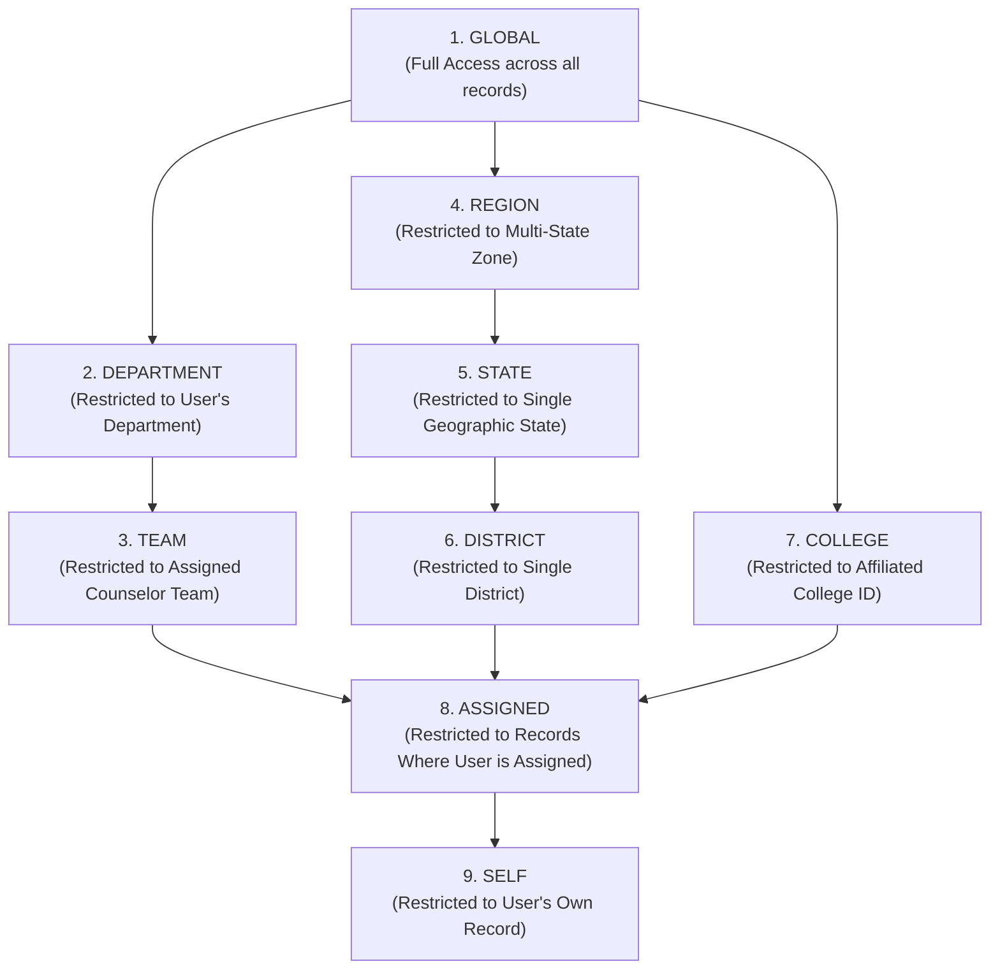
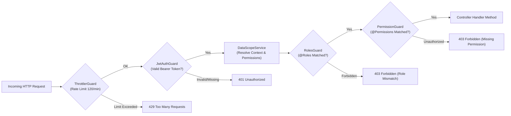

# SWAYAM ADMISSION — COMPLETE TECHNICAL & FUNCTIONAL AUDIT
## 08. Authentication, Roles and Permissions (RBAC) Audit

This document provides a comprehensive security and functional audit of the authentication, role-based access control (RBAC), and multi-tenant data-scoping engine in Swayam Admission.

---

### 1. Identity Architecture Overview

Swayam Admission employs a unified hybrid authentication architecture:
- **Stateless Bearer JWTs** for authenticated REST API requests (7-day default validity).
- **Single-Use Refresh Token Rotation** stored in the database (`RefreshToken` table) with concurrency queue handling in frontend interceptors.
- **Dual-Channel Multi-Factor Authentication (OTP)** over SMS (Fast2SMS) and Email (SMTP) with rate-limited verification attempts.
- **Role-Based Access Control (RBAC)** supporting 19 distinct institutional and administrative roles.
- **Dynamic 9-Tier DataScope Engine** restricting data visibility based on geographic, departmental, team, or counselor assignments.

---

### 2. Complete Role Inventory (19 Prisma Enum Roles)

Defined in `backend/prisma/schema.prisma` under `enum Role`:

| Role Enum Identifier | Portal Access | Typical User Description | DataScope Level | Key Capabilities |
|---|---|---|---|---|
| **`SUPER_ADMIN`** | Admin Portal | System Owners & Technical Leadership | `GLOBAL` | Unrestricted read/write access to all database models, settings, RBAC permissions, and audit logs. |
| **`ADMIN`** | Admin Portal | Head Operations & Operations Managers | `GLOBAL` | Management of colleges, applications, counselor assignments, campaigns, and payments. |
| **`DIRECTOR`** | Admin Portal | Board of Directors / Academic Executives | `GLOBAL` (Read/Approve) | Executive KPI dashboards, fee catalog approvals, governance requests, audit reviews. |
| **`COUNSELOR`** | Admin Portal | Student Admission Counselors | `ASSIGNED` / `SELF` | Manages assigned leads, follow-up calls, student notes, and converts leads to applications. |
| **`SENIOR_COUNSELOR`** | Admin Portal | Team Leads & Escalation Counselors | `TEAM` / `REGION` | Reviews junior counselor activity logs, reassigns stalled leads, resolves escalated inquiries. |
| **`CONTENT_MANAGER`** | Admin Portal | Editorial & CMS Staff | `GLOBAL` (Content) | Creates, edits, and publishes blogs, FAQs, page banners, study materials, and testimonials. |
| **`SEO_MANAGER`** | Admin Portal | Search Engine Optimization Specialists | `GLOBAL` (SEO) | Configures meta titles, descriptions, canonical tags, sitemaps, and landing page slugs. |
| **`MARKETING_TEAM`** | Admin Portal | Growth & Performance Marketing Staff | `GLOBAL` (Campaigns) | Manages tracking links, UTM campaigns, bulk WhatsApp/SMS broadcasts, coupon promotions. |
| **`ACCOUNTS_MANAGER`**| Admin Portal | Finance & Accounts Officers | `GLOBAL` (Finance) | Reconciles Razorpay transactions, generates official receipts, logs manual fee receipts, handles refunds. |
| **`PAYMENT_VERIFIER`**| Admin Portal | Junior Accounts Clerks | `ASSIGNED` (Finance) | Verifies offline bank deposit slips, NEFT transfers, and cheque clearances. |
| **`COLLEGE_MANAGER`** | Admin Portal | Institutional Relationship Officers | `GLOBAL` (Colleges) | Inspects college profiles, validates NAAC accreditations, uploads course brochures. |
| **`AUDITOR`** | Admin Portal | Compliance & Legal Inspectors | `GLOBAL` (Read-Only) | Read-only access to immutable audit logs, deletion requests, and financial ledgers. |
| **`COLLEGE_ADMIN`** | Admin Portal | Institutional Dean / Principal | `COLLEGE` | Dedicated institutional portal access to manage college profile, offerings, and campus photos. |
| **`COLLEGE_ADMISSION_OFFICER`**| Admin Portal| Institutional Admissions Head | `COLLEGE` | Reviews student applications specifically targeted to their affiliated institution. |
| **`COLLEGE_FINANCE_OFFICER`**| Admin Portal| Institutional Bursar / Accounts | `COLLEGE` | Inspects student fee installments, seat confirmation deposits, and institutional payouts. |
| **`COLLEGE_REPORTING_OFFICER`**| Admin Portal| Campus Welcome / Verification Desk | `COLLEGE` | Verifies physical student presence, validates original marksheets on campus, issues reporting slips. |
| **`COLLEGE_COUNSELOR`**| Admin Portal | On-Campus Counseling Faculty | `COLLEGE` | Conducts departmental interviews and faculty counseling for admitted students. |
| **`COLLEGE_VIEWER`** | Admin Portal | Institutional Stakeholder | `COLLEGE` (Read-Only) | Read-only view of affiliated college enrollment metrics. |
| **`STUDENT`** | Student Portal | Prospective & Enrolled Applicants | `SELF` | Explores colleges, submits applications, uploads documents, makes payments, accesses AI Counselor. |

---

### 3. The 9-Tier DataScope Architecture

Implemented in `backend/src/auth/data-scope.service.ts`, DataScopes enforce row-level security (RLS) dynamically across Prisma queries:



- **Query Filter Injection**: When an endpoint receives a request, `DataScopeService.buildLeadScopeFilter(ctx)` or `buildApplicationScopeFilter(ctx)` injects Prisma `where` clauses ensuring counselors cannot see or modify competitor leads.

---

### 4. Backend Guards and Authorization Matrix

The backend enforces security through four primary guards:
1. **`JwtAuthGuard`**: Validates the Bearer token in the `Authorization` header, decodes the user payload, and attaches `req.user` (`IUser`).
2. **`RolesGuard`**: Reads `@Roles(...)` metadata and checks if `req.user.role` matches the required roles. Supports role inheritance via `RoleHierarchyService`.
3. **`PermissionGuard`**: Reads `@Permissions(...)` metadata and verifies whether the user possesses the granular capability (e.g. `applications.approve`, `colleges.edit`).
4. **`OptionalJwtAuthGuard`**: Used on public discovery endpoints (e.g. AI Counselor, College Details) to extract user identity if present while permitting unauthenticated guests.



---

### 5. Frontend Session & Route Protection

#### Admin Portal (`frontend/admin`)
- **`AuthContext.tsx`**: Tracks `user`, `isAuthenticated`, `isLoading`.
- **Session Check**: On page load, calls `GET /v1/common/system-info` or `GET /v1/profile` with Bearer token.
- **Forced Password Change**: If `user.mustChangePassword === true`, `App.tsx` forces display of `LoginPage.tsx` in "Change Password Required" mode, blocking access to administrative modules until the password is updated.
- **Role Filtering**: Navigation items in `Sidebar.tsx` filter views based on `user.role`.

#### Student Portal (`frontend/user`)
- **`AuthContext.tsx`**: Manages student login state.
- **Protected Tabs**: In `StudentDashboard.tsx`, access to `/dashboard` requires an active student session. Unauthenticated attempts open `AuthModal.tsx` and preserve the return URL.

---

### 6. Security Vulnerabilities & Findings

1. **Hardcoded Fallback JWT Secret (CRITICAL)**:
   `backend/src/auth/auth.module.ts`:
   ```typescript
   secret: config.get<string>('JWT_SECRET') || 'swayam_super_secret_key',
   ```
   **Vulnerability**: If `JWT_SECRET` is unset, all issued tokens use `'swayam_super_secret_key'`, allowing attackers to forge tokens with `role: SUPER_ADMIN`.
   **Recommendation**: Remove the fallback string. Throw a fatal startup error if `JWT_SECRET` is missing in production.

2. **Long Default Token Expiration (MEDIUM)**:
   Access tokens are signed with `expiresIn: '7d'` (7 days).
   **Vulnerability**: A stolen access token remains valid for a full week unless explicitly blacklisted.
   **Recommendation**: Shorten access token lifetime to `15m` (15 minutes) and rely on the existing single-use refresh token rotation flow.

3. **Development OTP Bypass Risk (HIGH)**:
   In `backend/src/auth/auth.service.ts`, the code contains support for static dev OTPs when `ENABLE_DEV_OTP="true"`.
   **Vulnerability**: If misconfigured in staging or production environments, automated bots can authenticate any student or employee account using a static code.
   **Recommendation**: Enforce code-level assertions ensuring `ENABLE_DEV_OTP` cannot be active when `NODE_ENV === 'production'`.

