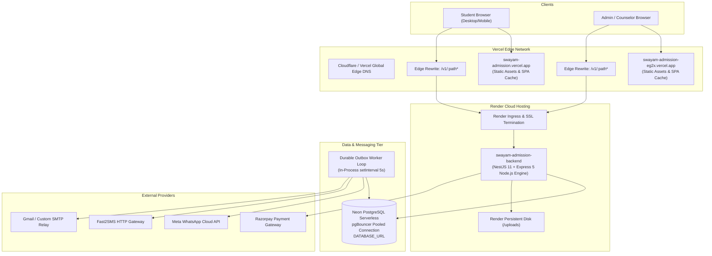
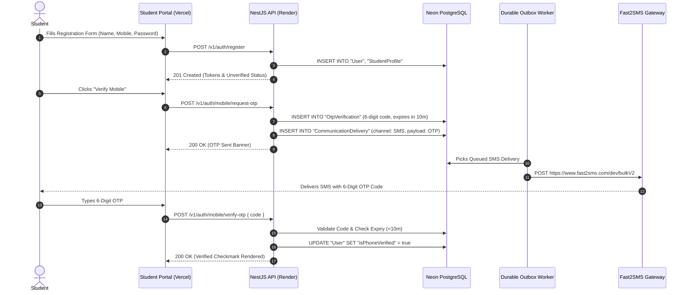
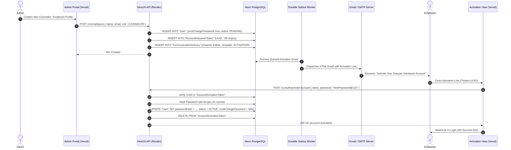
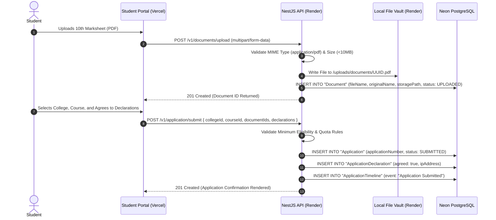
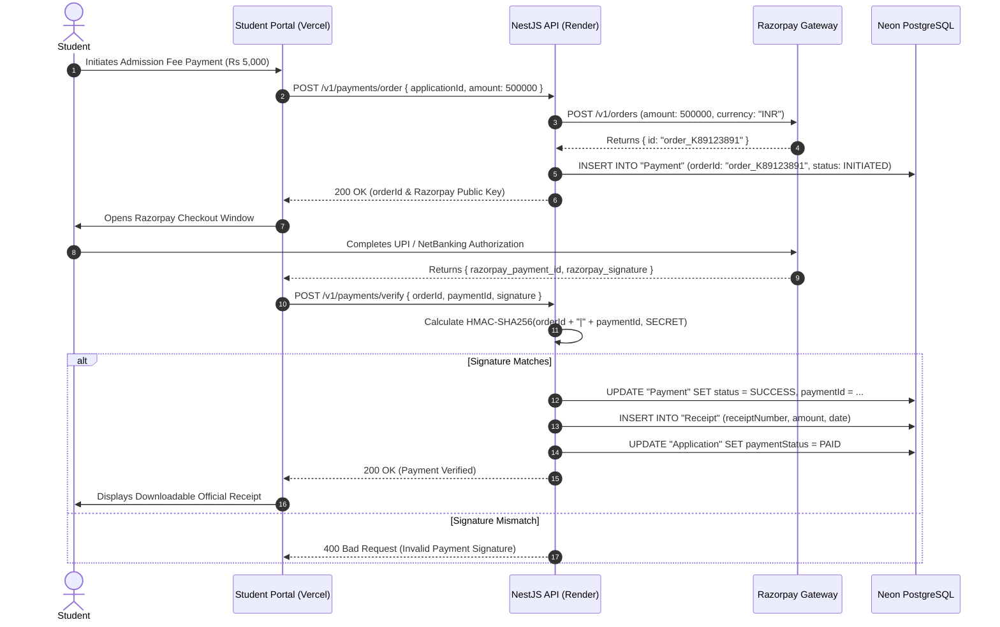

# SWAYAM ADMISSION — COMPLETE TECHNICAL & FUNCTIONAL AUDIT
## 09. System Architecture and Data Flows

This document details the communication topology, networking architecture, interceptor patterns, and end-to-end data flows between the client applications, the backend API engine, the database, background workers, and external third-party services.

---

### 1. Global Network & Deployment Architecture



---

### 2. Frontend-to-Backend Communication Engine

Both frontend applications utilize centralized, strongly configured Axios instances (`src/api/axios.ts`):

#### A. Base URL & Environment Resolution
The client dynamically resolves its backend target in this priority order:
1. `import.meta.env.VITE_API_URL` (configured during build or in `.env`).
2. If `window.location.hostname` includes `vercel.app` or is a non-localhost domain: defaults to `https://swayam-admission.onrender.com`.
3. If running locally (`localhost` or `127.0.0.1`): defaults to `http://localhost:3000`.
4. Appends the `/v1` prefix automatically if not already present.

#### B. Request Interceptors & Authorization Headers
Every outgoing HTTP request passes through an interceptor:
```typescript
api.interceptors.request.use((config) => {
  const token = localStorage.getItem("swayam_token");
  if (token) {
    config.headers.Authorization = `Bearer ${token}`;
  }
  return config;
});
```

#### C. Response Interceptors & Refresh Token Concurrency Handling
When the backend returns an HTTP `401 Unauthorized`:
1. **Public/Auth Exclusions**: If the failed URL is `/auth/login`, `/auth/refresh`, or public health/geography routes, the error is immediately returned to prevent infinite loops.
2. **Admin Portal Concurrency Queue**:
   In `frontend/admin/src/api/axios.ts`, multiple concurrent requests failing with 401 are held in a memory queue (`failedQueue`):
   - The first request sets `isRefreshing = true` and invokes `POST /v1/auth/refresh` with `{ refreshToken }`.
   - Subsequent requests return a deferred `Promise` pushed to `failedQueue`.
   - When refresh succeeds: new access token is stored in `localStorage`, `processQueue(null, newAccessToken)` retries all queued requests with the updated token, and `isRefreshing` resets to `false`.
   - When refresh fails: `clearAuthSession()` purges storage and fires `window.dispatchEvent(new CustomEvent("swayam:auth-logout"))`.

---

### 3. Detailed Architectural Data Flows (Mermaid)

#### Flow 1: Student Registration and OTP Verification


---

#### Flow 2: Employee Activation and Password Setup


---

#### Flow 3: Application Submission and Document Upload


---

#### Flow 4: Payment and Webhook Verification


---

#### Flow 5: Durable Outbox Background Worker
```mermaid
sequenceDiagram
    autonumber
    participant Engine as Platform Event (Application Approved)
    participant Outbox as DurableOutboxService
    participant DB as Neon PostgreSQL
    participant Loop as In-Process Polling Worker (setInterval 5s)
    participant Channels as NotificationChannelsService
    actor User as Recipient (WhatsApp / Email / SMS)

    Engine->>Outbox: enqueueJob({ channel: 'WHATSAPP', recipientMobile, title, message })
    Outbox->>DB: INSERT INTO "Notification" (title, message, receiverId)
    Outbox->>DB: INSERT INTO "CommunicationDelivery" (channel: 'WHATSAPP', status: 'QUEUED')

    loop Every 5 Seconds
        Loop->>DB: SELECT * FROM "CommunicationDelivery" WHERE status = 'QUEUED' LIMIT 20
        DB-->>Loop: Returns 1 Pending WhatsApp Job
        Loop->>DB: UPDATE "CommunicationDelivery" SET status = 'SENDING'
        Loop->>Channels: sendWhatsApp(payload)
        Channels->>User: Dispatches via Meta WhatsApp Cloud API
        alt Successful Gateway Response (200 OK)
            Channels-->>Loop: Result: { success: true, messageId: "wamid.HBg..." }
            Loop->>DB: UPDATE "CommunicationDelivery" SET status = 'DELIVERED', sentAt = NOW()
        else Gateway Error (4xx / 5xx)
            Channels-->>Loop: Result: { success: false, error: "Rate limit reached" }
            Loop->>DB: UPDATE "CommunicationDelivery" SET status = 'FAILED', retryCount = retryCount + 1
        end
    end
```

