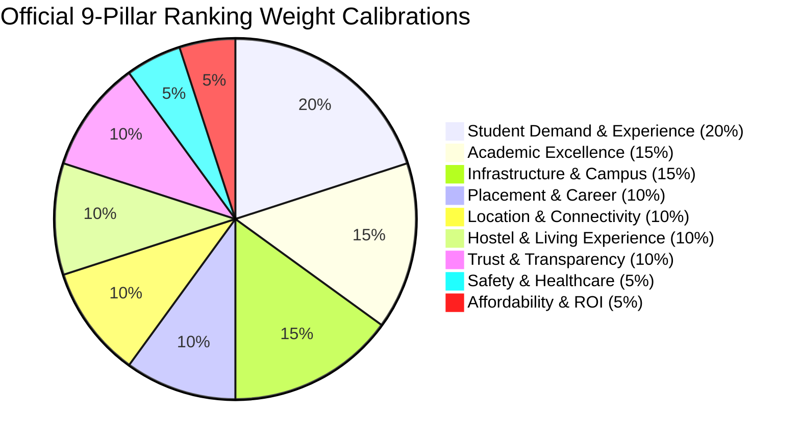

# SWAYAM ADMISSION — COMPLETE TECHNICAL & FUNCTIONAL AUDIT
## 11. Business Logic and Platform Rules Audit

This document details the business logic, mathematical algorithms, validation constraints, and platform workflows discovered in the Swayam Admission source code.

---

### 1. The Official 9-Pillar College Decision Intelligence Framework

Implemented in `backend/src/reviews-ranking/ranking-methodology.service.ts` and `ranking-engine.service.ts`, the platform calculates institutional rankings across 9 evidence-based pillars totaling exactly **100% (1.00)**.

#### A. Pillar Weight Distribution & Subcriteria


| # | Pillar Identifier | Pillar Name | Official Weight | Enforced Subcriteria in Code | Special Mathematical Constraints |
|---|---|---|---|---|---|
| **1** | `academicExcellence` | **Academic Excellence** | **15% (0.15)** | NAAC Grade, NIRF Rank, Faculty-to-Student Ratio, Faculty PhD %, Labs & Smart Classrooms. | Normalized against peer tier accreditation bands. |
| **2** | `placementCareer` | **Placement & Career** | **10% (0.10)** | Verified Placement Rate %, Average CTC, Median CTC (LPA), Recruiter Quality Count, Internship Support. | **`highestPackageDominanceCap: 0.25`**: Outlier single highest packages cannot contribute more than 25% of the placement score, preventing marketing distortion. |
| **3** | `studentDemandExperience`| **Student Demand & Experience** | **20% (0.20)** | Platform Shortlist Demand, Application Conversion Rate, Teaching Satisfaction, Recommendation Likelihood. | **Bayesian Smoothing**: Applies m-estimate smoothing ($m=10$) on student reviews to prevent low-sample distortion. |
| **4** | `infrastructureCampus` | **Infrastructure & Campus** | **15% (0.15)** | Classrooms, Computer Facilities, Campus Wi-Fi, Water/Power Backup, Sports Complex, Gym, Auditorium. | Binary verification against verified physical campus audits. |
| **5** | `locationConnectivity` | **Location & Connectivity** | **10% (0.10)** | Distance to Railway Station (km), Distance to Airport (km), Metro Proximity, Local Transit Access. | Inverted decay curve: $\text{Score} = \max(0, 100 - \text{distance} \times k)$. |
| **6** | `hostelLivingExperience` | **Hostel & Living Experience** | **10% (0.10)** | Boys/Girls Hostel Capacity, Mess Hygiene & Food Variety, Laundry, Daily Convenience Score (Pharmacy, ATM). | Daily Convenience Score weighted at 30% of hostel pillar. |
| **7** | `safetyHealthcare` | **Safety & Healthcare** | **5% (0.05)** | 24/7 CCTV Coverage, Entry Barrier Gates, Women Safety Committee, On-Campus Medical Clinic, Ambulance. | Mandatory zero-tolerance penalty if women safety committee missing. |
| **8** | `affordabilityRoi` | **Affordability & ROI** | **5% (0.05)** | Total Cost of Education (Tuition + Mandatory Fees + Hostel) vs Average Starting CTC. | $\text{ROI Ratio} = \frac{\text{Average Starting CTC}}{\text{Total 4-Year Cost of Education}}$. |
| **9** | `trustTransparency` | **Trust & Transparency** | **10% (0.10)** | Fee & Refund Policy Clarity, Admission Verification Rigor, Whistleblower Dispute Resolution Speed. | Deductions applied for unresolved student complaints in `ConfidentialComplaint`. |

#### B. Evidence Hierarchy & Source Priority
When resolving conflicting data points (e.g. self-reported vs audited placement stats), `ranking-methodology.service.ts` enforces strict source priority:
1. `SWAYAM_VERIFIED` (Physical campus audit by Swayam field team) — Highest Priority
2. `SWAYAM_PLATFORM_DATA` (Actual student applications and conversion logs)
3. `STUDENT_VERIFIED` (Enrolled student surveys with ID proof)
4. `SWAYAM_MANUAL_SURVEY` (Telephone & field surveys)
5. `PUBLIC_VERIFIED` (NIRF, NAAC, NBA government portals)
6. `COLLEGE_VERIFIED` (Official signed institutional documentation)
7. `COLLEGE_SELF_REPORTED` (Marketing claims) — Lowest Priority

---

### 2. Student Admission & Application Business Rules

Implemented in `backend/src/application/application.service.ts` (133KB):

1. **Academic Eligibility Rules**:
   - For **Engineering (B.Tech)**: Requires 10th and 12th marksheet with Physics, Mathematics, and Chemistry/Computer Science. Minimum aggregate threshold enforced (typically 45% for general category, 40% for reserved category under state norms).
   - For **Management (MBA)**: Requires graduation degree proof and entrance exam scorecard (CAT, MAT, CMAT, XAT).
   - For **Medical (MBBS/BDS)**: Requires NEET qualifying percentile.

2. **Application Status State Machine**:
   Applications transition strictly through defined states:
   ```text
   NEW / DRAFT 
     └──> SUBMITTED 
            └──> UNDER_REVIEW 
                   ├──> CORRECTION_REQUIRED ──> (Student Re-uploads) ──> UNDER_REVIEW
                   ├──> REJECTED
                   └──> APPROVED 
                          └──> PAYMENT_PENDING 
                                 └──> ADMISSION_CONFIRMED (Enrolled)
   ```

3. **Application Fee Rules**:
   - Standard application fee is configured per college/course in `CollegeOffering`.
   - Free application campaigns permit fee waivers if an authorized promotional code (`Coupon`) is applied.
   - Applications marked `PAYMENT_PENDING` block final admission offer letter issuance until the balance reaches `0`.

---

### 3. Fee Catalog & Coupon Redemption Business Rules

Implemented in `backend/src/coupons/coupon.service.ts` and `backend/src/fees/fees.service.ts`:

1. **Coupon Validation Engine**:
   - `validFrom` and `validUntil`: Rejects expired coupons with HTTP 400 (`"Coupon has expired"`).
   - `minOrderAmount`: Rejects if cart subtotal is below the threshold.
   - `maxUses`: Global redemption counter increments atomically (`usesCount = usesCount + 1`); rejects once capacity is reached.
   - `maxUsesPerUser`: Checks `CouponRedemption` table to ensure a single student cannot reuse a voucher.
   - Calculation:
     - `FIXED`: $\text{Discount} = \min(\text{discountValue}, \text{subtotal})$.
     - `PERCENTAGE`: $\text{Discount} = \min(\frac{\text{discountValue}}{100} \times \text{subtotal}, \text{maxDiscountCap})$.

2. **Official Admission Receipt Rules**:
   - Every successful transaction generates a serialized `Receipt` record with format `REC-YYYYMMDD-XXXX`.
   - Receipts cannot be deleted or modified; adjustments must be issued as negative line items in `FinancialLedger`.

---

### 4. Document Verification & Privacy Rules

Implemented in `backend/src/documents/documents.service.ts` and `document-watermark.service.ts`:

1. **Allowed MIME Types & Size Constraints**:
   - Accepted MIME types: `application/pdf`, `image/png`, `image/jpeg`, `image/jpg`.
   - Maximum upload size: **10 MB** per file. Executables, scripts, and archives (`.exe`, `.zip`, `.js`) are strictly blocked by Multer fileFilter.

2. **Automated Watermark Stamping**:
   - Every uploaded PDF is processed by `pdf-lib` prior to storage.
   - Across every page, a semi-transparent diagonal watermark is stamped:
     `"CONFIDENTIAL — FOR SWAYAM ADMISSION PURPOSES ONLY — APPLICANT ID: {ID} — DATE: {TIMESTAMP}"`.
   - This prevents uploaded student marksheets from being misappropriated or reused across unapproved third-party portals.

3. **Secure Document Access Gate**:
   - Direct static URL access to `/uploads/documents/*` is blocked with HTTP 403 in `main.ts`.
   - Documents can only be retrieved via `/v1/documents/:id/download`, which validates user authorization (Owner student, assigned counselor, or Super Admin) and logs every download in `DocumentAccessAudit`.

---

### 5. Student Referral & Reward Rules

Implemented in `backend/src/referrals/referral.service.ts`:

1. **Unique Code Generation**:
   - Generated upon student registration using format `SWAYAM-{FIRSTNAME}{4-DIGIT-RANDOM}`.
2. **First-Login Referral Code**:
   - New students can input a friend's referral code once during their initial dashboard onboarding (`FirstLoginReferralModal.tsx`).
   - Self-referrals (matching email or phone number) are detected and rejected.
3. **Reward Qualification Milestone**:
   - Referral rewards are **not credited immediately upon registration** (anti-fraud measure).
   - Rewards transition to `QUALIFIED` and are credited to `ReferralRewardLedger` only when the referred student's application reaches `ADMISSION_CONFIRMED` and initial tuition fees are verified.

