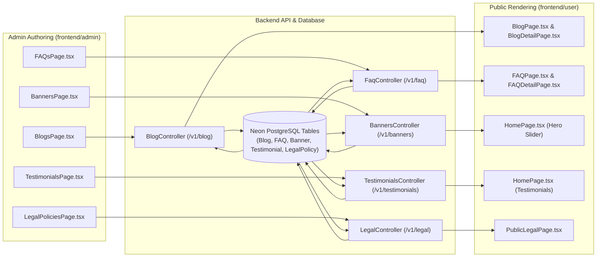

# SWAYAM ADMISSION — COMPLETE TECHNICAL & FUNCTIONAL AUDIT
## 13. SEO, Content and Public Website Audit

This document audits the public website's search engine optimization (SEO), metadata handling, structured data capabilities, indexability, and Content Management System (CMS) synchronization.

---

### 1. SEO Architecture & Indexability Status

| Audit Item | Current Implementation State | Code Evidence & Source File | Evaluation & Impact |
|---|---|---|---|
| **Robots Directive** | **`noindex, nofollow` (BLOCKED)** | `frontend/user/index.html` (line 9): `<meta name="robots" content="noindex, nofollow" />` | **CRITICAL DEFECT**: Explicitly instructs Google, Bing, and all crawlers to de-index the site and ignore all links. |
| **Sitemap Generation** | **NOT IMPLEMENTED (Missing)** | No `sitemap.xml` in `frontend/user/public/` or backend controller | **HIGH DEFECT**: Search engines cannot discover dynamic college, course, and blog URLs automatically. |
| **Robots.txt File** | **NOT IMPLEMENTED (Missing)** | No `robots.txt` in `frontend/user/public/` | Search engines receive 404 or SPA HTML fallback on `/robots.txt`. |
| **Canonical URL Tags** | **NOT IMPLEMENTED** | No `<link rel="canonical" ...>` in `index.html` or dynamic page renders | High risk of duplicate content indexing across query parameters. |
| **Open Graph (Social Cards)**| **NOT IMPLEMENTED** | No `og:title`, `og:image`, `og:description` in `index.html` | Social shares on WhatsApp, LinkedIn, and Facebook render as plain links without preview cards. |
| **Twitter Cards** | **NOT IMPLEMENTED** | No `twitter:card`, `twitter:title` in `index.html` | Twitter/X posts lack summary cards and banner visuals. |
| **Structured Data (JSON-LD)**| **NOT IMPLEMENTED** | No `<script type="application/ld+json">` schemas present | Lacks Google Rich Snippet support for `CollegeOrUniversity`, `Course`, and `FAQPage`. |
| **Dynamic Page Titles** | **PARTIALLY IMPLEMENTED (Imperative DOM)** | `CollegeDetailPage.tsx`, `ContactUsPage.tsx`, `FAQDetailPage.tsx` | Updates `document.title` on page mount using JavaScript DOM mutations. |
| **Dynamic Meta Descriptions**| **PARTIALLY IMPLEMENTED (Imperative DOM)** | `CollegeDetailPage.tsx`, `FAQDetailPage.tsx` | Mutates existing `<meta name="description">` tag via `document.querySelector`. |
| **URL Slug Structure** | **FULLY IMPLEMENTED (Semantic & Clean)** | `routes.tsx` (`/colleges/:id`, `/exams/:slug`, `/blog/:slug`, `/states/:slug`)| Clean, readable, semantic URL hierarchy using hyphenated slugs. |

---

### 2. Critical SEO Findings & Remediation

#### A. The `noindex, nofollow` Deployment Gate Blocker
- **Finding**: In `frontend/user/index.html`:
  ```html
  <meta name="robots" content="noindex, nofollow" />
  ```
- **Context**: This meta tag was likely placed during initial staging/development to prevent pre-launch crawler discovery.
- **Problem**: In production (`https://swayam-admission.vercel.app`), this completely prevents organic Google ranking.
- **Remediation**:
  Replace with dynamic environment-aware meta tag, or set to:
  ```html
  <meta name="robots" content="index, follow" />
  ```

#### B. Client-Side Rendering (CSR) Indexing Latency
Because `frontend/user` is a purely client-rendered Vite Single Page Application (SPA), crawlers that do not execute JavaScript (or defer JavaScript rendering) receive an empty `<div id="root"></div>`.
- **Recommendation**:
  For educational platforms where college profiles drive 80%+ of organic traffic, evaluate Server-Side Rendering (SSR) via Next.js or edge pre-rendering using prerender-spa-plugin / Cloudflare Workers to deliver pre-rendered HTML to Googlebot.

---

### 3. CMS and Public Content Architecture

The CMS pipeline connects the Admin Portal authoring views to the Public Student Portal via the NestJS API and Neon PostgreSQL:



#### Content Synchronization Verification:
1. **Promotional Banners**:
   - Admin manages hero sliders in `BannersPage.tsx` (`POST /v1/banners`).
   - Student Portal HomePage retrieves active banners (`GET /v1/banners?active=true`) and renders an interactive slider using `EmblaCarousel`. **Status: VERIFIED & ACTIVE.**
2. **Editorial Blogs & Guides**:
   - Admin creates rich articles with slug, excerpt, and banner in `BlogsPage.tsx`.
   - Student portal renders list at `/blogs` and article view at `/blog/:slug`. **Status: VERIFIED & ACTIVE.**
3. **Frequently Asked Questions**:
   - Admin categorizes FAQs by topic (Admissions, Fees, Counseling).
   - Student portal renders searchable accordion FAQ view at `/faq`. **Status: VERIFIED & ACTIVE.**
4. **Legal Policies & Terms**:
   - Admin authors versioned policies (Terms, Privacy, Refund) in `LegalPoliciesPage.tsx`.
   - Public portal renders full text at `/policies/:slug` and records mandatory student agreement timestamps during application submission. **Status: VERIFIED & ACTIVE.**

