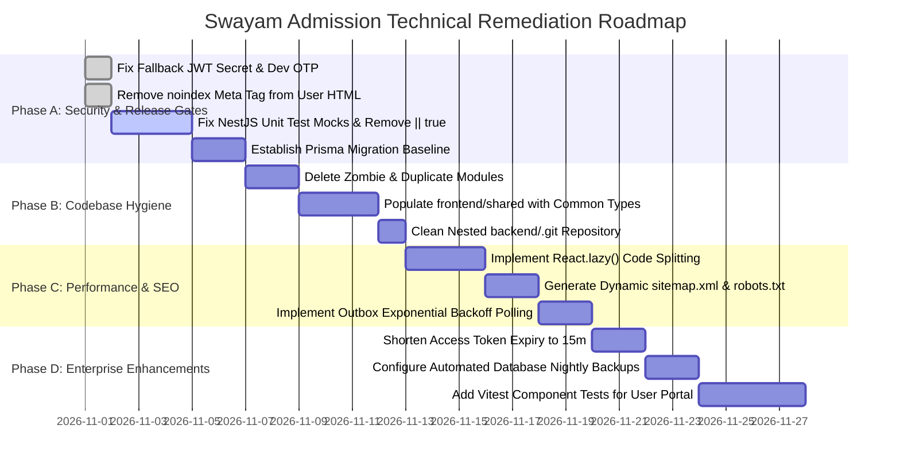

# SWAYAM ADMISSION — COMPLETE TECHNICAL & FUNCTIONAL AUDIT
## 16. Technical Debt and Architectural Recommendations

This document synthesizes all verified architectural defects, code duplications, reliability gaps, and performance bottlenecks discovered during the technical audit, and establishes an engineering roadmap for future development phases.

---

### 1. Executive Technical Debt Inventory

| Category | Issue Summary | Affected Components | Severity | Estimated Remediation Effort |
|---|---|---|---|---|
| **Security** | Hardcoded fallback JWT secret (`'swayam_super_secret_key'`) | `backend/src/auth/auth.module.ts` | **CRITICAL** | 1 Hour |
| **Security** | Unbounded 7-day access token lifetime | `backend/src/auth/auth.module.ts` | **MEDIUM** | 2 Hours |
| **Security** | Static dev OTP bypass risk in production | `backend/src/auth/auth.service.ts` | **HIGH** | 1 Hour |
| **CI / CD** | Test failure suppression (`\|\| true`) in release pipeline | `.github/workflows/ci.yml` | **HIGH** | 4 Hours |
| **Testing** | 18 failing Jest unit test suites due to unmocked DI providers | `backend/src/**/*.spec.ts` | **HIGH** | 1-2 Days |
| **Testing** | 0 frontend unit or component tests | `frontend/admin`, `frontend/user` | **MEDIUM** | 3-4 Days |
| **Database** | Complete absence of version-controlled Prisma migrations | `backend/prisma/` | **HIGH** | 1 Day |
| **SEO** | Hardcoded `<meta name="robots" content="noindex, nofollow" />` | `frontend/user/index.html` | **CRITICAL** | 30 Mins |
| **SEO** | Missing `sitemap.xml`, `robots.txt`, and Open Graph tags | `frontend/user/public/` | **HIGH** | 1 Day |
| **Performance** | Monolithic 3.16 MB Admin and 1.56 MB Student JS bundles | `frontend/admin`, `frontend/user` | **MEDIUM** | 2 Days |
| **Performance** | Constant 5-second outbox database polling loop | `backend/src/notifications/durable-outbox.service.ts` | **MEDIUM** | 1 Day |
| **Code Quality** | Completely empty `frontend/shared` directory | `frontend/shared/` | **MEDIUM** | 2 Days |
| **Code Quality** | 5 empty 0-byte zombie files in `applications/` | `backend/src/applications/` | **LOW** | 15 Mins |
| **Code Quality** | 17 unmounted / duplicate backend controllers | `backend/src/` | **MEDIUM** | 1 Day |
| **Code Quality** | Nested `.git` repository in `backend/` | `backend/.git` | **LOW** | 15 Mins |

---

### 2. Prioritized Engineering Recommendations

#### Priority 1: Critical Security Remediations (Immediate Action)

1. **Eliminate Fallback JWT Secret**:
   - In `backend/src/auth/auth.module.ts`, delete the `|| 'swayam_super_secret_key'` fallback.
   - Enforce an explicit runtime check in `main.ts` ensuring that `JWT_SECRET` is defined, is at least 32 characters long, and cannot equal any default string.
2. **Remove Production Dev OTP Bypass**:
   - In `backend/src/auth/auth.service.ts`, wrap all static OTP bypasses with:
     ```typescript
     if (process.env.NODE_ENV !== 'production' && process.env.ENABLE_DEV_OTP === 'true')
     ```
3. **Remove `noindex, nofollow` Meta Tag**:
   - In `frontend/user/index.html`, remove `<meta name="robots" content="noindex, nofollow" />` and replace it with canonical and Open Graph metadata so search engines can index public college profiles.

---

#### Priority 2: Reliability & CI/CD Hardening (Immediate Action)

1. **Restore Automated Test Quality Gate**:
   - In `.github/workflows/ci.yml`, delete `|| true` from the `npm test` step.
   - Update the failing test suites:
     - Provide mock `PrismaService` providers in the 16 NestJS scaffolding spec files.
     - Update `authorization-data-scope.spec.ts` assertions to match the current hierarchical senior counselor filter structure.
     - Supply a valid `%PDF-1.4` mock header buffer in `documents-vault.spec.ts`.
2. **Establish Prisma Migration Baseline**:
   - Run `npx prisma migrate diff` against the live database to generate an authoritative initial baseline migration (`0_init`).
   - Commit the generated `backend/prisma/migrations/` directory to Git to restore deterministic schema version control.

---

#### Priority 3: Architectural Cleanup & Dead Code Removal

1. **Delete Zombie Scaffolding Files**:
   - Delete `backend/src/applications/` (5 empty 0-byte files). The singular `backend/src/application/` is the active module.
2. **Purge Unmounted Duplicate Controllers**:
   - Safely remove or archive:
     - `backend/src/exam/` (duplicate of `exams/`)
     - `backend/src/scholarship/` (duplicate of `scholarships/`)
     - `backend/src/career/` (duplicate of `hr/careers`)
     - `backend/src/modules/` (unmounted sub-modules: cms, homepage, media, navigation, pages, seo)
3. **Consolidate `frontend/shared`**:
   - Migrate common TypeScript interfaces (`User`, `College`, `Application`, `Payment`, `Document`), date formatting helpers, and API error definitions from `frontend/admin/src/api` and `frontend/user/src/api` into `frontend/shared/`.
   - Configure path aliases (`@shared/*`) in both `vite.config.ts` files.

---

#### Priority 4: Performance & Frontend Bundle Optimization

1. **Implement Route-Level Code Splitting**:
   - In `frontend/admin/src/app/App.tsx` and `AppLayout.tsx`, convert the 39 statically imported view components to `React.lazy()` with a shared `<Suspense fallback={<LoadingSpinner />}>`.
   - In `frontend/user/src/app/routes.tsx`, convert all 28 route page components to `React.lazy()`.
   - This will reduce initial bundle download sizes from **3.16 MB to ~180 KB**, drastically improving page load speeds on mobile networks.
2. **Adopt Event-Driven Outbox Triggering with Exponential Polling Backoff**:
   - When new notifications are enqueued via `DurableOutboxService.enqueueJob()`, immediately trigger an outbox process tick.
   - When the outbox queue is empty, dynamically increase the interval from 5 seconds to 30 seconds to minimize idle database compute usage on Neon PostgreSQL.

---

### 3. Implementation Roadmap for Subsequent Phases



